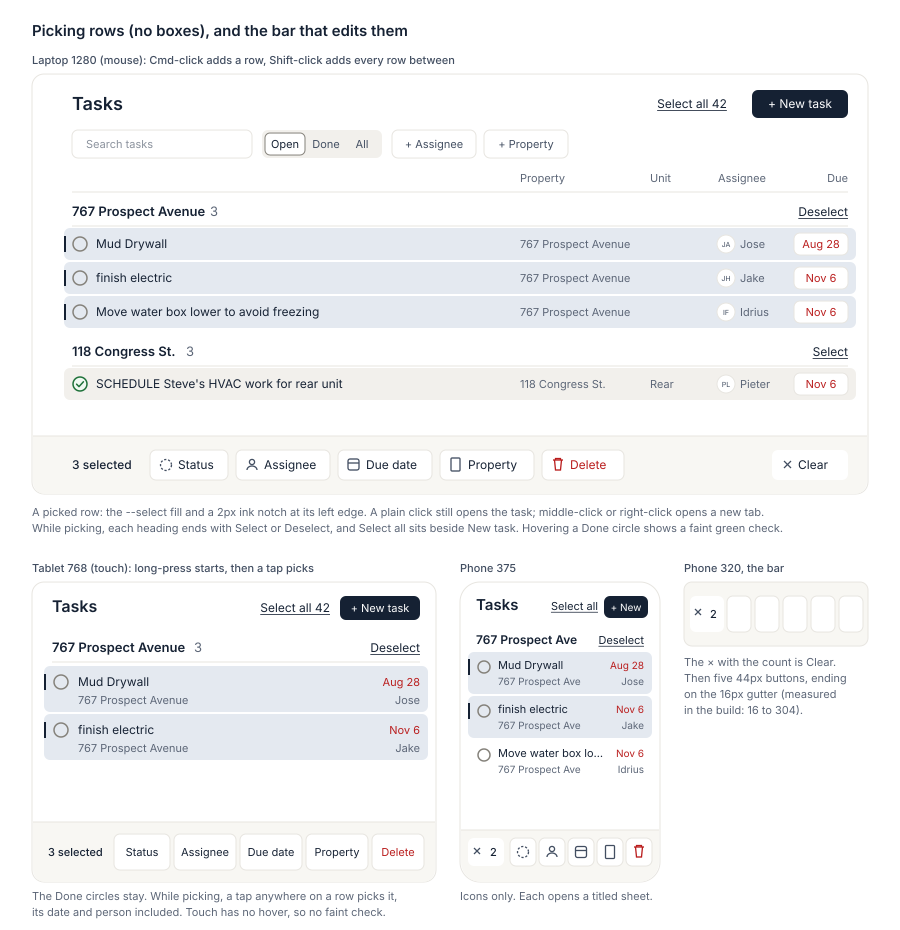
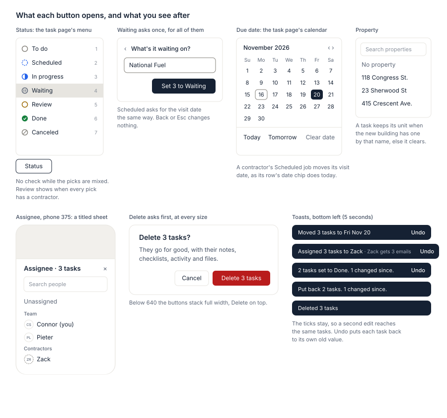

# Bulk edit on the Tasks list

Planned with Connor on Nov 16, 2026, one question at a time (Q1 to Q9). He took every recommendation except Q1, where he chose clicking rows straight into a bar of edits over a Select button. It waits for his "build it".

## 1. Summary

**Why.** Every change on the Tasks list is one task at a time today. Handing a building's jobs to one contractor, pushing a week of work to Monday or tidying up after the Asana import means opening each task. Only Home's "Move all to today" changes several at once.

**What changes.**

- On the Tasks page (`/tasks`), a box picks a row: it shows in the row's left margin on hover with a mouse, and a long-press starts picking on a phone or tablet.
- Once a row is picked, a bar docks at the bottom with every edit: Status, Assignee, Due date, Property and Delete. On a phone they're icons.
- Each edit uses the task page's own picker and rules, applies to every picked task at once, and toasts with Undo. Delete asks first and can't be undone.
- The ticks stay after an edit, so a second change reaches the same tasks, and clear when a filter, the view or the search changes.
- A box on the column header picks every row on screen, a box on each group heading picks that group, and Shift-click picks a range.
- Contractors get one email per job, as today.

## 2. Decisions

| # | Decision |
|---|---|
| D1 | Rows are picked by clicking them, and a bar at the bottom holds every edit (ClickUp's pattern). No Select step first. Connor's call over the recommended Select button, which is how the Missing info page works |
| D2 | With a mouse the pick box shows on hover in the row's left margin; on touch, a long-press starts picking |
| D3 | The bar holds Status, Assignee, Due date, Property and Delete. Unit and Repeat stay on the task page |
| D4 | Labeled buttons from tablet width up; icons only on a phone, with the count as Clear |
| D5 | Each change saves at once and toasts with Undo, which puts every task back to its own old value. Delete asks first and has no Undo |
| D6 | The ticks stay after an edit and clear when a filter, the Open \| Done \| All view or the search changes |
| D7 | A box on the column header (every row on screen) and on each group heading (that group), plus Shift-click for a range. Only rows on screen are ever picked |
| D8 | One email per job when a contractor is handed several, as today |
| D9 | Only the Tasks page. Home's Today and the property page's task list keep one-at-a-time edits |

## 3. Calls made in this spec, for Connor to check before "build it"

1. **The unread dot gives way to the box.** The dot already sits in a row's left margin, and the margin has room for one mark. While a row's box shows (hover, or while picking), its dot hides; the dots come back when the ticks clear. The task still opens at its New divider.
2. **On touch, a tap picks while you're picking.** The Done circle turns into the box in the same 44px spot, and a tap anywhere on a row picks it instead of opening it, as in Gmail and Todoist. The circles come back when the ticks clear. With a mouse, a click on a row still opens it (Gmail, ClickUp and Linear do the same); only the box and Shift-click pick.
3. **Picked rows take `--accent`.** The row hover is already `--muted`, so a picked row sits one step darker and a hovered row never reads as picked. The box's tick is the real mark.
4. **The contractor email line is shorter than in chat:** "Zack gets 3 emails" instead of "Zack gets an email for each", so the toast keeps one line.
5. **Big batches may be split.** Up to 400 rows can be on screen. Changing the status of 400 tasks runs each through the same rules as one at a time, and may not fit one database transaction. The build times it on the local copy. If it takes over 10 seconds, it runs in batches of 100 that each save on their own; if one fails partway, the toast says how many changed.
6. **It adds `react-aria` to `package.json`** for its long-press hook. It's the library under `react-aria-components`, at the same version line.
7. **Already there counts as done.** Setting 3 tasks to Waiting when one already is Waiting changes that one's reason only, and the toast still says 3.

## 4. How it works

### Picking

**With a mouse.**

- Hovering a row, or focusing inside it with the keyboard, shows its box in the left margin, centered where the unread dot is.
- Clicking the box picks the row. From then on every row, every group heading and the column header show their boxes.
- Shift-click on a box or a row picks every row between it and the last box clicked, in list order, across groups.
- A click anywhere else on a row opens the task. The Done circle and the date chip work as today.

**On touch (phones and tablets).**

- A long-press on a row picks it and starts picking. React Aria's `useLongPress` sets the threshold, cancels on scroll and gives screen readers a description of it. The row link gets `-webkit-touch-callout: none` and `select-none` on touch, and the context menu is held off, so iOS and Android don't open a link preview or start selecting text instead.
- While picking, each row's Done circle is its box, and a tap anywhere on the row picks or unpicks it. The date chip and the person are inert until the ticks clear.

**Many at once.**

- On the wide list (60rem and up), the header box sits in the margin over the row boxes. Empty, it picks every row on screen. Partly ticked (a dash), it picks the rest. Full, it clears.
- Below 60rem there are no column headers, so while picking, a "Select all 42" line sits above the list and does the same.
- Each group heading (a building, a person, "No property", "Unassigned") gets a box in the same margin with the same three states, for the rows of that group on screen. The flat Due sort has no groups.
- "Show more" loads more rows without clearing the ticks; rows it loads start unpicked.

**When ticks clear.** Clear on the bar, the × beside the count on a phone, or Esc. Changing the Open | Done | All view, a filter or the search also clears them. Sorting and "Show more" don't. A picked task that leaves the list (set to Done in Open, moved to another building while filtered to one) drops out of the count; at zero the bar goes away.

**Keyboard.** Each box is a real checkbox in row order: Tab reaches it, Space toggles it. One Esc closes one layer: an open picker first, then the ticks.

### The bar

`ActionBar` with `placement="app"`: docked to the content column, the toast lifted above it, a spacer so the last row never hides under it, hidden while the on-screen keyboard is up.

- **From 640px of bar width:** "3 selected", then Status, Assignee, Due date, Property and Delete as small secondary buttons with an icon and a label (Delete's in `--destructive`), and Clear at the end.
- **Below 640px:** an × with the count (Clear, named "Clear 3 selected" for screen readers), then the five as 44px icon buttons named for what they do. At 320 that's about 285 of the 288px between the gutters.
- **Icons:** `CircleDashed` (Status, as `entity-picker.tsx` uses it), `UserRound`, `CalendarDays`, `Building2`, `Trash2` and `X`, all lucide.
- The count is in a polite live region, so a screen reader hears "3 selected" as it changes.

Each button opens its picker through `PickerLayer`: a popover anchored to the button with a mouse, a titled sheet on a touch phone ("Status · 3 tasks").

### The edits

Every edit goes through the task services one task at a time inside the batch (section 5), so each task gets its own timeline line, its own email and its own repeat copy, exactly as if it had been changed by hand.

**Status.** `StatusMenu` with its number keys. When every picked task has the same status it carries the check; mixed, nothing does. Review is offered only when every picked task has a contractor or is already in Review (the task page's rule). Waiting asks "What's it waiting on?" once, Scheduled asks for the "Visit date" once, through `followUp`, and the answer applies to every task; Back or Esc changes nothing. Done on a task in Review is an approval, as it is one at a time. A repeating task set to Done makes its next copy. Each task is sent with the status its row showed, so one someone else moved since is skipped.

**Assignee.** `AssigneePicker`: the team, contractors and Unassigned. Each task is sent with the assignee its row showed (`expectedAssignee`), so one someone reassigned since is skipped. A contractor handed jobs gets one email per job, and one taken off open jobs gets "You're off this job" for each, as today.

**Due date.** `DatePanel` with Clear. A contractor's job moves its target (the visit date while Scheduled, otherwise the due date) and a staff task its due date, the rule each row's date chip uses. Closed tasks are skipped, as "Move all to today" skips them. Clearing the date on a Scheduled job is skipped (it needs a visit date) instead of failing the batch.

**Property.** `PropertyPicker` with No property. A task keeps its unit when the new building has a unit by that name, and loses it otherwise, the rule the task page uses today (`fields.tsx` `changeProperty`), moved into `lib/tasks` so both share it.

**Delete.** `ConfirmDialog`: "Delete 3 tasks?", "Their notes, checklists and files go too. This can't be undone.", Cancel and a destructive "Delete 3 tasks". It stays open, busy, while it runs. Each task goes through `deleteTask`, files and all. The ticks clear with the rows.

### After a change

- The rows change at once (`useOptimistic`), then the server saves. A failure puts every row back and toasts why.
- One toast says what happened, with Undo (except Delete). Tasks that were skipped are named by count and reason in the same line.
- **Undo** puts each changed task back to its own old value, sent with the value the bulk change set, so a task someone changed since is left alone. Undo says nothing when everything went back, and "Put back 2 tasks. 1 changed since." when something didn't.
  - Status: back to the old status with its waiting reason and visit date. A task this change finished goes back the way the Done toast's Undo does (`undoDone`, which takes back an untouched repeat copy). An approval goes back the way Approve's Undo does (`undoApproval`).
  - Dates: `restoreTaskDates`, which already exists.
  - Assignee and property: back to the old assignee, or the old property and unit.
- **Emails and Undo.** Job emails wait a few minutes and drop a change that's put back before they go, so an Undo means the contractor hears nothing. The build checks the case of a job moved from one contractor to another and back (Jose to Zack, Undo) and adds a test in `content.test.ts` if it isn't covered: neither should get an email.

## 5. Code

### Reuse check

**Reused as is:** `ActionBar` docking (`placement="app"`), `PickerLayer`, `StatusMenu` (with `followUp`, `numberKeys`, `sheetTitle`), `DatePanel`, `AssigneePicker` and `PropertyPicker` (`entity-picker.tsx`), `ConfirmDialog`, `CheckboxMark`, `useToast` (`detail`, `phoneMessage`, `action`), `restoreTaskDates`, `core.setStatus`, `core.patchTask`, `approved` and `undoTaskApproval`, `undoDone`, `deleteTask`, `withResult` and `ActionResult`, `GENERIC_ERROR`, and the job email outbox.

**Extended:**

- `ActionBar`: an `actions` slot, a row of buttons after `status`, in place of `secondary` and `primary`.
- `TaskRow`: `picking`, `picked` and `onPick`. The box in the margin with a mouse; the box in the circle's place on touch while picking; the long-press.
- `TaskSection` and `TaskColumnHeads`: the heading box and the header box, with the dash for a partly ticked group.
- `TaskListProvider`: the ticks (a set of ids checked against the rows on screen, so rows that leave drop out), `toggle`, `pickRange`, `pickMany`, `clear`, and one function per bulk edit. A `scope` prop from `page.tsx` (the view, filters and search) clears the ticks when it changes. Inline assignee editing (on main at 144585d) already gave it `people` (`TaskPeople`), `peopleRows` and `assign`; the bar's Assignee picker uses the same `peopleRows`, and the bulk assign sends each row's shown assignee the way `assign` does (`assigneeValueOf`).
- `applyPatch` (`lib/tasks/list.ts`): a patch that holds many, so one bulk change shows at once, built from the existing kinds (`"dates"`, `"status"`, `"assignee"`) plus one for the property and unit.
- `moveTaskDates` (`lib/tasks/bulk.ts`): `which: "row"`, the job-or-staff rule per task, and a skip for a Scheduled job asked to lose its date.
- `lib/tasks/bulk.ts`: `bulkSetStatus`, `bulkAssign`, `bulkSetProperty`, `bulkDelete` and `undoBulk`, each locking its tasks in id order as `moveTaskDates` does, sending each task through `core`, turning a rule refusal (`TaskChangedError`, `AssigneeChangedError`, `TaskRuleError`) into a skip with its reason and failing the whole batch on anything else. Every one of those refusals is thrown before that task's first write, so no savepoint is needed; the build confirms it per function.
- `list-actions.ts`: one thin action per edit and one for Undo, each validating ids (500 at most) and calling `bulk.ts`.

**New:**

- `app/(app)/tasks/bulk-bar.tsx`: the bar's composition for this page (feature-only, beside the page).
- Long-press: React Aria's [`useLongPress`](https://react-spectrum.adobe.com/react-aria/useLongPress.html), not a hand-rolled timer.
- `lib/tasks/bulk-copy.ts`: the toast lines (section 6), pure and tested.

Nothing new is invented. Picking by box with a header box and a dash for a partial group is [shadcn's data table](https://ui.shadcn.com/docs/components/data-table) (`data-state="selected"` rows, an indeterminate header checkbox); the bar of edits is ClickUp's; long-press to start on a phone is Gmail's and Todoist's.

### Tests and the device check

- `bulk-copy.test.ts`: every toast line, singular and plural, under 90 characters at 3 and 400 tasks, with and without skips.
- `list.test.ts`: the bulk patch; the ticks against rows that left; a range across groups; a group's three states.
- `bulk.pg.test.ts`: a status change across a repeating task, a task in Review and a stale row (skipped), then its Undo (the repeat copy taken back, the approval undone); an assign with a stale row; a property move keeping and dropping units; a date clear skipping a Scheduled job; job emails queued per job and dropped by Undo.
- `npm run typecheck`, `npm run lint`, `npm test`, then `npm run test:devices`.
- The device sweep only sees each page's default state, so by hand at 320, 375, 768, 1280 and 1920: long-press in WebKit (no link preview, no text selection), the bar's fit at 320, each picker as a popover and as a sheet, the Delete dialog stacked below 640, the toast above the bar, and Esc closing one layer at a time.

## 6. Copy

All one line, under 90 characters, no em dashes. "1 task" and "3 tasks" throughout.

| Where | Words |
|---|---|
| Bar | "3 selected" ("3" on a phone), Status, Assignee, Due date, Property, Delete, Clear |
| Above the list while picking, below 60rem | "Select all 42" |
| Screen reader names | "Select Mud Drywall", "Select all 42 tasks", "Select all at 767 Prospect Avenue", "Select all for Zack", "Clear 3 selected" |
| Picker titles | "Status · 3 tasks", "Assignee · 3 tasks", "Due date · 3 tasks", "Property · 3 tasks" |
| Status steps | "What's it waiting on?" with "Set 3 to Waiting"; "Visit date" with "Schedule 3" |
| Status toast | "3 tasks set to Waiting" |
| Assignee toast | "Gave 3 tasks to Zack" · "Zack gets 3 emails" (only when job emails went); "Unassigned 3 tasks" |
| Due date toast | "Moved 3 tasks to Fri Nov 20"; "Removed the date from 3 tasks" |
| Property toast | "Moved 3 tasks to 118 Congress St."; "Removed the property from 3 tasks" |
| Skips, after the line | "1 is closed.", "1 changed since.", "1 is scheduled and needs a date." |
| Nothing changed | "Nothing changed. Those tasks are closed." |
| Undo, when some couldn't go back | "Put back 2 tasks. 1 changed since." |
| Delete | "Delete 3 tasks?", "Their notes, checklists and files go too. This can't be undone.", "Delete 3 tasks"; then "Deleted 3 tasks" |
| Failure | "Couldn't save. Try again or reload the page." (`GENERIC_ERROR`) |

## 7. Build order

Starts from main at or after 144585d, where inline assignee editing landed, since both touch `task-row.tsx`, `task-list-context.tsx` and `lib/tasks/list.ts`. That change moved a one-line row's columns inside the title line before the date chip; the pick box goes in the margin, outside them.

1. Server: `bulk.ts` functions, Undo, the actions and `bulk.pg.test.ts`. Time the 400-task status change (call 5).
2. Picking: the ticks in `TaskListProvider`, the row box with hover and long-press, the heading and header boxes, "Select all", clearing on scope.
3. The bar, its pickers, the toasts and `bulk-copy.ts`.
4. Delete.
5. Docs: rows in [docs/components.md](../components.md) for `ActionBar`'s `actions` and the row's pick box, this spec in [README.md](README.md), and a "What the build changed" section here.

## 8. References

- [ClickUp, tasks picked with the bar of edits](https://mobbin.com/screens/e9639493-e0a6-46c9-93d1-d3189cbdc3c7): the bar's pattern (D1).
- [Todoist on iPhone, picking with an icon bar](https://mobbin.com/screens/37b98570-ce82-4a2a-85fa-fec229b639d5): icons on a phone (D4).
- [GitHub on iPhone, Select all](https://mobbin.com/screens/5edb4b50-e0ce-4571-ac92-dc6af0f05cea) and [Apollo, a toolbar of task edits](https://mobbin.com/screens/068da585-485c-4c0e-8c55-3351eeba605b): select-all and labeled edits.
- [shadcn data table](https://ui.shadcn.com/docs/components/data-table): selection column and the partial header box (D7).
- [React Aria `useLongPress`](https://react-spectrum.adobe.com/react-aria/useLongPress.html): long-press on touch (D2).
- In this repo: the Missing info page's picking (`app/(app)/missing/missing-list.tsx`), which D1 departs from on purpose.

## 9. Not in this

- Bulk edit on Home's Today and the property page (D9).
- One combined email for several jobs, and a switch to reassign without emailing (D8). A quiet reassign, if wanted, belongs in both pickers at once.
- Picking tasks that aren't on screen ("Select all 230 that match") (D7).
- Unit and Repeat in the bar (D3).
- Keyboard shortcuts for picking beyond Space, Shift-click and Esc.
