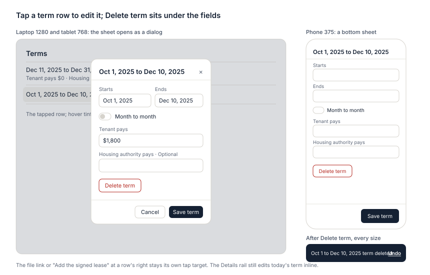

# Editing and deleting lease terms

Planned with Connor on Nov 16, 2026, after he found an older term on 933 Lafayette Avenue · Floor 1 that he couldn't fix or remove. He took the recommendation on all five questions, said "build it" the same day, and it's built.

## 1. Summary

**Why.** The lease page only edits the term in force today, through the Details rail (Rent, Housing authority, Who pays, Contact, Contact email, Term ends). An older or upcoming term can't be changed, no term's start date can be changed, and the only way to remove a term is Delete lease, which takes the whole stay with it. A term typed in wrong during the Nov 14 import, or added to the wrong lease, has no fix short of the database.

**What changes.**

- Tapping a row in the Terms section opens that term in a sheet: the Renew sheet's fields, filled in, titled with the term's dates. Save term saves it.
- **Delete term** at the bottom of the sheet removes the term at once, with a toast and Undo.
- The term's signed PDF stays stored with the lease, unlinked, as Replace leaves the old file today. Undo links it back.
- A lease's only term can be deleted. The lease then reads like a new playbook lease: "No signed lease yet", "Add the signed lease", and "1 missing: Rent" at the top.

## 2. Decisions

| # | Decision |
|---|---|
| D1 | Tap a term row to edit it, as tapping a person in Tenants opens their sheet. No ⋯ menu per row, no edit mode on the section |
| D2 | Delete term removes the term at once, with an Undo toast. No confirm dialog |
| D3 | A deleted term's PDF stays stored with the lease, unlinked and not shown. It goes when the lease is deleted |
| D4 | A lease's only term can be deleted |
| D5 | The sheet's title is the term's dates ("Oct 1, 2025 to Dec 10, 2025"), as the tenant sheet's title is the person's name |

## 3. Calls made in this spec, for Connor to check before "build it"

1. **Every field is editable on every term**, start date included. The overlap rule stays: a change that makes two terms overlap is refused on the field with "This term overlaps another one. Check its dates." Gaps between terms stay allowed, as today.
2. **Delete term sits under the fields**, where Remove from lease sits in the tenant sheet, not in the footer. The footer stays Cancel and Save term. (My Question 1 sketch had it in the footer; the tenant sheet's placement wins.)
3. **Saving the sheet has no Undo**, as saving the tenant sheet has none. The sheet asks before discarding unsaved changes ("Discard changes to this term?"), as every form sheet does. Saving with nothing changed closes the sheet without a save.
4. **The Details rail doesn't change.** It still edits today's term inline. Editing that term in the sheet changes the same row.
5. **Toasts:** "Term saved" after a save; "Oct 1 to Dec 10, 2025 term deleted" with Undo after a delete (under 40 characters). A month-to-month term reads "Month-to-month term from Oct 1, 2025 deleted".
6. **Undo can be refused.** If a new term was added over the same dates before Undo, Undo shows "This term overlaps another one. Check its dates." and the term stays deleted. If the PDF was meanwhile linked to another term (it can't be from the page, but the check is there), the term comes back without it.
7. **No history line.** Leases have no activity log yet, so a deleted term leaves no record beyond the unlinked PDF.

## 4. How it works

### The row (`terms-section.tsx`)

Each row's left part (the dates, rent and split) becomes a `<button aria-haspopup="dialog">`, styled as the tenant rows are: `-mx-2` with a `pointer-fine:hover:bg-muted` tint and `min-h-12`. The file link, Replace and "Add the signed lease" at the right stay their own controls, outside the button. On a phone the row still stacks: the button over the file line.

### The sheet (`term-sheet.tsx`)

`TermSheetProvider`'s `open()` takes an optional term. With none it opens Renew or Add the signed lease as today; with one it opens the edit sheet:

- **Title** the term's dates (D5), **primary** "Save term".
- **Fields** as Renew, filled from the term: Starts, Ends, Month to month (on when `endsOn` is blank), Tenant pays (the rent less the share), Housing authority pays, and Who pays, Contact name and Contact email when there's a share.
- **Save** sends the whole form through the existing `saveLeaseTerm`, which re-reads the merged term and checks overlap and the share against the rent.
- **Delete term**, a `danger` `Button` under the fields, calls `deleteLeaseTerm` through `useRun` with `undo` set to `restoreLeaseTerm` and the snapshot it returned.

`TermRow` (the page's shape for a row) gains the fields the sheet needs: `subsidyFrom`, `subsidyContact` and `subsidyEmail`.

### The server (`actions.ts`, `src/lib/tenants/service.ts`, `src/lib/tenants/core.ts`)

- **`deleteTerm(db, leaseId, termId)`** in core: in one transaction, finds the term (refused when it's gone or on another lease), deletes it and returns a snapshot: its dates, rent, share, who pays, contact, email and `fileId`. The `LeaseFile` row and its Blob stay.
- **`restoreTerm(db, leaseId, snapshot)`** in core: re-reads the snapshot with `readTerm`, checks overlap against the lease's terms, and creates the term. It links `fileId` only when that file belongs to this lease and no term holds it.
- The service wraps both and calls `revalidateLease`. The actions, `deleteLeaseTerm` and `restoreLeaseTerm`, `requireUser()` and parse their input with zod, as `saveLeaseTerm` does. The snapshot is re-validated on the server, so Undo can't write anything a new term couldn't.

## 5. Data model

No migration. `LeaseTerm.fileId` already lets a file outlive its term (`onDelete: SetNull` from the file's side, and a term delete leaves the file row alone), and lease files already go with the lease (`onDelete: Cascade`).

## 6. Reuse check

**Reused as is:** `FormSheet`, the Renew sheet's fields and validation (`readTerm`, `rentFromParts`), `saveLeaseTerm` and `patchTerm` (already take any term), the overlap rule (`overlappingTerms`, `TERMS_OVERLAP`), `useRun`'s `undo` toast, the tenant row's button styling, the danger `Button`, the empty Terms state, the rail's "Add the signed lease", and missing info's "Rent" check for a lease with no term in force.

**Extended:** `TermSheetProvider` and `TermSheet` take an existing term to edit; `TermRow` carries the who-pays and contact fields.

**New:** `deleteTerm` and `restoreTerm` in core, their service wrappers, and the `deleteLeaseTerm` and `restoreLeaseTerm` actions.

**References:** the edit sheet with Delete at its foot follows [Calendly](https://mobbin.com/screens/c7ad914e-41e3-4cb0-a104-9c144276d6e9), [Pinterest](https://mobbin.com/screens/3f15b644-ba1d-4874-ba33-5ca7a397a686), [Etsy](https://mobbin.com/screens/0e38cc46-41b7-4476-b7a3-754e1837c79f) and [AllTrails](https://mobbin.com/screens/6d3bc537-fef1-4a8f-af6a-9dd668936a3a) on Mobbin. The ⋯ row menu we passed on is [Copilot](https://mobbin.com/screens/ac085728-fea2-4ee0-adc3-a54f1f4bee61) and [HoneyBook](https://mobbin.com/screens/cb2a2f0f-f8c9-49c5-82b8-e6fa97903d77); the confirm-first delete is [YNAB](https://mobbin.com/screens/05a88a31-9af3-4eda-ac58-4901a3e6700f) and [Chime](https://mobbin.com/screens/598f56f9-6a79-45a0-bb02-c7e24b6e9f4f).

No new general-purpose component, so no row in docs/components.md.

## 7. Sizes

- **Laptop 1280x800:** a mouse tints the row on hover. The sheet opens as a centered dialog, as Renew does, and fits without scrolling until a housing authority share adds Who pays and the contact fields; then its body scrolls.
- **Tablet 768x1024:** the touch layout. No hover tint; a tap opens the same dialog.
- **Phone 375x667:** the row stacks, dates over the file line, each its own tap target. The sheet comes up from the bottom, the two dates stack, and Save term stays pinned at its foot. Delete term and the Undo toast's button are 44px targets.

## 8. Tests and checks

- **`core.pg.test.ts`:** `deleteTerm` removes the term, keeps its `LeaseFile`, and refuses a term from another lease; `restoreTerm` brings it back with its file, refuses an overlap, and comes back without a file that another term now holds; `patchTerm` moves an older term's start date and refuses an overlap.
- **Device check:** `npm run test:devices`, then open the edit sheet, Delete term and the Undo toast by hand at 320, 375, 768, 1280x800 and 1920: an older term, today's term, a month-to-month term, a term with a housing authority share, and a lease's only term.

## 9. Also updated in the build

- [tenants.md](tenants.md) section 6's Terms bullet: rows open their term; Delete term; and a line in its follow-ups pointing here.
- [README.md](README.md): a line for this spec.

## 10. Size

About an hour to build, plus the device check. No migration and no env changes.
