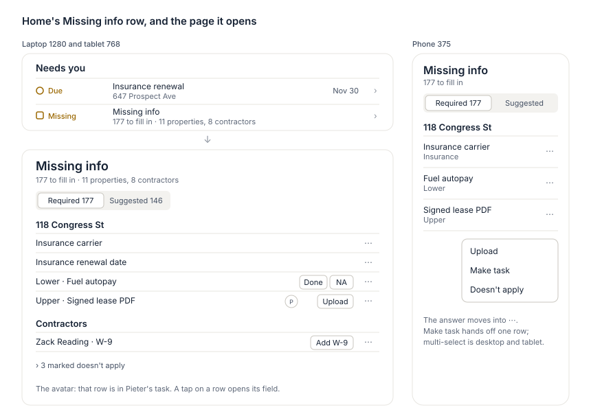
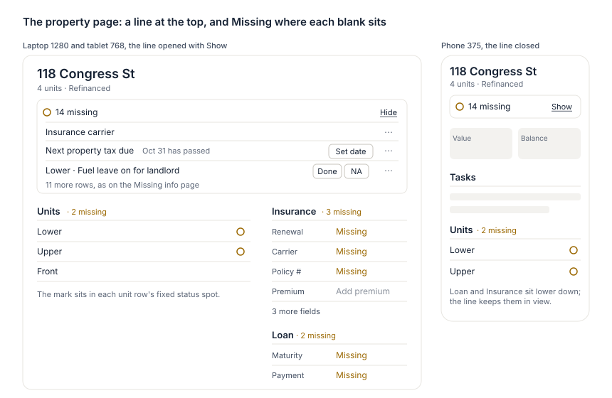

# Missing info

Planned with Connor on Nov 15, 2026, one question at a time (D1 to D10 below). He said "build it" the same day. Section 11 lists where the build differs from this plan.

## 1. Summary

**Why.** The app is only as good as what's typed into it, and the gaps are silent. A blank insurance renewal date makes no reminder and no Needs you row, so a lapse would arrive with no warning. Connor wants every important blank to come to him until it's filled in, with the less critical ones kept in a list he can work through later.

**What changes.**

- Home's **Needs you** gets one **Missing info** row with a count. It opens a **Missing info** page: every gap, grouped by property and contractor, with a Required | Suggested switch. Each line opens the exact field (D1).
- Every **property page** gets a line under its header ("14 missing", Show) and an amber **Missing** on each blank required field where it sits. Lease and contractor pages get the same (D2).
- Each gap clears with its **real answer** (Upload, Mark vacant, a Done or NA pick) or, for anything else, **Doesn't apply** from the row's ⋯ menu (D3).
- **Lease ends** get a dated Needs you row, timed to New York's notice deadline (D5).
- **Make task** hands any rows to Pieter as one task whose checklist items tick themselves as the data goes in (D9).

Production today (read-only counts, Nov 15): **177 required** gaps across 11 properties and 8 contractors, and **146 suggested**.

## 2. Decisions

| # | Decision |
|---|---|
| D1 | Option A: one Needs you row ("Missing info") that opens a worklist page, not a row per property and not auto tasks |
| D2 | Option C: each property page gets both a line at the top that expands its gaps, and an amber Missing on each blank required field |
| D3 | Option C: a row offers its real answer first (Upload, Mark vacant, Done or NA); Doesn't apply in the ⋯ menu covers the rest, with who and when kept and an Undo |
| D4 | Option B: every utility box needs an answer. National Grid and National Fuel: account number, autopay, leave on for landlord. Water: account number, autopay. Done and NA count as answered; blank, "Need to set up" and "Call to confirm" don't |
| D5 | Option A: a lease end is a dated Needs you row that shows 30 days before New York's notice deadline (30, 60 or 90 days before the end, by how long they've lived there) |
| D6 | Option A: a unit with no current lease counts as vacant when its property is Rehabbing or it has an Available listing; otherwise it asks once (Add lease or Mark vacant) |
| D7 | Option A: a W-9 is required for a contractor who worked a job this calendar year (or, once QuickBooks is connected, was paid this year); suggested for every other active contractor |
| D8 | Option A: a date that has passed counts as missing until the next one is set (the property tax due date); numbers count as done once filled |
| D9 | Option B: one shared list for both partners, plus Make task, which turns chosen rows into one task with each gap as a checklist item that ticks itself |
| D10 | The list in section 4 is right, without the property front photo ("those don't matter") |

## 3. Calls made in this spec, for Connor to check before "build it"

1. **A row is one field on one record.** "Insurance carrier" and "Insurance renewal date" at 118 Congress are two rows, as drawn in D1. Opening either opens the Insurance editor, where both can be filled, so both rows go at once. The Home count is these rows (177 today).
2. **The lease-end row reads Late from the notice deadline**, not the end date, since missing the notice is what costs the right to not renew or raise the rent. D5 said Late after the end date; this moves it earlier.
3. **Unknown tenure counts as over 2 years.** A lease with no move-in date (an import of someone who lives there now) gets the 90-day notice, the safe side.
4. **W-9: Add W-9 is the real answer, not Request.** The contractor page already uploads a W-9 a partner has in hand. Asking a contractor to upload one needs a new email, so Request is a follow-up.
5. **Properties keep no activity log**, so "who filled it" shows only for rows handed off with Make task (the task's checklist records it) and for Doesn't apply (the row in the fold says "Connor · Nov 15"). D9's answer said the property's activity would record it; that log doesn't exist.
6. **What counts:** archived and sold properties are out. Archived contractors are out. House-meter rows (HSE) get the utility checks but no lease or lockbox check. Any non-blank utility account value counts, "TENANT" included. Lease checks cover current and upcoming leases.
7. **Doesn't apply stays with its record.** A new lease or a new term starts with fresh checks. Adding a lease clears "Vacant since".
8. **Forms never block a save.** A blank becomes a flag, not an error: lease PDFs, W-9s and renewal dates usually arrive after the record exists.
9. **Suggested never turns a page amber.** A blank suggested field shows its usual "Add …" prompt or dash.

## 4. The checks

Production counts are from a read-only query on Nov 15, 2026. "Real answer" is what the row offers before Doesn't apply.

### Required

| Record | Check (a row each) | Real answer | Production |
|---|---|---|---|
| Property | Insurance carrier, policy number, renewal date | Fill in | 11 of 11 each |
| Property, with a loan balance | Loan maturity date, lender, servicer, monthly payment | Fill in | maturity 11, payment 11, lender 4, servicer 7 |
| Property | Next property tax due date: blank, or passed (D8) | Set date | 11 of 11 |
| Property | Rental registration expiry | Fill in | 11 of 11 |
| Unit, house meter included | Each utility box (D4): Grid account, autopay, leave on; Fuel account, autopay, leave on; Water account, autopay | Done or NA pick; account by typing | 58 boxes on 26 of 31 units (Fuel leave on 24, Fuel autopay 11, Grid account 8, Grid autopay 6, Grid leave on 5, Fuel account 2, Water 1 and 1) |
| Unit, rentable | No current or upcoming lease, property not Rehabbing, no Available listing for the unit (D6) | Add lease, Mark vacant | 1 (8 have no lease; 7 count as vacant) |
| Lease, current or upcoming | Signed PDF on the term in force | Upload | 21 of 21 |
| Lease, current or upcoming | Rent: at least one term | Add term | 0 |
| Lease, current or upcoming | Primary tenant's phone | Fill in | 1 |
| Contractor | W-9 on file, worked this year (D7) | Add W-9 | 8 of 9 |

**Rules in detail.**

- **Utility answers.** For autopay and Fuel leave on for landlord, the value lowercased and trimmed is `done` or `na`. Grid leave on for landlord holds an account-style number, so any value that isn't blank and doesn't start with "Call" or "Need" counts. An account number counts when it isn't blank.
- **Worked this year.** A task assigned to them that isn't Canceled, and is open now or was completed this calendar year (Buffalo's year, `todayYmdEastern`). Once QuickBooks is connected, also a `LedgerLine` this year whose vendor maps to them (`QboVendor.contactId`). The year turns over on Jan 1, matching the 1099 year.
- **The term in force** is `termToday` in `lib/tenants/status.ts`; an upcoming lease uses its first term.

### Dated rows in Needs you

Their own rows with a date, as key dates are today. They aren't part of the Missing info count.

| Row | When it shows | Clears with | Production |
|---|---|---|---|
| Loan maturity, insurance renewal, rental registration | As today: 90, 60, 60 days ahead, then Late | Moving the date | unchanged |
| **Lease ends** (new, D5) | 30 days before the notice deadline. The deadline is the term's end less 30 days (stay under a year), 60 days (1 to 2 years) or 90 days (over 2 years, or unknown), counted from `movesIn` to the end | A renewal term, a move-out date, Month to month (adds a term with no end at the same rent), or Doesn't apply | 3 leases end in the next 4 months |

The lease-end row's title is "Lease ends Mar 31", its detail the home ("767 Prospect · Front", `homeLabel`), and its date column the notice deadline. It reads Due, then Late in `--destructive` once the notice deadline passes (call 2). It opens the lease page.

### Suggested

| Record | Check | Production |
|---|---|---|
| Unit, rentable | Lockbox code | 1 |
| Lease | Security deposit | 2 |
| Lease term with a subsidy | Section 8 caseworker | 2 |
| Tenant on a current lease | Email | 6 |
| Appliance | Install year (the CapEx forecast skips anything without one) | 20 |
| Property, with a loan balance | Loan rate, loan number | 11 and 11 |
| Property | Insurance premium, coverage | 11 and 11 |
| Contractor, active, no work this year | W-9 | 20 |
| Contractor, active | Insurance certificate (unless "I don't carry business insurance"), email, phone | 28, 14, 9 |

The property front photo is not a check (D10).

## 5. Where it shows



### Home: one row in Needs you

A new kind, `missing`, after the key dates, sign-ups and Baselane rows and before CapEx and QuickBooks. Icon `ListChecks`. Title "Missing info". The state word is "Missing". The detail is the count and where: "177 to fill in · 11 properties, 8 contractors", with the places dropping before the count on a narrow phone. The row is absent when nothing required is missing. It opens `/missing`.

The lease-end rows join the key dates, ordered by their notice deadline.

### The Missing info page, `/missing`

- **Header:** `PageHeader` "Missing info", subtitle the same line as Home's row.
- **Switch:** `SegmentedControl` Required | Suggested with counts ("Required 177"). The pick is kept in `?show=suggested`.
- **Groups:** one per property (by address), then one per contractor, each a `Section` heading that links to the record. Inside, rows in page order: property facts, then each unit by its label ("Lower · Fuel leave on for landlord"), then each lease ("Upper · Signed lease PDF").
- **A row** is one line at every width (two on a phone: the field over its place). It carries the real answer as a small secondary `Button` when it has one, and a ⋯ `Menu` with Doesn't apply and Make task. A tap anywhere else opens the field: the property page with that field's editor open (`openPropertyField`), the unit sheet, the lease page's term, or the contractor page's W-9 row.
- **Doesn't apply** moves the row to a fold at the foot of its tab, "3 marked doesn't apply", closed by default. Each row in the fold reads "Connor · Nov 15" with Undo in its ⋯. A toast confirms with Undo.
- **Make task:** on desktop and tablet each row has a `CheckboxMark` on hover or focus, and once one is ticked every row shows it and a bar at the foot says "3 selected · Make task". On a phone Make task is in each row's ⋯ menu and hands off that one row. Rows already in an open task show the assignee's `Avatar` and stay in the list.
- **Empty:** with nothing required, the Required tab shows `SpotArt` `all-clear`, "Everything's filled in", and a link to Suggested when it has rows.

**Sizes.** Laptop 1280: the list at the page's reading width (`max-w-300`), the answer button and ⋯ at the row's right. Tablet 768: the same, with touch targets at 44px and the checkboxes always showing once one is ticked. Phone 375: rows go to two lines, the answer button moves into the ⋯ menu, and multi-select drops.

### Property page



- **The line.** Under the header, above the fact strip: the `Notice` from `components/source-line.tsx` with a `CircleAlert` in `--warn`, "14 missing", and Show as its action. Show expands the same rows as the Missing info page, filtered to this property (its facts, units and leases), inside the notice. Hide closes them. Only required gaps count; the line is gone when there are none.
- **The marks.** A blank required field reads "Missing" in `--warn` where it stands, and still opens its editor on a tap. Each section with one gets "· 3 missing" in `--warn` beside its title. A unit row with a utility gap shows a `CircleAlert` in `--warn` in the row's fixed status spot; its unit sheet marks the boxes themselves.
- **The fold.** `RailFold` keeps a missing required row out of the fold, so Carrier and Policy # show while they're blank and fold again once filled.

On a phone the line is the first thing under the address, so Loan and Insurance, several screens down, are never missed.

### Lease and contractor pages

The same line and marks. The lease page's line counts its own gaps (the PDF, rent, the primary tenant's phone) and its notice deadline sits beside the end date. The contractor page's W-9 row already reads in `--warn` when it's missing; it gets the line when the W-9 is required.

### Make task

Make task opens the New task sheet filled in: title "Fill in 3 items at 118 Congress St" (or "… for 2 contractors"), the property when every row belongs to one, and the checklist with one item per row ("Lower · Fuel leave on for landlord"). The partner picks the assignee and due date and saves, as with any task.

Each item carries the row's key. When the data goes in, wherever it's entered, the item ticks itself with the actor "Missing info" on its event, and once every item is ticked the task is Done. Marking a row Doesn't apply ticks its item too. Unticking an item by hand does nothing to the data, and the next check ticks it again if the gap is filled.

## 6. Data

One migration, additive:

```prisma
// A partner said a missing-info check doesn't apply to this record (docs/specs/missing-info.md, D3).
model MissingInfoSkip {
  id              String   @id @default(cuid())
  check           String   // "insurance.carrier", "utility.fuelLofl", "lease.pdf", ...
  subject         String   // "property:<id>", "unit:<propertyId>:<unitId>", "lease:<id>", "tenant:<id>", "contact:<id>"
  createdBy       User?    @relation(fields: [createdByUserId], references: [id], onDelete: SetNull)
  createdByUserId String?
  createdAt       DateTime @default(now())

  @@unique([check, subject])
}
```

- `TaskChecklistItem` gains `checkKey String?` (`"<check>|<subject>"`) with an index, so Make task's items know their row.
- `PropertyUnit` (the units JSON) gains `vacantSince?: string | null`, a Buffalo day, set by Mark vacant and cleared by the tenants service when a lease for that unit is created.
- RLS on the new table, as on every table (README, Rules of the road).
- Before launch, give every unit an id: units saved before ids existed have none (2 locally), and the subject key needs one. A one-off script runs `reconcileUnits` over each property.

No table stores the gaps. They're computed on each read from the records, so a filled field leaves every list at once.

## 7. Code

### Reuse check

| | What | Where |
|---|---|---|
| **Reused** | Needs you row, ordering and phone "N more" | `app/(app)/needs-you.tsx`, `lib/home/needs-you.ts` |
| | Key-date row shape and Late state | `keyDateItems` |
| | Notice line with one action | `components/source-line.tsx` `Notice` |
| | Required and Suggested switch | `components/segmented-control.tsx` |
| | ⋯ row menu | `components/menu.tsx` |
| | Toast with Undo | `components/toast.tsx` |
| | Pick-many mark | `components/ui.tsx` `CheckboxMark` |
| | Empty payoff | `components/spot-art.tsx` `all-clear` |
| | Open a property field's editor | `properties/[id]/edit-field-event.ts` `openPropertyField` |
| | Lease status, term in force, home label | `lib/tenants/status.ts` |
| | Utility statuses Done, Need to set up, Call to confirm, NA | `lib/property-types.ts` `UTILITY_STATUS_OPTIONS` |
| | W-9 row and upload | `contractors/[id]/contact-doc-fact.tsx` |
| | Task and checklist writes | `lib/tasks/core.ts`, `TaskChecklistItem` |
| **Extended** | A `missing` Needs you kind and a `lease` key-date kind | `lib/home/needs-you.ts`, `lib/home/queries.ts` |
| | `RailFold` keeps a missing required row unfolded (a `missing` flag on `FoldRow`) | `lib/rail-fold.ts`, `components/rail-fold.tsx` |
| | `PropertyFact`, `RailFact` and the unit sheet show "Missing" in `--warn` | `properties/[id]/property-fact.tsx`, `components/rail.tsx`, `properties/[id]/unit-sheet.tsx` |
| | New task opens with a checklist filled in | the New task form (`lib/tasks/new-task.ts` and its sheet) |
| | Tenants service clears `vacantSince` | `lib/tenants/service.ts` |
| **New** | The checks, pure and tested: records in, rows out | `lib/missing/checks.ts`, `checks.test.ts` |
| | The notice deadline for a lease | `lib/missing/lease-notice.ts`, tested |
| | The query that loads what the checks read, once | `lib/missing/queries.ts` |
| | Doesn't apply, Mark vacant and Make task writes, and settling checklist items | `lib/missing/service.ts` (services own writes) |
| | The page and its list | `app/(app)/missing/page.tsx`, `missing-list.tsx` (feature-only, beside the page) |

No new general-purpose component: the list is a feature composition beside its page, so `docs/components.md` gets no row.

### Settling the checklist

`settleMissingInfo(subjects)` runs after each write that can fill a gap: the property, units, leases and terms, tenant and contractor services, and the document uploads. For each open checklist item with a `checkKey` whose check now passes or is skipped, it ticks the item (system actor "Missing info", an INTERNAL CHECKLIST event) and marks the task Done when it was the last one. That Done goes through `lib/tasks/core.ts` as a system change, so it follows [send-for-review.md](send-for-review.md) (landed Nov 15 in 3a261f4): no email to a contractor on Done. Merge `origin/main` before building, since that change touched `core.ts` and `rules.ts`. The every-minute background job runs it over every open item too, as a safety net for any write that doesn't call it.

### Tests and the device check

- `checks.test.ts`: every check passing, failing and skipped; house meters; "TENANT" accounts; Rehabbing and listed vacancy; the W-9 year boundary on Jan 1 in Buffalo time; a passed tax date.
- `lease-notice.test.ts`: under a year, 1 to 2 years, over 2, unknown tenure; Due and Late around the deadline.
- `needs-you.test.ts`: the new kinds and their order.
- A pg test for settling: a filled field ticks the item and closes the task; a skip ticks it; a hand untick comes back.
- `tests/devices/routes.ts` lists `/missing`. Open the ⋯ menu, the fold, Make task's bar and the property line's Show at 320 and 375 by hand.

## 8. Copy

Run [copy-rules.md](../copy-rules.md) before it ships. Starting words:

- Home row: "Missing info", "177 to fill in · 11 properties, 8 contractors".
- Property line: "14 missing", Show, Hide.
- In place: "Missing"; a section's "· 3 missing".
- Row labels name the field as its editor does ("Renewal date" under Insurance reads "Insurance renewal date" on the list).
- Doesn't apply toast: "Marked doesn't apply · Undo". Mark vacant toast: "Front marked vacant · Undo".
- Empty: "Everything's filled in".
- Lease-end row: "Lease ends Mar 31", "767 Prospect · Front", date "Jan 30".

## 9. Build order

1. Migration (`MissingInfoSkip`, `checkKey`) and the unit id backfill.
2. `lib/missing/checks.ts` and `lease-notice.ts` with their tests.
3. The `/missing` page with Doesn't apply and the real answers.
4. Home's row and the lease-end rows.
5. Property page line and marks, then lease and contractor pages.
6. Make task and settling.
7. Device check, lint, typecheck, tests; land.

## 10. References

- Brex keeps a "Missing documentation" filter on its Tasks tab, each row with its own Add: [Brex](https://mobbin.com/screens/47dfde64-0ad0-41c6-978c-c56480db69de).
- HoneyBook's setup list: one row per step, a chevron to open it, a count of what's done: [HoneyBook](https://mobbin.com/screens/d345c7a0-0468-49fc-ad35-82b66fe1e7a5).
- Airbnb pins one "Confirm a few key details" card above the listings: [Airbnb](https://mobbin.com/screens/d8494673-d50a-497f-b350-c4646a14db7c).
- Attio shows empty fields as prompts where they sit instead of hiding them: [Attio](https://mobbin.com/flows/ed18fe27-a14a-4331-9d02-c5dceb2c60b9).
- Earlier review findings this answers: PORTFOLIO-I01 and PORTFOLIO-007 in `docs/uiux-review/portfolio.md`, JOURNEYS-006 and JOURNEYS-007 in `docs/uiux-review/journeys.md`.
- New York Real Property Law § 226-c, the notice before not renewing or raising rent 5% or more. Confirm the days with HG Capital's attorney.
- The 1099-NEC threshold for payments made in 2026 is $2,000 under the 2025 tax law (it was $600). Confirm with the CPA.

## 11. What the build changed

Built Nov 15, 2026. Where the code differs from the sections above:

1. **Select, not hover boxes.** Picking rows for Make task starts with a Select button beside the Required | Suggested switch, as Mail's Select does. At rest a row has no box, so nothing on the list reads as "tick when done", and rows line up with their group's heading. While selecting, a tap anywhere on a row picks it, and the bar at the foot holds Cancel and Make task (Select all with nothing picked). Select is hidden below 640px; a phone hands off one row from its ⋯.
2. **The in-place mark is the field's own verb in --warn** ("Add carrier"), the look key dates already had (JOURNEYS-006), not the word "Missing". It still opens the field. Section titles carry "· 3 missing" in --warn, and a unit row with gaps shows a --warn mark and "2 missing" in its status spot.
3. **Vacant since is never cleared by a write.** The checks treat it as stale once a lease for the unit moves in on or after it, so the tenants service needed no change.
4. **No unit id backfill script.** `ensureUnitIds` gives a property's units their ids the first time a skip or Make task names one under a placeholder (23 Sherwood's two units in production).
5. **Lease and contractor pages get a one-line summary** ("2 missing: Signed lease PDF, primary tenant's phone") without Show, since their sections sit right under it. The lease page also shows its lease end once the notice window opens: "Lease ends Mar 31 · Notice by Jan 30".
6. **The unit sheet isn't marked.** Its status selects already color "Need to set up" and "Call to confirm"; blank account fields aren't flagged inside the sheet yet.
7. **A lease-end row has no Doesn't apply button yet.** Its real answers (a renewal term, a move-out date, a month-to-month term) are on the lease page. The data takes a skip on `term:<id>`.
8. **The worklist is 800px wide** (`max-w-200`), a reading width for one column of rows.
9. **A tenant's email row names them:** "Dana Fox's email". A tenant on two live leases has one row.
10. `/missing` is a staff section (`STAFF_SECTIONS`, the proxy matcher) with its own Not found.
