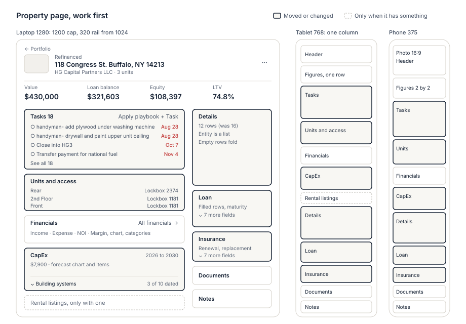

# Property page cleanup: work first

Planned with Connor on Nov 14, 2026, from his review of 118 Congress St. It waits for his "build it".

## Summary

**What changes.** The property page keeps its two columns, but the main column now leads with the work: Tasks, then Units and access, then Financials, then one CapEx section. The facts rail on the right gets shorter. Three fields leave the page, Entity becomes a list, and empty fields fold behind one "7 more fields" row. The Rentals section, renamed Rental listings, shows only once a property has a listing.

**Why.** Today the page is about 2,760px tall at 1280. Tasks, the most-used section, sit about 1,900px down the narrow rail with their titles cut off. On a phone they come last, after every CapEx table. On 118 Congress, Loan and Insurance carry 16 "+ Add" rows between them, and CapEx is split into two back-to-back sections.

**Nothing about the data changes**, apart from one property's entity (section 4). Every field that leaves the page keeps its value in the database.

## 1. Decisions

Connor's, as he made them on Nov 14.

| # | Decision |
|---|---|
| 1 | Layout B, "Work first": same two columns, main column reordered to Tasks, Units and access, Financials, CapEx, then Rental listings |
| 2 | Refi target, Closing costs and Rehab amount leave the page |
| 3 | Entity is a fixed list of the five companies set up for QuickBooks, not free text. New property uses the same list |
| 4 | 58 Mariner Street's entity, stored as "1) 50% BK / 2) 50% HG Buffalo Holding 1 LLC", becomes BMK Property Group LLC |
| 5 | Empty fields fold behind one "N more fields" row that opens them in place (option A). Reminder dates never fold |
| 6 | CapEx is one section: the forecast, then a folded "Building systems · 3 of 10 dated" row at its foot that opens the systems in place |
| 7 | The Rental listings section shows only when the property has a listing. "Add listing" moves to the header's ⋯ menu |
| 8 | The section is renamed from "Rentals" to "Rental listings" |

**Defaults Connor was told about.**

- Tasks keep showing 8 rows and "See all 18", as now. In the wider column each row fits on one line.
- Details keeps its current order, minus the three removed rows. Value stays in Details because it's where the fact strip's "Add value" opens.
- Details folds empty rows the same way Loan and Insurance do. On 118 Congress every Details row is filled, so nothing folds there.
- HG Buffalo Holding 3 LLC isn't on the Entity list. It gets added when it exists, in the same place QuickBooks needs it.

## 2. What Connor will see

### 2.1 The page

| Width | Behavior |
|---|---|
| Laptop 1280 | Two columns from 1024, as today: main column, then the 320px rail. Main: Tasks, Units and access, Financials, CapEx, Rental listings (only with a listing). Rail: Details, Loan, Insurance, Documents, Notes |
| Tablet 768 | One column, in the main column's order, then the rail's. The fact strip stays one row |
| Phone 375 | The same order as tablet, so Tasks and lockbox codes sit right under the figures. The photo is 16:9 and the figures 2 by 2, as today |

The fact strip doesn't change. The header changed on Nov 14 (see Header under the decisions below).

### 2.2 The facts rail

- **Details** loses Closing costs, Rehab amount and Refi target, going from 16 rows to 12.
- **Entity** is a find-or-add picker (changed Nov 14, at Connor's ask): "Not set", HG Capital Partners LLC, HG Buffalo Holding 1 LLC and HG Buffalo Holding 2 LLC in that order, then every name added on any property, A to Z. A search sits on top, and typing a name that isn't there offers 'Add "…"', which saves it on this property and lists it on every other. HG Buffalo Property Management LLC and BMK Property Group LLC stay in QuickBooks but aren't offered; 58 Mariner keeps BMK as its own row. A QuickBooks company typed in another case saves in its own spelling, so Financials still finds it (`entityName`, `entityChoices` in `lib/properties/entity.ts`). On a phone the picker is a titled sheet. New property's Entity field works the same way.
- **What shows, what folds (Nov 14, Connor's lists).** Each section shows its important rows always, empty ones as their "+ Add" verb, and folds the rest, filled or not:

  | Section | Always shown | Folded |
  |---|---|---|
  | Details | Value, Purchase date, Purchase price, Refinance date, Beds, Baths, Square feet, Entity | Attorney, Status, Move-in form, Registration, Tax due |
  | Loan | Maturity, Balance, Lender, Rate, Payment / mo | Servicer, Loan #, Loan type, Original loan, Escrow, Originated |
  | Insurance | Renewal, Premium, Replacement | Carrier, Policy #, Coverage, Deductible, Liability |

  Registration and Tax due used to never fold, since setting one creates its reminder task; Connor chose to fold them.
- **Folding.** The last row of the section reads "5 more fields" with a chevron. A tap opens the folded rows under the shown ones, in their usual order, so the shown rows never move, and the row turns into "Fewer fields". While it's open the lower rows stay put, even one you fill. Rows stay 40px with a mouse and 48 on touch at every width, and nothing depends on hover. (`RailFold` still folds an empty row that is neither `keep` nor `fold`, for a future section; none of the three uses that now.)
- Anything that asks for a folded field opens the fold first. The fact strip's "Add value" on a property with no value is one example.
- The fold starts closed on every visit. It isn't remembered.

### 2.3 CapEx and Rental listings

- **CapEx** is one section titled "CapEx", with the forecast's year range on the right. The forecast is unchanged: total, past due, the year bars and the items table with its 5-year total.
- Under it, "Building systems" is one row with the "3 of 10 dated" count and its meter. A tap opens the systems table in place. Every system row still opens its own sheet to edit. On a phone the table drops Type and Age, as today; below 360 the Status column drops too and each row's status sits under its name (design call 17).
- The separate "Building CapEx" section and its heading are gone.
- The **Rental listings** section renders only when the property has at least one listing. Without one, the header's ⋯ menu gets "Add listing" above Copy link, which opens the same listing sheet as today. The item only appears when the property has units, matching today's disabled "Add listing".
- Once a listing exists, the section is back below CapEx with its own "+ Add listing" row, as today.

## 3. Copy

New strings, checked against [copy-rules.md](../copy-rules.md):

- "7 more fields" (the count is live; "1 more field" for one)
- "Fewer fields"
- "Building systems" (the count line beside it already exists: "3 of 10 dated")
- "Add listing" in the ⋯ menu (the existing verb)
- "Rental listings", the section heading that replaces "Rentals"

The heading "Building CapEx" goes away. "5-year CapEx forecast" becomes "CapEx", since the year range on the right already says 2026 to 2030.

## 4. Data

- **58 Mariner Street.** A migration sets `Property.llcOwner` to `BMK Property Group LLC` where it holds the "50% BK" text. QuickBooks already maps both strings to the BMK entity (`QBO_ENTITY_SEED`, `llcOwnerNames`), so Financials doesn't move.
- **The three removed fields.** The columns `refiTarget`, `closingCosts` and `rehabAmount` stay, with their values. `patchProperty` stops accepting writes to them, since nothing on screen can set them. In the local copy, Refi target is set on 3 properties ("-->HG1", "-->HG3"), and Closing costs and Rehab amount are empty on all 11.
- **Strategy (removed Nov 14, at Connor's ask).** The Details row is gone, leaving 11 rows. The `strategy` column keeps its values and `patchProperty` stops accepting writes to it, the same as the three fields above.
- **Header (Nov 14, Connor's ask).** The status line above the address is gone; Status lives in Details. The photo tile shows only once a photo is set; until then the ⋯ menu offers "Add photo", which opens the file picker, and a task photo can still be set as the property photo. The line under the address is what the building is: "6 beds · 2.5 baths · 2,880 sq ft · 2 units" (`buildingLine` in `lib/properties/figures.ts`), each part dropping out when it isn't set. Entity left that line; it is always shown in Details.
- **Beds and baths (Nov 14).** New `Property.beds` (whole number) and `Property.baths` (Decimal(6,2), so 1.5 works) columns, migration `20261115160000_property_beds_baths`, for the whole building. Both are always-shown rows in Details, before Square feet.
- **Unit equipment rows (Nov 14, Connor's ask).** Each row of a unit's Equipment table opens that one item in a small sheet (Type, Model #, Comments, Year installed), the way a Building systems row does: the same hover fill with a mouse, a click anywhere on the row, and a button on the type for the keyboard. A row tapped while the sheet's code is still downloading takes that fill until the sheet opens (`sheetWaitingFill`, design call L6). It saves the unit with that item changed, pinned to the version it opened at (`EquipmentSheet` in `unit-sheet.tsx`). Adding and removing equipment stay in the unit's sheet.
- **Utility account numbers (Nov 14).** Always shown in full, wrapping inside their column when long; the reveal button is gone (`Code` no longer has `mask`).
- **Square feet (Nov 14).** "Sq ft" reads "Square feet" in Details, its error lines and the listing sheet; the unit inside the number field stays "sq ft", and deals keep their "Sq ft" column.
- **Entity values.** `patchProperty` and New property accept any name (Nov 14): empty clears it, a QuickBooks company is saved in its own spelling, and anything else is a new entity as typed.

**Checked on production, read-only, before the build (Nov 14):** 12 properties; Closing costs and Rehab amount are empty on all of them, Refi target is set on 3, and every `llcOwner` is one of the five, empty (1), or the 58 Mariner text (1).

## 5. Reuse check

| | What | Where |
|---|---|---|
| Reused | The rail and its rows | `components/rail.tsx` `RailList`, `RailFact`; `properties/[id]/property-fact.tsx` `PropertyFact`, `PropertyKeyDate` |
| Reused | The Entity picker | `PropertyFact` with `kind="choice"`, the same as Strategy (`edit-details.tsx`), rows from `QBO_ENTITY_SEED` in `lib/quickbooks/entities.ts` |
| Reused | Tasks in a wider column | `property-tasks.tsx` already lays rows out on one line above 30rem |
| Reused | The CapEx forecast and systems table | `capex-outlook.tsx` `CapexForecastCard`, `building-capex.tsx` `BuildingCapexSection`'s table and sheet |
| Reused | Opening a field from elsewhere | `edit-field-event.ts` `openPropertyField`; the same pattern opens the listing sheet from the ⋯ menu |
| Extended | The header ⋯ menu | `components/record-archive.tsx` `RecordMoreMenu` gets an optional list of record actions above Copy link |
| Extended | Rental listings | `edit-listings.tsx` `ListingsSection` renders its sheet but no section while there are no listings |
| Extended | New property's Entity field | `properties/new/new-property-form.tsx` uses the five names instead of the free-text combobox |
| New | The fold | `RailFold` in `components/rail-fold.tsx`, its rules in `lib/rail-fold.ts`: the "N more fields" row and the rows it holds, with a row in [components.md](../components.md). Pattern from [Attio](https://mobbin.com/screens/297adfeb-8312-496b-8acf-41839a6cf775) ("Show all values") and [Lightfield](https://mobbin.com/screens/edb25210-fb3c-4cd4-8736-85569882b93e) ("See more") |
| New | The Building systems disclosure | A one-row disclosure at the foot of CapEx, the same anatomy as `RailFold` |

Layout references: [Zillow Rentals](https://mobbin.com/screens/5cd12c32-2216-45f0-bf87-6ccd06b0476e) and [Shopify](https://mobbin.com/screens/46de7047-d628-4cf6-9a5a-bc6984f22a76) lead a record with its work and keep the facts in the side column.

## 6. Files

- `src/app/(app)/properties/[id]/page.tsx`, `loading.tsx` (skeleton in the new order)
- `src/app/(app)/properties/[id]/edit-details.tsx`, `edit-loan.tsx`, `edit-insurance.tsx`, `property-fact.tsx`
- `src/app/(app)/properties/[id]/capex-outlook.tsx`, `building-capex.tsx`, `edit-listings.tsx`
- `src/components/rail-fold.tsx` (new), `src/lib/rail-fold.ts` (new), `src/components/ui.tsx` (`addRowClass`), `src/components/record-archive.tsx`, `src/app/(app)/properties/[id]/property-more-menu.tsx` (new)
- `src/app/(app)/properties/new/new-property-form.tsx`, `new-property-screen.tsx`
- `src/lib/properties/service.ts`, `src/lib/properties/entity.ts` (new), `src/lib/properties/numbers.ts`, `src/lib/quickbooks/entities.ts` (`ENTITY_NAMES`)
- `prisma/migrations/20261115140000_bmk_entity` for 58 Mariner; `docs/components.md`

**Overlap.** The "Tenant contact info" session's tenants work doesn't touch these files. Its later property-page Tenants section (after design-calls-nov14) will sit in the main column beside Units and access, and should start from this layout.

## 7. Not in this change

- Tenants on the property page (the tenants spec).
- Route tabs (layout C). Worth revisiting once tenants and leases land on this page.
- A blank "New system" row that the local copy shows in Building systems comes from Settings → CapEx rules, not from this page. If production has it, delete it there.

## 8. Done when

- `npm run typecheck`, `npm run lint` and `npm test` pass, with tests for the fold's rules (what folds, what never does), the entity check in `patchProperty`, and the 58 Mariner migration.
- `npm run test:devices` passes with no new errors, and the fold, the Entity picker, Building systems and the ⋯ menu are opened by hand at 375 and 320.
