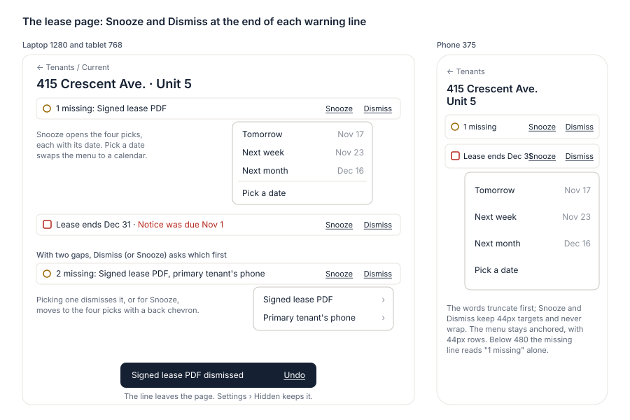
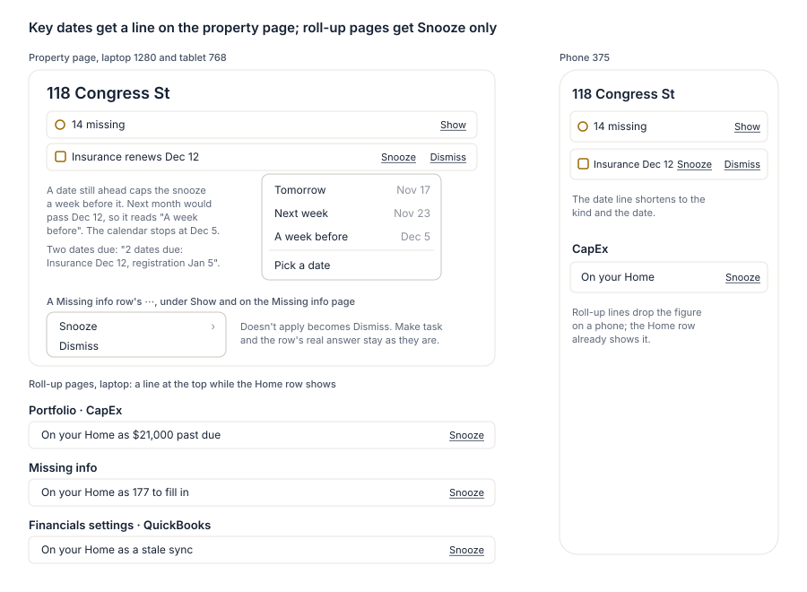
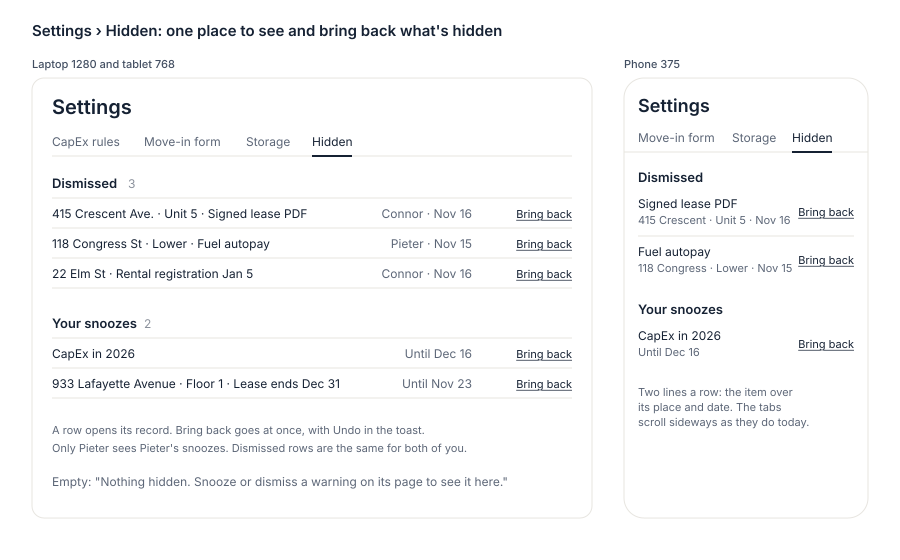

# Snooze and dismiss

Planned with Connor on Nov 16, 2026, one question at a time (D1 to D9 below). Waits for his "build it".

## 1. Summary

**Why.** Missing info (docs/specs/missing-info.md) and Home's Needs you flag everything until it's filled in or handled, and some of it Connor doesn't care about and never will. Today the only way out is Doesn't apply, which lives on the Missing info page and under a property page's Show. The lines he actually sees on a lease page ("1 missing: Signed lease PDF", "Lease ends Dec 31 · Notice was due Nov 1") have no button at all, and nothing can be put off for later.

**What changes.**

- Every warning line on a record's page gets **Snooze** and **Dismiss** at its end (D1, D2). Home's rows stay as they are.
- **Snooze** quiets it on your own Home until a day you pick: Tomorrow, Next week, Next month or a date, never past a week before a deadline that's still ahead (D4, D8).
- **Dismiss** hides that one item on that one record for both partners, with who and when kept (D4). It comes back when what it's about changes: next year's renewal date, the next lease term (D9).
- Key dates (loan maturity, insurance renewal, rental registration) get a line on the property page, like the lease page's lease-end line, so they can be snoozed and dismissed there (D2).
- Roll-up rows (Missing info, CapEx, QuickBooks) can only be snoozed, from a line at the top of the page each one opens (D3).
- **Settings › Hidden** lists everything dismissed and your own snoozes, each with Bring back (D6).
- Missing info's "Doesn't apply" is renamed Dismiss everywhere.

## 2. Decisions

| # | Decision |
|---|---|
| D1 | Each warning gets two choices: Snooze and Dismiss. Connor first took a third, "stop checking this kind everywhere", then dropped it: "I just want to either snooze or dismiss" |
| D2 | Option C: the choices live on a line on the record's own page; Home's Needs you rows don't change. Key dates get a line on the property page to make that work |
| D3 | Option C: roll-up rows (Missing info, CapEx, QuickBooks) only snooze, from a line on the page each opens. Hiding one for good would hide everything that lands in it later |
| D4 | Option C: Snooze is yours (it quiets only your Home); Dismiss is shared by both partners and shows who chose it and when |
| D5 | Option B: deadlines (loan maturity, insurance renewal, rental registration, property tax, lease ends) could never be switched off as a kind. Moot since D1 dropped switching kinds off; they snooze and dismiss like anything else, with D8's cap |
| D6 | Option A: a dismissed or snoozed line leaves the page, with Undo in the toast. Settings › Hidden holds everything hidden, with Bring back |
| D7 | Option A: on a line with two or more items, Snooze and Dismiss first ask which item, then act on it. A property page keeps its Show, and its rows' ⋯ gets the same two choices |
| D8 | Option A: Tomorrow, Next week, Next month, Pick a date. A snooze never runs past a week before a deadline that's still ahead |
| D9 | Option A: a dismiss comes back when what it's about changes. A date's dismiss follows that date; a lease item's follows the term. Everything else stays dismissed on its record, as Doesn't apply does today |

## 3. Calls made in this spec, for Connor to check before "build it"

1. **The line carries two words, Snooze and Dismiss, not one Dismiss menu.** It follows "either snooze or dismiss". Roll-up lines carry Snooze alone.
2. **"Doesn't apply" becomes "Dismiss"** on the Missing info page, its fold ("3 dismissed") and its toast, so the app has one word for it.
3. **Sign-up and Baselane rows get no Snooze.** D3 listed them with the roll-ups, but each is a person waiting on a partner and already has its own one-tap answer on Home, and their contractor page has no line to put Snooze on. Add one later if they nag.
4. **Two key dates due at once share one line** on the property page ("2 dates due: Insurance Dec 12, registration Jan 5"), and Snooze or Dismiss asks which, as D7 does for gaps.
5. **Within a week of a deadline, Snooze offers only Tomorrow.** Once the deadline passes (Late), the cap is gone and all four picks show.
6. **A snoozed gap leaves your Missing info count too.** Your Home might read "176 to fill in" while Pieter's reads 177.
7. **Snoozing the Missing info row hides the whole row for you**, but each line on a record page still shows. Snoozing a single gap hides it on the page as well.
8. **The property tax check follows its date.** Dismissing "Oct 31 has passed" hides it until the next due date is entered and, a year on, passes too.
9. **Existing Doesn't apply rows on a signed lease PDF move to the term** that was in force when they were made, so D9 holds for them. A one-off script does it; the production count is checked read-only before landing.

## 4. What can be snoozed or dismissed

| Line | Where | Choices | Dismiss holds until |
|---|---|---|---|
| "N missing" (gaps) | Lease page, contractor page | Snooze, Dismiss | A lease term's gap (signed PDF, Section 8 caseworker): the next term. Anything else: Bring back |
| "N missing" rows under Show | Property page, Missing info page | Snooze, Dismiss in each row's ⋯ | A date check (property tax due): the next date. Anything else: Bring back |
| Lease ends · notice | Lease page | Snooze, Dismiss | The next term (it already skips on `term:<id>`) |
| Key date (new line) | Property page | Snooze, Dismiss | The date changes |
| "On your Home as …" (new line) | Missing info page, Portfolio's CapEx forecast, Financials settings | Snooze | Not dismissable (D3) |

A Needs you row on Home hides while its item is snoozed by you or dismissed. The lease-end and key-date rows are one item each; Missing info, CapEx and QuickBooks are their roll-up.

## 5. Screens

### Lease and contractor pages



- **The line.** `Notice` from `components/source-line.tsx` with two text buttons in its `action` slot, Snooze then Dismiss, `textLinkClass` at `text-meta`, 16px apart. The words truncate first; the buttons never wrap or shrink.
- **Snooze** opens an anchored `Menu`: the four picks with their date as `description`-style trailing text ("Next week · Nov 23"). Pick a date swaps the menu to `DatePanel` through `followUp`, with days after the cap turned off.
- **Dismiss** goes at once: the line leaves, and the toast reads "Signed lease PDF dismissed · Undo".
- **Two or more items:** either button opens a `Menu` listing the items with a chevron. Dismiss acts on the pick; Snooze moves to the four picks with a back chevron (`followUp`).
- **Sizes.** Laptop 1280 and tablet 768: as drawn, at the line's normal width. Tablet gets 44px targets (`pointer-coarse:after:-inset-3`, as the property line's Show does). Phone 375: the words truncate; below 480px the missing line reads "1 missing" alone and the lease-end line "Lease ends Dec 31". At 320 both buttons still fit beside "1 missing". Menus stay anchored with 44px rows, as every ⋯ menu does.

### Property page



- **Key-date line (new).** Under the "N missing" line: a `Notice` with the key date's icon from Needs you (`Landmark`, `ShieldCheck`, `FileBadge`), "Insurance renews Dec 12", reading Late in `--destructive` once passed ("Insurance renewal was due Dec 12"). It shows in the same window Home uses (90 days for a loan, 60 for insurance and registration) and goes when the date moves out of it. On a phone it shortens to "Insurance Dec 12".
- **Show rows.** The ⋯ on each row (shared with the Missing info page, `missing-list.tsx`) becomes: the row's real answer, Snooze ›, Make task, Dismiss.
- **The cap in the menu.** A pick past the cap drops out, and "A week before" with its date takes the first dropped slot.

### Roll-up pages

On the Missing info page, Portfolio's CapEx forecast (`#capex`) and Financials settings, a line at the top while the matching Home row would show for you: "On your Home as 177 to fill in", "On your Home as $21,000 past due", "On your Home as a stale sync" (or "an expired link"), with Snooze. On a phone the figure drops: "On your Home". Snoozed, the line leaves and the toast reads "Missing info snoozed to Dec 16 · Undo".

### Settings › Hidden



- A fourth `TopTabs` tab, **Hidden** (`/settings/hidden`).
- **Dismissed:** one row per live dismiss, "415 Crescent Ave. · Unit 5 · Signed lease PDF", then "Connor · Nov 16" and Bring back. A dismiss whose date or term has moved on hides nothing, so it isn't listed.
- **Your snoozes:** only yours, "CapEx in 2026", "Until Dec 16", Bring back. A snooze that has ended isn't listed.
- A row opens its record. Bring back goes at once with Undo in the toast. Each section is newest first.
- **Empty:** `EmptyState`, "Nothing hidden. Snooze or dismiss a warning on its page to see it here."
- **Sizes.** Laptop and tablet: one line per row at the settings width (`max-w-300`), the who-and-when column right-aligned before Bring back. Phone: two lines, the item over its place and date, Bring back at the right. The tabs scroll sideways at 320, as they do today.

## 6. Rules

- **When a snooze ends.** A snooze holds a Buffalo day (`todayYmdEastern`); the item is hidden while today is before it and shows again that morning. Tomorrow is today plus 1, Next week plus 7, Next month the same day next month (the month's last day when it has no such day).
- **The cap.** For a key date or a lease's notice deadline still ahead, the latest snooze is 7 days before it. Within 8 days of the deadline only Tomorrow shows. A deadline that has passed has no cap.
- **Who sees what.** A snooze belongs to the partner who set it. A dismiss belongs to the record and shows for both, with who and when.
- **What a dismiss keys on (D9).** It's stored as the check and the subject it hides, as Doesn't apply is today (`MissingInfoSkip`). A subject about a date carries the date, so a new date is a new subject: `property:<id>@2026-12-12` for a key date, the passed date for the property tax check. A lease term's gap uses `term:<id>`, as lease ends already do. Everything else keeps its record's subject.
- **Settling Make task items.** A dismiss still ticks a matching checklist item (missing-info.md, "Settling the checklist"). A snooze doesn't.
- **Counts.** Home's Missing info count and the page lines leave out what's dismissed and what you snoozed.

## 7. Data

```prisma
// A partner put a warning off until a day (docs/specs/snooze-dismiss.md, D4, D8).
model Snooze {
  id        String   @id @default(cuid())
  user      User     @relation(fields: [userId], references: [id], onDelete: Cascade)
  userId    String
  // A Needs you row's key ("insurance:<propertyId>", "missing", "capex", "quickbooks") or a gap's key ("lease.pdf|term:<id>").
  key       String
  // The Buffalo day it shows again, YYYY-MM-DD.
  until     String
  createdAt DateTime @default(now())

  @@unique([userId, key])
  @@index([userId])
}
```

- Snoozing the same key again replaces the day. A snooze that has ended is ignored; nothing needs to delete it.
- RLS on the new table, as on every table (README, Rules of the road).
- `MissingInfoSkip` is reused for Dismiss with no schema change. New checks: `keydate.loan`, `keydate.insurance`, `keydate.registration`. `lease.pdf` and `lease.caseworker` move from `lease:<id>` to `term:<id>`; `tax.due` gains its date when there is one.
- One-off script (`scripts/migrate/`): move existing `lease.pdf` skips to the term in force on their `createdAt`, and give `tax.due` skips the date they were made against. Dry run first, then `--apply`.

## 8. Reuse check

| | What | Where |
|---|---|---|
| **Reused** | The line | `components/source-line.tsx` `Notice` (its `action` slot takes the two buttons) |
| | Snooze's picks and the item pick | `components/menu.tsx` `Menu`, `MenuItem`, `followUp` |
| | Toast with Undo | `components/toast.tsx` |
| | Settings tab | `components/nav.tsx` `TopTabs` in `settings/layout.tsx` |
| | Empty Hidden tab | `components/ui.tsx` `EmptyState` |
| | Dismiss storage and writes | `MissingInfoSkip`, `lib/missing/service.ts` `skipGap`, `unskipGap` |
| | Lease-end skip by term | `lib/missing/lease-notice.ts` `leaseEndItems` |
| | Key-date windows, icons and Late | `lib/home/needs-you.ts` `keyDateItems` and the Needs you icons |
| **Extended** | A latest day, with later days turned off | `components/date-panel.tsx` `DatePanel` (it has no limit today) |
| | Snooze and Dismiss on the lines | `missing/missing-summary.tsx` `MissingSummary`, `LeaseEndNotice`; `properties/[id]/missing-line.tsx` |
| | Row ⋯: Snooze ›, Dismiss | `missing/missing-list.tsx` |
| | Needs you and counts leave out snoozed and dismissed items | `lib/home/queries.ts`, `lib/missing/queries.ts`, `lib/home/needs-you.ts` |
| | Subjects that carry a date or term | `lib/missing/checks.ts` |
| **New** | Snooze writes, the cap and the picks (pure, tested) | `lib/snooze/service.ts`, `lib/snooze/picks.ts` |
| | Key-date line | `properties/[id]/key-date-line.tsx` (feature-only) |
| | Roll-up line | `components/home-snooze-line.tsx`, used on three pages, so it gets a row in docs/components.md |
| | Hidden tab | `settings/hidden/page.tsx` and its list (feature-only) |
| | The script | `scripts/migrate/dismiss-subjects.ts` |

References behind the new pieces: Gmail's and Linear's snooze menus (preset days, each with its date, then a calendar) for D8. On Mobbin, [Linear's notification settings](https://mobbin.com/screens/fbb07294-5214-4769-97e0-f2bd9f8cb36a) and [Fresha's](https://mobbin.com/screens/b61e78fb-dda8-4493-b063-b9cce40fa712) show a settings list of what's on and off; Mobbin had no snooze menu worth citing.

## 9. Copy

Run [copy-rules.md](../copy-rules.md) before it ships. Starting words:

- Line buttons: "Snooze", "Dismiss". Picks: "Tomorrow", "Next week", "Next month", "A week before", "Pick a date".
- Toasts: "Signed lease PDF dismissed · Undo", "Lease end snoozed to Nov 23 · Undo", "Brought back · Undo".
- Key-date line: "Insurance renews Dec 12", "Loan matures Feb 1", "Rental registration ends Jan 5"; Late: "Insurance renewal was due Dec 12". Two: "2 dates due: Insurance Dec 12, registration Jan 5".
- Roll-up line: "On your Home as 177 to fill in", "On your Home as $21,000 past due", "On your Home as a stale sync", "On your Home as an expired link".
- Hidden: "Dismissed", "Your snoozes", "Until Dec 16", "Bring back", the empty line in section 5.

## 10. Tests and the device check

- `lib/snooze/picks.test.ts`: the four picks' days, month ends, the cap (8+ days out, within 8, passed), Buffalo time across midnight.
- `checks.test.ts`: a date-keyed dismiss hides only its date; a term-keyed dismiss hides only its term; a snoozed gap leaves the count for its partner only.
- `needs-you.test.ts`: snoozed and dismissed rows drop out.
- The script: a dry run that prints each skip it would move.
- `tests/devices/routes.ts` lists `/settings/hidden`. By hand at 320 and 375: the lease page's two lines and both menus, a two-item line, the property key-date line, each roll-up line, the Hidden tab.

## 11. Build order

1. Migration (`Snooze`) with RLS, and the subject script.
2. `lib/snooze` picks and service, and the date and term subjects in `checks.ts`, with tests.
3. Needs you and counts leave out snoozed and dismissed items.
4. Lease and contractor lines, then the property key-date line and the Show rows' ⋯.
5. Roll-up lines on the three pages.
6. Settings › Hidden.
7. Rename Doesn't apply to Dismiss. Device check, lint, typecheck, tests; land.
