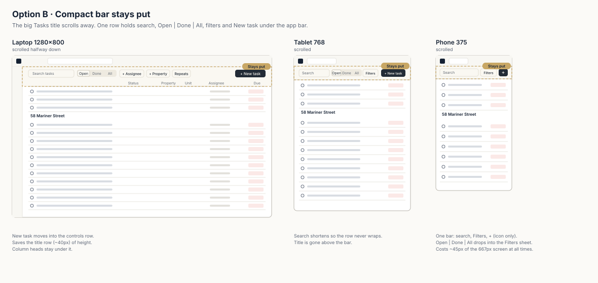
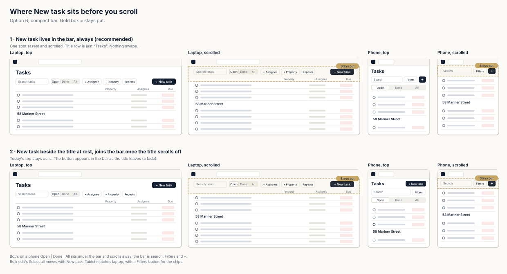

# Sticky controls on the Tasks list

Planned with Connor on Nov 21, 2026. Halfway down a long list he can't make a new task without scrolling back to the top. He picked option B, a compact bar that stays put (Question 1), with New task living in that bar at all times (Question 2). He said "build it" the same day, and it's built, uncommitted until he says commit.

Unpicked: [A, the whole header stays put](sticky-task-header/option-a-whole-header.svg) and [C, only a floating New task](sticky-task-header/option-c-floating-only.svg).

## 1. Summary

The Tasks page's filter bar sticks under the app bar while the list scrolls, and New task moves into it. The big "Tasks" title scrolls away as it does today. On a wide screen the column headers stick under the bar too.

| Size | Stays put while scrolled | Scrolls away |
|---|---|---|
| Laptop 1280×800 (mouse, list 60rem or wider) | Search, Open \| Done \| All, the Assignee, Property and Repeats chips, New task, then the column headers | "Tasks" title, the result line, group headings |
| Tablet 768 (touch) | Search, Open \| Done \| All, Filters, New task | "Tasks" title, the result line, group headings |
| Phone 375 | Search, Filters, + (New task, icon only) | "Tasks" title, the Open \| Done \| All row under the bar, the result line, group headings |

## 2. Decisions

| # | Decision |
|---|---|
| D1 | Option B: one compact bar sticks, not the whole header (Q1) |
| D2 | New task lives at the right end of the bar at all times, at the top of the page and scrolled. The title row is "Tasks" alone. Nothing swaps or fades (Q2, option 1) |
| D3 | On a phone the bar is search, Filters and an icon-only + whose accessible name is "New task". Open \| Done \| All keeps its own full-width row under the bar and scrolls away |
| D4 | Group headings ("58 Mariner Street") don't stick |

## 3. Calls made in this spec, for Connor to check before "build it"

1. **Select all stays in the title row.** My Question 2 note said it moves with New task. On a 320px phone the bar has no room for it next to search, Filters and +, so bulk edit's Select all keeps its spot beside the title, which now holds nothing else. It scrolls away with the title, as it does today.
2. **The divider shows only once the bar is stuck.** At the top the page looks as today. Once rows slide under the bar, a 1px `--border` line marks its bottom edge ("Sticky headers clip at a divider"). On the wide list the column headers' own bottom line is that divider, so the bar adds none there.
3. **Phone +.** A 44px primary square with the Plus icon, like the drawing. Tablet and laptop keep the words "New task".
4. **Lift.** None. The bar sits on `--background` with no shadow; the divider does the job (brand guidelines: elevation only for floating layers).
5. **The loading screen matches.** `loading.tsx` draws the same bar with New task in it, so the page doesn't jump when the list lands.

## 4. How it works

### Reused
- `FilterBar` (`src/components/filter-bar.tsx`), `SearchInput`, `SegmentedControl`, `Button`, `LinkButton` and `PageHeader`, all as they are.
- `TaskColumnHeads` (`src/app/(app)/tasks/all-list.tsx`): only its wrapper's classes change, so the Scheduled column the contractor-scheduled-date session is adding merges in beside it.
- `--app-bar-h` (`globals.css`), which the app bar and sticky table headers already use as their top.

### Extended
- **`FilterBar` gets two optional props**, so the other lists (deals, properties, tenants, contractors) don't change:
  - `action?: ReactNode`: drawn at the bar's right end (Tasks passes New task).
  - `sticky?: boolean`: the row of controls gets `sticky top-(--app-bar-h) z-20 bg-background` and a little vertical padding so rows don't show above it. A sentinel above the bar and an IntersectionObserver set `data-stuck`, which shows the divider (call 2). A ResizeObserver writes the bar's height to `--list-bar-h` on the page, for the column headers.
  - Below `sm`, with `sticky`, the views row renders after the sticky row instead of inside its grid, so it scrolls away (D3). Without `sticky` the phone layout is unchanged.
- **`TaskColumnHeads`** gets `sticky top-[calc(var(--app-bar-h)+var(--list-bar-h))] z-10 bg-background`. It only shows at `lg` with a 60rem list, the same condition the chips use, so the two line up.

### Changed
- `tasks-header.tsx`: `PageHeader` keeps the title and Select all; New task leaves it.
- `select-all.tsx`: split New task out (`NewTaskButton`), with the phone's icon-only form.
- `filters.tsx`: passes `sticky` and `action={<NewTaskButton />}`, in the live bar and the placeholder.

### New
Nothing new. A sticky toolbar over a scrolling list is the pattern in Asana, Unify and Plane on the web ([Asana](https://mobbin.com/screens/8935ad31-7dde-44dc-9aa6-7970e66f0312), [Unify](https://mobbin.com/screens/fdd1a460-a90b-450c-ac58-9fb5c7b7dd0c), [Plane](https://mobbin.com/screens/ec889495-35a4-4f32-b328-6cb925f5635d)), and a compact top bar with search, filter and add is Evernote's on iOS ([Evernote](https://mobbin.com/screens/e5da9609-b2d9-4a47-a401-672f628345b5)).

## 5. Edges to check when built

- Rows never wrap at any width from 320 to 1920, with a long search typed and with Select all showing.
- Opening the Filters sheet, a chip's menu, or the sort menu while stuck: popovers open below the bar and aren't clipped.
- iOS Safari: the bar holds under the app bar while the toolbar collapses; search input stays 16px.
- Bulk edit: picking rows while scrolled leaves the bar in place; the bottom bulk bar doesn't cover it.
- Back to the list (ScrollMemory) lands with the bar already stuck and the divider showing.
- Dark mode: the bar's `--background` matches the list's.
- `npm run check`, `npm run test:devices` and `test:devices:dark`, then open the stuck bar by hand at 320, 375, 768, 1280×800 and 1920.
