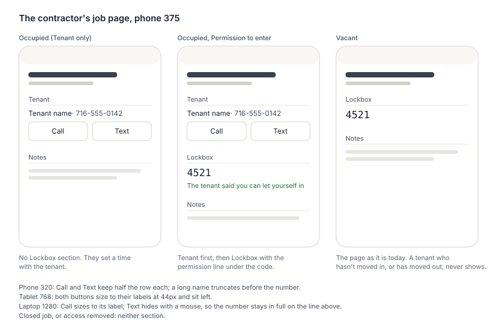
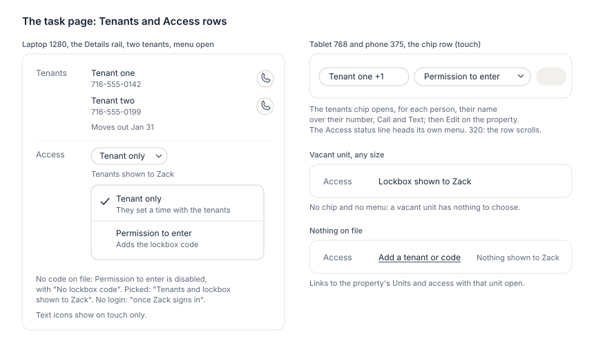
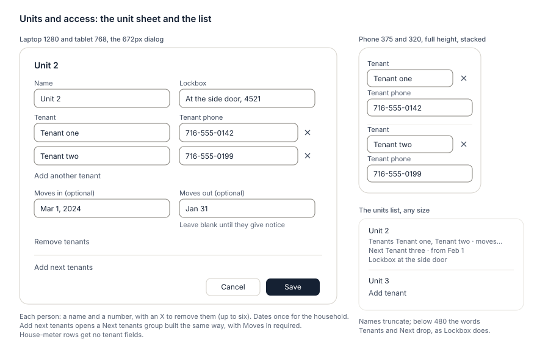
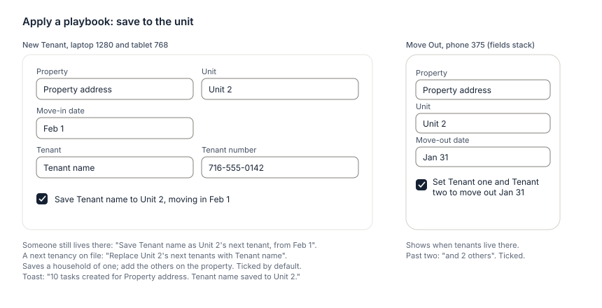

# Tenant contact on jobs

Planned with Connor on Oct 26, 2026 (Q1 to Q20), and reopened on Nov 14, 2026 when he asked for every decision to be argued again. The Nov 14 round changed four things (Q21 to Q24): a unit counts as occupied by move dates, an occupied unit shares the lockbox only with the tenant's permission to enter, the auto-switch of Q18 and Q20 is gone, and applying the New Tenant and Move Out playbooks saves to the unit.

Connor said "build it after" on Nov 14: it builds once branch `design-calls-nov14` is on main. That branch and the Nov 14 job emails both change files cited here (the portal job page and its queries, `properties/service.ts`), so the build starts by re-reading every cited file and correcting the cites.

## 1. Summary

**Why.** Many jobs are at an occupied home. Today no unit holds a tenant: a unit stores its label, lockbox code, utilities and equipment (`src/lib/property-types.ts`). A tenant's name and number live only in task text, such as a move-in report, notes, or a playbook's `[Tenant]` and `[tenant number]` blanks. The assigned contractor sees the unit's lockbox code on every open job (`src/lib/portal/access-code.ts`), occupied or not.

**What changes.**

- A unit holds its tenant: a name, a phone number, and optional Moves in and Moves out dates. It can also hold a next tenant who takes over on their move-in date (Q1, Q23, Q24).
- A unit is occupied while a tenant lives there by those dates. Occupied shows the contractor the tenant; vacant shows the lockbox (Q21, Q23).
- On an occupied unit, staff mark **Permission to enter** on a job when the tenant has said the contractor may let themselves in with nobody home. Only then does the lockbox code show too (Q21, Q22).
- The contractor sees the tenant on the job page as a Tenant section with Call and Text, above Lockbox (Q3, Q14).
- The tenant follows the lockbox code's rules: only the assigned contractor, only while the job is open, logged when shown (Q2, Q12).
- Staff see the tenant on the task with Call and Text (Q10). Applying New Tenant saves the tenant to the unit, and applying Move Out sets the move-out date (Q24).
- Nothing is sent to the tenant (Q5).

**Decisions.**

| # | Decision |
|---|---|
| Q1 | The tenant lives on the unit, beside its lockbox code. A tenant and lease record can take it over later |
| Q2 | Same rule as the lockbox code: only the assigned contractor, only while the job is open; gone once it's done or their access is removed. Staff always see it on the property |
| Q3 | Full name and number, with Call and Text buttons that dial the clean number, so a number with an extension still dials |
| Q4 | One contact per tenancy. Nov 14 fix: units have no notes field, so a roommate or spouse goes in the name ("Dana and Sam Lee") and a second number in the job's notes |
| Q5 | Nothing goes to the tenant in this round |
| Q6 | Superseded by Q21 and Q22. Was: a per-job Tenant, Lockbox or Both, defaulting to Tenant when one is on file |
| Q7 | Superseded by Q23. Was: occupied means a tenant is on file. Still true: a job always shows the unit's current tenant, never a copy |
| Q8 | Staff enter the tenant in the property's Units editor. The task's Access row links there when nothing is on file |
| Q9 | No unit picked: a single-unit home uses its unit; a multi-unit building shows no tenant, and the task page asks for a unit |
| Q10 | The task page shows the tenant with Call and Text for staff, and says what the contractor gets |
| Q11 | Extended by Q24. Applying a playbook prefills `[Tenant]` and `[tenant number]` from the unit's current tenant, except on a move-in playbook |
| Q12 | A contractor opening a job that shows the tenant is logged, like the lockbox code |
| Q13 | Text shows on phones and tablets only, as on a contractor's record (ADMIN-004); with a mouse the number shows next to Call |
| Q14 | Layout B on the job page: a Tenant section with a Call and Text pair, above Lockbox |
| Q15 | Built after `design-calls-nov14` lands (was: after chunk 7, which landed Oct 27) |
| Q16 | Superseded by Q22. Was: a three-way menu on the task's Access row |
| Q17 | The Units editor gets the tenant under each unit's lockbox code, with Remove tenant, and Add tenant on a unit without one. Q23 and Q24 add the dates and the next tenant |
| Q18 | Dropped by Q21. Was: adding a tenant switches open jobs to Both so the contractor keeps the code. Under Q21 nobody gets the code to an occupied home without permission |
| Q19 | Playbook fill-ins stay in task text. Nov 14 check: every playbook step with a tenant blank goes to Connor or Pieter today, none to a contractor |
| Q20 | Dropped with Q18 |
| Q21 | Occupied shows the tenant; vacant shows the lockbox. The lockbox shows on an occupied unit only when the tenant has given permission to enter: the contractor may let themselves in with nobody home |
| Q22 | Option A: on an occupied unit the Access chip offers Tenant only (the default) and Permission to enter. A vacant unit has no choice. Permission stays with the one job and isn't copied to the next repeat |
| Q23 | Option B: the tenant has optional Moves in and Moves out dates. Blank Moves in means they live there now; blank Moves out means they're staying, month to month included. Moves out is the day they leave, not a lease end, so it stays blank until they give notice. No month-to-month switch: lease terms stay in Baselane |
| Q24 | Option A: applying New Tenant saves the tenant and move-in date to the unit, and applying Move Out sets the current tenant's move-out date, each behind a checkbox ticked by default. If someone still lives there, the new tenant waits as the next tenant |

## 2. Data

**On the unit.** `PropertyUnit` gains two optional objects. Units are JSON, so this part needs no migration.

```ts
type UnitTenant = {
  name: string;            // "Dana Lee", trimmed
  phone: string;           // as shown: "716-555-1234 ext 2"
  phoneE164: string;       // what Call and Text dial: "+17165551234"
  movesIn: string | null;  // "2026-02-01", a Buffalo day; null: they live there now
  movesOut: string | null; // the day they leave; null: staying
};

tenant?: UnitTenant | null;     // the tenancy on file now
nextTenant?: UnitTenant | null; // signed and waiting; movesIn required
```

- **The save.** `unitSchema` in `src/app/(app)/properties/actions.ts` is a plain zod object, so it drops any key it doesn't name. It gains `tenant` and `nextTenant` with `name` (max 120), `phone` (max 40), `movesIn` and `movesOut` (ISO dates). `phoneE164` is never read from the client.
- `writeUnits` in `src/lib/properties/service.ts` (the one write to the units list) adds both to its explicit clean map through a pure `readUnitTenants` in `property-types.ts`. The name is trimmed. The phone goes through `readPhone` from `src/lib/contractors/contact-fields.ts`, which also derives `phoneE164`, so a unit's number reads and dials like a contractor's.
- **Refusals** come back as field errors, so the sheet's fields draw them: a number `readPhone` can't read (`PHONE_INVALID`), a phone with no name ("Enter the tenant's name."), a name with no phone ("Enter the tenant's phone number."), a move-out on or before the move-in ("Move-out comes after move-in."), a next tenant with no move-in ("Enter the move-in date."), and a next tenant moving in before the current one's move-in ("They move in after the current tenant.").
- **Promotion.** When a save or an Apply finds `nextTenant.movesIn` on or before today, it becomes `tenant` and `nextTenant` clears. Nothing waits on a save, though: the rule below reads the dates, so the unit is right on the day itself.
- Re-running `scripts/migrate/01-properties.ts` rewrites each property's units from the spreadsheet, which has no tenant columns, so it erases every tenant entered here.

**Who lives there today.** One pure function, `livingThere(unit, today)`, in `property-types.ts`:

```
if nextTenant and nextTenant.movesIn <= today and (no movesOut or today < movesOut): nextTenant
else if tenant and (no movesIn or movesIn <= today) and (no movesOut or today < movesOut): tenant
else: nobody, and the unit is vacant
```

`today` is the Buffalo day. A tenant whose move-in is ahead, or whose move-out has come, is on file but not living there, so the unit is vacant for contractors.

**On the task.** One nullable column (Q22):

```prisma
model Task {
  // existing fields stay
  entryPermittedAt DateTime? // when staff marked Permission to enter; null: Tenant only
}
```

- Permission holds while `entryPermittedAt` is set and the tenant living there moved in on or before that day (or has no move-in date). So a permission given by the old tenant never carries over to a new one.
- `createNextRepeat` (`src/lib/tasks/core.ts`) doesn't copy it: each visit needs its own yes.
- Changing the job's unit or property clears it, with an ACCESS event (section 4). Changing the assignee keeps it: the tenant let HG in, not one person.

**What the contractor sees.** One pure function, `accessState`, beside `lockboxState` in `src/lib/tasks/lockbox.ts`. The staff task page calls it; in the portal only `access-code.ts` does (section 7):

```
unit       = the job's unit; with no unit, a single-unit property's one unit (Q9)
tenant     = livingThere(unit, today)
code       = resolveLockboxCode(units, unitLabel), unchanged
permitted  = entryPermittedAt set, and tenant.movesIn is null or on or before its Buffalo day
shows tenant  = tenant is not null
shows lockbox = code and (tenant is null or permitted)
```

A single-unit property means one rentable unit, so the house-meter rows `isHouseMeterRow` finds don't count. A multi-unit building with no unit picked has no tenant; a code the units share still shows, as today (`lockbox.ts`), since that is common-area work.

**The security log.** `SecurityEventKind` gains `TENANT_VIEWED`. `noteJobViewed` (`src/lib/portal/jobs.ts`) takes `{ lockboxShown, tenantShown }` and hashes the IP when either is true. `logLockboxView` takes the kind as a parameter and reuses its once-a-day advisory lock, so each kind is logged once per contractor, job and Buffalo day.

**The migration**, one file, sorted after the newest on main:

```sql
-- Tenant contact on jobs (docs/specs/tenant-contact.md). Additive: one
-- nullable column, one enum value. Nothing is backfilled; a null
-- entryPermittedAt means Tenant only. No statement here may use TENANT_VIEWED:
-- Postgres can't use an enum value in the transaction that adds it (55P04),
-- as 20261023000000_task_status_values says. Roll forward only.
ALTER TABLE "Task" ADD COLUMN "entryPermittedAt" TIMESTAMP(3);
ALTER TYPE "SecurityEventKind" ADD VALUE 'TENANT_VIEWED';
```

## 3. The contractor's job page



A Tenant section above Lockbox (Q14), in `_components/job-details.tsx` beside `LockboxSection`. The name and number sit on one line; the Call and Text pair sits under it, built like `AddressActions` on the same page.

- **Occupied, Tenant only:** the Tenant section, and no Lockbox section.
- **Occupied, Permission to enter:** Tenant, then Lockbox, with "The tenant said you can let yourself in" under the code in `--ok`.
- **Vacant:** the Lockbox section as it is today. A tenant who hasn't moved in, or has moved out, never shows.
- **Closed job, or access removed:** neither section (Q2).
- The name is `text-body` `--fg-1`, the number `num` `--fg-2`, joined by " · ". The name truncates (`min-w-0 truncate`) and the number doesn't shrink.
- The buttons are plain `<a href="tel:…">` and `<a href="sms:…">` styled with `buttonClass({ variant: "secondary" })`, since `LinkButton` is a Next `Link`. Icons are lucide `Phone` and `MessageSquareText` at the brand sizes. The labels read "Call" and "Text"; the `aria-label`s read "Call Dana" and "Text Dana", from the record. They dial `phoneE164` through `telHref` and `textHref` in `src/lib/contacts.ts`.
- **Sizes.** Phone 375: the pair splits the row. Phone 320: each keeps half the row, about 136px, and a long name truncates before the number. Tablet 768: touch layout, both buttons size to their labels at 44px and sit left. Laptop 1280: Call sizes to its label and Text hides with a mouse (Q13), so the number stays in full on the line above.
- **My jobs** adds nothing: the Tenant section shows only on the job page.
- **Job emails.** "Show access" (`src/lib/portal/job-link-paths.ts`) lands at `#lockbox` today. It moves to `#access` on whichever section comes first, and the button shows when either section would. The email itself never carries the tenant or the code.

## 4. The staff task page



Two rows in Details, in `tasks/[id]/fields.tsx`.

**Tenant row.** It shows whenever the job's unit (or a single-unit property) has a tenant on file, whether or not a contractor is assigned. It shows who lives there today, or, when the unit is vacant, a tenant on file who moves in later.

- In the rail: the name, with the number as a meta line under it, so a mouse user sees the number without hovering, plus "moves out Jan 31" or "moves in Feb 1" when that date is set. The name truncates; the number stays whole. Then the Call and Text icon links as on a contractor's record (`src/app/(app)/contractors/[id]/contact-section.tsx`), with Text touch only.
- In the chip row: a chip with the name opens a `Menu` headed by `MenuHeader` (the name over the number), then "Call Dana", "Text Dana" and "Edit on the property". "Text Dana" is left out on a fine pointer through `useCoarsePointer`, not hidden with CSS, so a keyboard can't reach a hidden item.
- "Edit on the property" goes to `/properties/<id>?unit=<label>` (section 5).

**Access row.** It shows when a contractor is assigned on an active job with a property, as today's Lockbox row requires (`tasks/[id]/page.tsx`), and it replaces that row.

- **Occupied:** a chip that opens a `Menu` with `selectionMode="single"`: **Tenant only** ("They set a time with the tenant") and **Permission to enter** ("Adds the lockbox code"). With no code on file, Permission to enter is disabled with "No lockbox code".
- **Vacant:** no chip. The row reads "Lockbox shown to Zack".
- **Nothing on file:** the row is the link **Add a tenant or code**, to `?unit=<that label>`, or to an empty `?unit=` that lands on Units and access when the property has no units (section 5), with "Nothing shown to Zack".
- **Pick a unit first** applies only when a multi-unit building has no unit picked and no shared code resolves.
- **The status line** stays one line: "Tenant shown to Zack", "Tenant and lockbox shown to Zack", "Lockbox shown to Zack", "Nothing shown to Zack". With no login, "once Zack signs in" takes the place of "shown to Zack". The sr-only sentences say it in full, as today's lockbox row does. In the rail it sits under the chip; below lg it's the menu's `MenuHeader`, first in the menu.
- The page sends the row what resolves (a tenant living there or not, a code or not, or pick a unit) and the contractor's first name, never the code. `view.tsx` passes it where it carries `lockbox` today.

**Sizes.** Laptop 1280 with a mouse: the rail, with the number on its own line and Call only. Tablet 768 on touch: the chip row, with "Text Dana" in the Tenant menu. Phone 375: the chip row as drawn. Phone 320: the chip row scrolls sideways, as it does today.

**The write.** Through `TaskFields`' `save()`, like Unit. `patchSchema` (`tasks/[id]/actions.ts`) gains `entryPermitted: boolean`; the server writes `now()` or null, never a client time. Toasts: "Permission to enter marked" and "Set to Tenant only", key `task:<id>:access`, and Undo writes the stored value back. `patchTask` writes an INTERNAL ACCESS event and sends no notice or email. The contractor sees the change the next time the job page loads. ACCESS events never fold.

**The ACCESS line.** Nothing writes ACCESS today, and `activity.ts` prints "changed who can see this" whatever the data. Its data becomes `{ entry: { from, to } }`, two booleans, plus `cleared: "unit"` when a unit or property change clears it. The lines:

- "Connor marked permission to enter";
- "Connor set access to Tenant only";
- "Permission to enter was cleared when the unit changed";
- an ACCESS event with no `entry` keeps "Connor changed who can see this".

## 5. The property's Units editor



In `properties/[id]/edit-units.tsx`.

**The unit sheet** (`UnitSheet`, a `FormSheet` with `fullHeight`). Name and Lockbox sit in a `FieldGrid`, side by side from sm. Under them:

- **Tenant** and **Tenant phone**, a second `FieldGrid`. Tenant phone is `type="tel"` with `inputMode="tel"`, and its helper shows "Saves as 716-555-1234" when that differs from what's typed.
- **Moves in (optional)** and **Moves out (optional)**, a third `FieldGrid`, as `DateField`s. Moves out's helper reads "Leave blank until they give notice".
- A ghost **Remove tenant** under them clears the tenant. Save still saves, so closing without saving keeps them.
- With a tenant on file, a ghost **Add next tenant** opens a **Next tenant** group: Tenant, Tenant phone and Moves in (required), with **Remove next tenant**. The group shows whenever a next tenant is on file.
- On a house-meter row the tenant fields don't show.

**The units list** (`ReadUnit`). A unit with a tenant gets a meta line under its name, "Tenant Dana Lee · moves out Jan 31" (the date only when set), and "Next Sam Ortiz · from Feb 1" when one waits, above "Lockbox at …". The words "Tenant" and "Next" drop below 480, as "Lockbox" does. A unit without a tenant shows **Add tenant** in that slot, which opens its sheet with the Tenant field focused: a ghost `size="sm"` button, 32px with a mouse and 44 on touch, offset like Add equipment (`-ml-2.5`) so its label lines up with the name. House-meter rows get neither.

**The copy.** The Delete confirm's fallback reads "Its tenant, lockbox code, utilities and equipment go with it." The empty state reads "Add each unit to keep its tenant, lockbox code, utilities and equipment here."

**Opening a unit from a link.** The property page (`properties/[id]/page.tsx`) reads `?unit=<label>`: the page scrolls to Units and access, and `UnitsSection` opens the unit whose label matches (case-insensitive, as `resolveLockboxCode` matches) with the Tenant field focused. A label that matches nothing, or an empty `?unit=`, scrolls to the section and opens nothing. It opens once on load, and `?unit=` is dropped with `router.replace`, so a save's re-render or a refresh doesn't reopen it.

**Sizes.** Laptop 1280 and tablet 768: the sheet is the centered 672px dialog (`size="lg"`), and each pair of fields sits side by side. Phone 375 and 320: a full-height sheet with every field stacked. In the list, the name truncates and the number stays whole at every width.

## 6. Playbooks



In the Apply flow (`templates/[id]/apply/apply-flow.tsx`, `src/lib/tasks/template-items.ts`) and its server action (`templates/actions.ts`).

**Which playbook is which.** A playbook whose date label reads as a move-in ("Move-in date", matched as `/move[- ]?in/i`) is a move-in playbook; "Move-out date" (`/move[- ]?out/i`) makes a move-out playbook. Today that's New Tenant and New Move Out. Renaming the label only drops the checkbox, so it fails safe. A test pins both patterns.

**The prefill (Q11).** Picking a unit, picking a single-unit property, or restoring a draft with a unit calls a server action that returns that unit's tenant living there, or null. Only that tenant reaches the browser. On any playbook except a move-in one, the fill-ins prefill: `[Tenant]` and `[tenant name]` with the name, and phone fill-ins whose name starts with "tenant" (`[tenant number]`, `[tenant phone]`, `[tenant cell]`) with the phone as shown. A move-in playbook prefills nothing, since its tenant is the new one. The prefill is a computed default, like `[Address]` in `valueOf`, and is never written to `typed`, so it never lands in the saved draft and never marks the form changed.

**Saving to the unit (Q24).**

- **Move-in playbook.** Once a unit resolves and both a tenant name fill-in and a tenant phone fill-in are filled, a `Checkbox` under the fill-ins, ticked by default, reads "Save Dana Lee to Unit 2, moving in Feb 1", with the playbook's date as Moves in. If someone lives there on that day, or the current tenant has no move-out before it, it reads "Save Dana Lee as Unit 2's next tenant, from Feb 1". If a next tenant is already on file, it reads "Replace Sam Ortiz with Dana Lee as Unit 2's next tenant".
- **Move-out playbook.** When the unit has a tenant living there, a `Checkbox` ticked by default reads "Set Dana Lee to move out Jan 31", with the playbook's date as Moves out.
- **The write.** The Apply action creates the tasks and writes the unit through the properties service in one transaction, so a refused save creates nothing and the page shows the refusal. The toast reads "10 tasks created for 767 Prospect. Dana Lee saved to Unit 2."
- The draft keeps the checkbox's state, so a restored draft doesn't flip it back on.

**Sizes.** Laptop 1280 and tablet 768: the checkbox sits under the fill-ins' `FieldRow`, full width. Phone 375 and 320: under the stacked fields; its label wraps to a second line at 320, which a checkbox label may.

## 7. Privacy

- `src/lib/portal/access-code.ts` stays the one portal file that reads `Property.units`. The guard (`src/lib/auth-guard.test.ts`) is a plain search for the word "units" in portal files, so in the portal only `access-code.ts` calls `accessState`. It gains `readJobAccess(db, propertyId, unitLabel, entryPermittedAt)`, which returns `{ lockbox, permitted, tenant: { name, phone, dial } | null }` for this one job, never the list. A next tenant, or a tenant who hasn't moved in or has moved out, never leaves it. `pickLockboxCode` keeps its JSON guard and delegates the pick to `resolveLockboxCode`, so the portal and the staff page can't disagree.
- `readJobAccess` stays under the existing gate in `getJob`: only for the assigned contractor while the job is active.
- Open means `isActiveStatus`, Review included, exactly as the lockbox works today, so the tenant stays on the job page through Review until staff Approve. It never appears in My jobs, Updates, emails or the job-page notice.
- Playbook fill-ins are the one exception (Q19): Apply writes the name and number into task text, which shows wherever the title and notes do. Today every such step goes to staff.
- The staff task page sends the client only the tenant of this task's unit. It still never sends a lockbox code.
- The Asana importer never sets `entryPermittedAt`, so imported jobs on occupied units start at Tenant only.

## 8. Files

Every portal, task and notification file here is the task migration session's code, so it reviews the diff before landing.

| Area | Files |
|---|---|
| Schema | `prisma/schema.prisma`, one new migration |
| Units | `src/lib/property-types.ts` and its test (`UnitTenant`, `readUnitTenants`, `livingThere`), `src/lib/properties/service.ts` (`writeUnits`), `src/app/(app)/properties/actions.ts` (`unitSchema`), `src/app/(app)/properties/[id]/edit-units.tsx`, `src/app/(app)/properties/[id]/page.tsx` (`?unit=`) |
| The rule | `src/lib/tasks/lockbox.ts` and its test (`accessState`, beside `lockboxState`) |
| Portal | `src/lib/portal/access-code.ts` and its test, `src/lib/portal/queries.ts`, `src/lib/portal/jobs.ts`, `src/lib/portal/job-link-paths.ts` (`#access`), `src/app/(portal)/p/jobs/[id]/page.tsx`, `_components/job-details.tsx` |
| Task page | `src/app/(app)/tasks/[id]/page.tsx`, `view.tsx`, `fields.tsx`, `actions.ts`; `src/lib/tasks/core.ts` (`patchTask`, `createNextRepeat`) and its test; `src/lib/tasks/activity.ts` and its test for the ACCESS lines |
| Playbooks | `src/lib/tasks/template-items.ts` and its test, `src/app/(app)/templates/[id]/apply/apply-flow.tsx`, `src/app/(app)/templates/actions.ts` |

**Tests.**

- `livingThere`: blank dates, a future move-in, a move-out today and tomorrow, a next tenant before and on their move-in day, and Buffalo midnight.
- `accessState`: occupied with and without permission, occupied with no code, vacant with and without a code, a permission given before the current tenant moved in, no unit on single-unit and multi-unit properties (a shared code included), and house-meter rows.
- `readUnitTenants`: cleans the name and phone, writes the phone pair together, refuses each case in section 2, and promotes a next tenant whose move-in has come.
- `readJobAccess` returns this job's living tenant only, never a next or past one.
- `patchTask` writes `entryPermittedAt` from the server clock with an INTERNAL ACCESS event and no outbox row; Undo stores null; a unit or property change clears it with its own line; an assignee change keeps it.
- `createNextRepeat` doesn't copy `entryPermittedAt`.
- Each ACCESS line reads as section 4 says, and an ACCESS event with no `entry` keeps today's sentence.
- The Apply flow: the move-in and move-out patterns, the prefill skipped on a move-in playbook, the three checkbox sentences, the next-tenant case, one transaction, and the draft keeping the checkbox's state.
- `TENANT_VIEWED` is logged once a day, like the lockbox.
- `auth-guard.test` still finds `units` in access-code.ts alone.

**Checks.** `npm run typecheck`, `npm run lint`, `npm test` and the device check. The job page, the task page, the unit sheet, the property page opened with `?unit=`, and both Apply checkboxes get checked by hand at 375 and 320 occupied, occupied with permission, vacant, and with nothing on file.

## 9. Reuse check

| | What |
|---|---|
| **Reused** | `Section`, `Code`, `buttonClass`, `telHref` and `textHref`, `readPhone` and `PHONE_INVALID`, `FieldError`, `firstName`, `Menu` with `selectionMode`, `description` and disabled items, `MenuHeader`, `useCoarsePointer`, the Details `Row`, `FormSheet`, `FieldGrid`, `FormField` and `DateField` in `UnitSheet`, `Checkbox` on the Apply page, `resolveLockboxCode`, `logLockboxView`'s once-a-day lock, `isHouseMeterRow`, `isActiveStatus`, `tokenInputType` |
| **Extended** | `PropertyUnit`, `unitSchema` and `writeUnits` (tenant, next tenant, dates); `access-code.ts` (`readJobAccess`, and `pickLockboxCode` delegating); `lockbox.ts` (`accessState`); the Lockbox row becomes the Access row; `noteJobViewed` (`tenantShown`) and `logLockboxView` (a kind); `patchTask` and `createNextRepeat` (`entryPermittedAt`); the ACCESS line in `activity.ts`; the property page (`?unit=`); the Apply flow's computed defaults and its server action; `job-link-paths.ts` (`#access`) |
| **New** | `TenantSection`, a feature-only composition beside `LockboxSection` that mirrors `AddressActions`, so no `docs/components.md` row. Also `UnitTenant`, `readUnitTenants`, `livingThere`, the Apply page's tenant action, `Task.entryPermittedAt` and `TENANT_VIEWED` |

**References** (Mobbin, Oct 26 and Nov 14):

- [Grab Driver](https://mobbin.com/screens/ca866942-38fe-469f-94d9-f0541d458c02) and [inDrive](https://mobbin.com/screens/889175bf-3d1f-41b0-a873-2b18a81147c0): the person under the place, with a Call and message pair.
- [Postmates](https://mobbin.com/screens/e5108821-8dc9-4e25-89ff-a32ccbce5ebc) and [7-Eleven](https://mobbin.com/screens/a6ece76f-0fc3-4565-af86-dfda83b07099): the access code beside the contact.
- [Jobber](https://mobbin.com/screens/1717a0a9-386f-4bfc-a4f6-3d9550db0778): the client's full name on a field-service job.
- [Blinkit](https://mobbin.com/screens/477de4ec-7269-47dd-974f-cac3eac83f65) and [Careem](https://mobbin.com/screens/1ea96c85-4758-406b-9dc2-fbff1e10b748): the contact hidden or masked once the job is done.
- [Zoho CRM](https://mobbin.com/screens/98597a2d-9aed-4658-803f-4403509eac34): a phone value with a Call icon on desktop.
- [Zillow Rentals](https://mobbin.com/screens/2a203487-bc43-46d3-bdb6-6b3903e37bcb) and [its leased state](https://mobbin.com/screens/9ebc2f71-14c3-4924-a485-f8aebc4a8da8): a property's tenant with contact details and a tenancy period whose end date stays blank, marked Future before it starts (Q23, Q24).

## 10. Build

One package after `design-calls-nov14` lands. It starts by re-reading every file cited here on main and correcting the cites. Then a Sonnet build in its own worktree, an Opus review on data and privacy and one on every size, then a Sonnet repair, per the model split. The task session reviews before landing and reruns its import tests, since `Task` gains a column. About two hours of build and checks.
