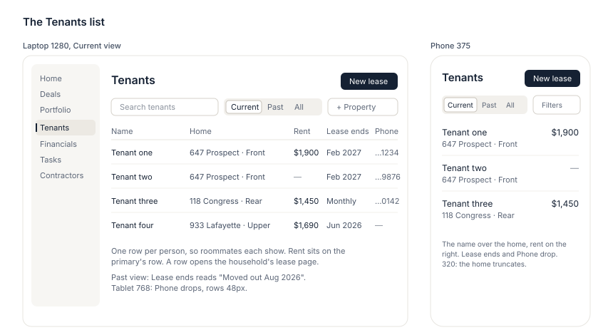
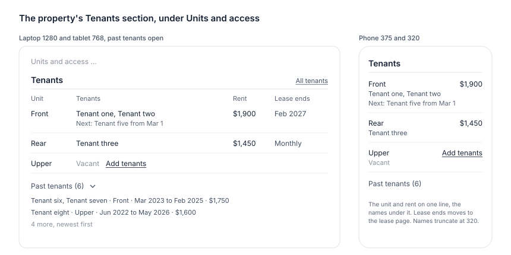
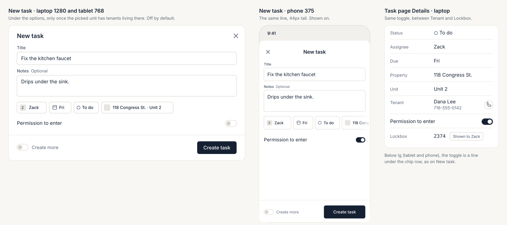

# Tenants and leases

Planned with Connor on Nov 14, 2026, one question at a time (T1 to T9 below). It merges [tenant-contact.md](tenant-contact.md), which another session planned with him the same day (Q1 to Q26): that spec's rules for what a contractor sees at an occupied home are kept as written, and its data model (a tenancy stored in the unit's JSON) is replaced by tenant and lease records. Connor said "merge here" on Nov 14, so this file is now the one spec for tenants; `tenant-contact.md` stays as the decision log.

Nothing here gets built until Connor says "build it" in chat. It also builds only after branch `design-calls-nov14` is on main (Q15), since that branch changes the portal job page and `properties/service.ts`.

## 1. Summary

**Why.** HG Capital has no record of its tenants. Their names, numbers and rent live in signed leases, in Baselane, and in task text such as a move-in report. Connor wants every tenant in the app, current and past, with what each one pays or paid, their contact info and their move dates, and he wants a contractor at an occupied home to know who they're dealing with.

**What changes.**

- A **Tenants** list of its own in the sidebar, under Portfolio, with Current, Past and All (T6).
- Each property gets a **Tenants** section under Units & access: one row per unit with everyone living there, the rent and when the lease ends, then its past tenants (T5).
- A **lease page** per household: everyone on the lease with their contact info, the rent with its Section 8 split, the deposit, each signed term with its PDF, the move dates and notes (T3, T7).
- Every person who lives in a unit is a tenant on its lease, and one is marked **primary** (T2, Q25).
- **The import** brings in every current and past tenant from Connor's Baselane export and the signed lease PDFs, after he checks the list (T4).
- **Contractors** at an occupied home see the tenants, and the lockbox only with permission to enter, exactly as `tenant-contact.md` sections 3 and 4 say (Q21 to Q26, T8).
- **Playbooks**: applying New Tenant creates the upcoming lease, and applying Move Out sets the move-out date (Q24, adapted).

## 2. Decisions

**From this round (Nov 14):**

| # | Decision |
|---|---|
| T1 | Tenants are records with their own list, not a field on the unit. Past tenants are kept. Supersedes Q1 and Q23's "lease terms stay in Baselane" |
| T2 | Everyone who lives in a unit is on its lease, and one tenant is the primary. Matches Q25 |
| T3 | Option B, the useful extras. Each tenant: name, phone, email (Connor dropped the emergency contact later on Nov 14). Each lease: everyone on it, rent with the Section 8 split, deposit, each signed term, move-in and move-out, the signed PDF, notes. No date of birth, ID numbers, income or employer |
| T4 | The import reads Connor's Baselane export and the signed leases. Connor checks the list before anything is saved |
| T5 | Option A on the property page: a Tenants section under Units & access, one row per unit, past tenants below |
| T6 | Tenants gets its own sidebar item under Portfolio, and the property page shows each property's tenants too. The list can be filtered by property |
| T7 | Option A: a click on a tenant opens the lease page for the household, from the list and from the property alike |
| T8 | Keep all five of the other session's calls: permission ends when a new household moves in; changing a job's unit or property clears it; changing the contractor keeps it; a repeat starts without it; Move Out sets the date for everyone on the lease |

**Kept from `tenant-contact.md`:** Q2, Q3, Q5, Q9, Q10, Q12, Q13, Q14 as updated by Q26, Q19, Q21, Q22, Q25, Q26, and Q24 with its saves made to leases (section 9). **Superseded here:** Q1 and Q17 (tenants live in leases, not in the Units editor), Q8 (staff add tenants from the property's Tenants section or New lease), Q23's dates move from the unit to the lease, and Q11's prefill reads the lease.

**Calls made in this spec, for Connor to check before "build it":**

1. A rent change at renewal is a new **term** inside the same lease, each with its own dates, rent and PDF. The lease is the household's stay; its terms are the leases they signed. So "what they were paying" keeps every rent, and a renewal doesn't look like a move.
2. A tenant's phone is optional. Leases often name a co-tenant with no number, and the import shouldn't drop them. The contractor sees a tenant without a phone by name only, with no icons. (Q25 had made both required.)
3. Up to 10 tenants on a lease.
4. Tenants show in global search (⌘K) by name, phone and email, and open their lease.
5. The Units editor doesn't get the tenant fields `tenant-contact.md` section 5 drew. Tenants are added from the property's Tenants section or New lease.
6. A unit with current or upcoming tenants can't be deleted: "Front has current tenants. End their lease first."

**From Nov 17 (Permission to enter, section 8):**

| # | Decision |
|---|---|
| T10 | Permission to enter belongs to the home, not to who goes. It shows on every open task at an occupied unit, whether it's assigned to a contractor, to staff or to nobody. For a contractor it adds the lockbox code to their job page. Staff see codes anyway, so for them it records that they can let themselves in. Supersedes "shows when a contractor is assigned" for the Access row (`tenant-contact.md` section 4) |
| T11 | New task gets a **Permission to enter** switch under its chip row, shown once the picked unit has tenants living there, off by default. Option A of two (B was an Access chip in the chip row) |
| T12 | The task page uses the same switch in Details, in place of the Tenant only and Permission to enter menu. Connor asked for "a toggle for permission to enter" on the details side |
| T13 | The switch is its label and nothing else: no line under it. Connor's copy rule, now in `CLAUDE.md` and `docs/copy-rules.md` |

**Calls for Connor to check before "build it" (Nov 17):**

7. The switch works with or without a lockbox code on file. With none, turning it on records the permission and the contractor still sees no code. (Was: disabled with "No lockbox code".) Permission now matters to staff too (T10), so it shouldn't depend on a code.
8. The task page drops `tenant-contact.md` section 4's status lines ("Tenants and lockbox shown to Zack"). The Lockbox row stays as built and keeps showing the code to staff; its "Shown to Zack" tag shows only while the contractor sees the code (a vacant unit, or permission on).
9. ~~The job page drops "The tenants said you can let yourself in" under the code.~~ Connor kept it (Nov 17, with "build it"): it stays under the code at an occupied home with permission, "The tenant said" with one person.
10. Toasts read "Permission to enter on" and "Permission to enter off", with Undo. The activity lines read "Connor turned on permission to enter", "Connor turned off permission to enter" and "Permission to enter was cleared when the unit changed".

## 3. Data

Three tables and a file table, all new. Money follows `Property` (`Decimal(12,2)`), and dates follow `Task.dueDate` (UTC midnight, read as a Buffalo day).

```prisma
// A person who lives, or lived, in one of HG Capital's units.
model Tenant {
  id             String   @id @default(cuid())
  fullName       String
  phone          String?  // as shown: "716-555-1234 ext 2"
  phoneE164      String?  // what Call and Text dial, from readPhone
  email          String?
  notes          String?  @db.Text
  createdAt      DateTime @default(now())
  updatedAt      DateTime @updatedAt
  leases         LeaseTenant[]

  @@index([fullName])
}

// One household's stay in one unit: from moving in to moving out.
model Lease {
  id         String    @id @default(cuid())
  property   Property  @relation(fields: [propertyId], references: [id], onDelete: Restrict)
  propertyId String
  unitId     String?   // the unit's id in Property.units; null on a property with no units
  unitLabel  String?   // the unit's label, kept current by writeUnits (renames follow unitId)
  movesIn    DateTime? // null: they live there now (an import with no date)
  movesOut   DateTime? // the day they leave; null until they give notice
  deposit    Decimal?  @db.Decimal(12, 2)
  notes      String?   @db.Text
  source     LeaseSource @default(APP)
  createdAt  DateTime  @default(now())
  updatedAt  DateTime  @updatedAt
  createdByUserId String?
  tenants    LeaseTenant[]
  terms      LeaseTerm[]
  files      LeaseFile[]

  @@index([propertyId, unitId])
}

model LeaseTenant {
  lease    Lease   @relation(fields: [leaseId], references: [id], onDelete: Cascade)
  leaseId  String
  tenant   Tenant  @relation(fields: [tenantId], references: [id], onDelete: Restrict)
  tenantId String
  primary  Boolean @default(false)
  position Int     // the order staff entered them; the primary shows first

  @@id([leaseId, tenantId])
}

// A signed lease: its dates and rent. Renewing adds a term.
model LeaseTerm {
  id       String    @id @default(cuid())
  lease    Lease     @relation(fields: [leaseId], references: [id], onDelete: Cascade)
  leaseId  String
  startsOn DateTime
  endsOn   DateTime? // null: month to month
  rent     Decimal   @db.Decimal(12, 2) // the whole monthly rent
  subsidy  Decimal?  @db.Decimal(12, 2) // the housing authority's share (Section 8); the tenant pays rent minus this
  subsidyFrom String? // "Buffalo Municipal Housing Authority"
  file     LeaseFile? @relation(fields: [fileId], references: [id], onDelete: SetNull)
  fileId   String?   @unique

  @@index([leaseId, startsOn])
}

// The signed PDFs, stored like PropertyAttachment (private Blob).
model LeaseFile {
  id               String   @id @default(cuid())
  lease            Lease    @relation(fields: [leaseId], references: [id], onDelete: Cascade)
  leaseId          String
  url              String
  pathname         String
  filename         String
  size             Int
  contentType      String?
  createdAt        DateTime @default(now())
  uploadedByUserId String?
  term             LeaseTerm?
}

enum LeaseSource {
  APP
  IMPORT
  PLAYBOOK
}
```

`Task` gains `entryPermittedAt DateTime?` and `SecurityEventKind` gains `TENANT_VIEWED`, exactly as `tenant-contact.md` section 2 says. One migration adds all of it. It's additive, and its `TENANT_VIEWED` line follows that section's note about Postgres enum values (55P04).

**Rules, in one service** (`src/lib/tenants/service.ts`, the only writer, per the README's rule that services own writes):

- Every lease has at least one tenant and exactly one primary. Removing the primary makes the next tenant primary; the last tenant can't be removed ("A lease needs at least one tenant. Delete the lease instead.").
- A tenant's name is required; the phone goes through `readPhone` from `src/lib/contractors/contact-fields.ts`, which also writes `phoneE164`, so it reads and dials like a contractor's (`PHONE_INVALID` on a number it can't read).
- `movesOut` comes after `movesIn` ("Move-out comes after move-in."). A term ends after it starts. Terms on one lease don't overlap.
- Two leases on one unit can't both be living there on the same day ("Another lease covers Mar 2025 at Front."). An upcoming lease may start the day the current one moves out.
- `subsidy` is at most `rent`.
- A tenant can be on more than one lease (moved units, or came back), and their contact info is the same record on each.

**Status, from dates alone** (`leaseStatus(lease, today)` in `src/lib/tenants/status.ts`, pure, with the Buffalo day):

```
past      = movesOut set and movesOut <= today
upcoming  = movesIn set and movesIn > today
current   = otherwise
```

**Who lives there today** replaces `tenant-contact.md`'s `livingThere(unit, today)`: `livingLease(leases, unitId, today)` returns the unit's current lease or null. Everything in that spec that read the unit's tenancy reads this instead: `accessState`, the task page's Tenants row, the job page, the playbook prefill. Its rule for a property with no unit picked (Q9) is unchanged: a single-unit property uses its one unit (house-meter rows don't count), and a multi-unit building shows no tenants.

**Rent today**: the term whose `startsOn` is on or before today and whose `endsOn` is blank or on or after today. After the last term ends with nobody moving out, the lease reads "Month to month since Feb 28, 2027" and the last term's rent stands.

**Units.** `writeUnits` in `src/lib/properties/service.ts` (the one write to the units list) gains two steps inside its transaction: a rename updates `Lease.unitLabel` where `unitId` matches, as `renameTaskUnits` does for tasks, and a delete is refused while the unit has a current or upcoming lease (call 6). Units that predate unit ids have none until their property's next units save, and the pickers name them by a placeholder (`unit-at-<index>`). So creating a lease runs that save's id step first (`ensureUnitIds` in `src/lib/tenants/core.ts`): every unit on the property gets a lasting id, nothing else in the list changes, and a placeholder pick turns into its unit's new id. It bumps the property's `updatedAt` on purpose, so an editor still holding placeholders is refused and reloads instead of giving the units new ids under a lease. The import does the same (section 10).

## 4. The Tenants list



A new route, `src/app/(app)/tenants/(list)/page.tsx`, beside Contractors' and built the same way.

- **Sidebar:** "Tenants" with lucide `Users`, right under Portfolio in `src/components/nav.tsx`, with `list: "tenants"` so the link remembers its filters (`src/lib/list-memory.ts`). The phone drawer gets it in the same place. Global search's Go list (`src/lib/commands.ts`) gets "Tenants".
- **The bar** (`FilterBar` in a `FilterScope list="tenants"`): search (name, phone, email, address, unit), views **Current**, **Past** and **All** (a segmented control, Current by default), and a **Property** facet. Sort: Home (the default, street order then unit), Name, Rent, Lease ends.
- **Rows: one per tenant**, so everyone in a unit shows. Columns: **Name** (the primary has no badge here; the lease page says it), **Home** ("647 Prospect · Front"), **Rent** (the whole rent, on the primary's row only; the others show "—" in `--muted-foreground`), **Lease ends** ("Feb 2027", "Monthly", or in Past "Moved out Aug 2026") and **Phone** (`num`, `--fg-2`). A row opens its lease (`TaskRow`-style whole-row link).
- **New lease** is the header's button, as New contractor is on Contractors.
- **Empty states:** Current with no tenants reads "No current tenants yet." with New lease; a search with nothing reads as Contractors' does.
- **Sizes.** Laptop 1280: every column. Tablet 768 (touch): Phone drops, rows 48px. Phone 375: each row is the name over the home, with the rent on the right; Lease ends and Phone drop. Phone 320: the same, the home truncates. The bar collapses into its Filters button as Contractors' does.

## 5. The property's Tenants section



A new `TenantsSection` in `src/app/(app)/properties/[id]/`, right under `UnitsSection` in the main column.

- **One row per rentable unit**, in the units' order (house-meter rows skipped; a property with no units gets one row, "Home"). Columns: **Unit**, **Tenants** (the primary first, everyone else after, comma-joined, truncating), **Rent** and **Lease ends**. A row opens the lease.
- **A vacant unit** reads "Vacant" in `--muted-foreground` with an **Add tenants** verb (`RailVerb`-style), which opens New lease with the property and unit picked.
- **An upcoming lease** shows as a meta line under its unit: "Next: Ana Ruiz from Feb 1". On a vacant unit it takes the row instead: "Ana Ruiz · moves in Feb 1".
- **Past tenants (6)** is a ghost button under the rows that opens the list in place: one line per past lease, newest first, "Amy Chen, Bo Chen · Front · Mar 2023 to Feb 2025 · $1,750", each opening its lease. It stays open for the visit.
- The section's own header link "All tenants" opens the Tenants list filtered to this property.
- **Sizes.** Laptop 1280 and tablet 768: the four columns. Phone 375 and 320: each row is the unit and rent on one line, the names under it; Lease ends moves to the lease page.

## 6. The lease page


`src/app/(app)/tenants/[id]/page.tsx`, where the id is the lease's. A record page on the task page's grid: main column and a 320px Details rail from lg, a chip row below that.

- **Header:** the back link "Tenants", a status mark (Current, Upcoming or Past, from `leaseStatus`, using `StatusMark`'s ring family: Upcoming the clock, Current the half ring, Past the slashed ring) and the title "647 Prospect · Front", whose address links to the property. The ⋯ menu: Copy link, and Delete lease (confirm: "Delete this lease? Its tenants stay in the app, but this stay, its terms and its files go for good.").
- **Tenants** section: one row per person, the primary first with a "Primary" tag (`tagClass`). Each row: the name over the phone and email as meta. Call, Text (touch only, Q13) and Email icon links on the right, as on a contractor's record. A click on the row opens the person's sheet (`FormSheet`): name, phone, email, notes, "Make primary", "Remove from lease". **Add tenant** under the rows opens the same sheet empty, or lets staff pick someone already in the app.
- **Terms** section: one row per term, newest first: "Mar 1, 2026 to Feb 28, 2027 · $1,900", with "Tenant pays $400 · Housing authority $1,500" under it when there's a subsidy, and the signed PDF as a file link on the right (the files list's row). **Renew** adds a term starting the day after the last one ends, prefilled with its rent. A row opens its term to edit, with **Delete term** and Undo ([lease-term-edits.md](lease-term-edits.md), Nov 16).
- **Notes**: `InlineField` multiline, as on the task page.
- **Earlier at this unit**: the unit's other leases, one line each as on the property page.
- **The Details rail:** Property, Unit, Moved in, Moves out ("Leave blank until they give notice"), Rent, Tenant pays, Housing authority, Deposit and Term ends, each an `InlineField` fact that saves at once with a toast and Undo. Rent, the split and Term ends edit the current term.
- **Moving out**: setting Moves out on a current lease reads in the toast "Dana Lee and Sam Lee move out Jan 31" and the unit turns vacant for contractors that day.
- **Sizes.** Laptop 1280: the rail on the right. Tablet 768 and phones: the facts become the chip row under the title, as on the task page, and the sections stack. Phone 320: the chip row scrolls sideways.

## 7. New lease

`src/app/(app)/tenants/new/page.tsx`, a page like New contractor, opened from the list's button, a vacant unit's Add tenants, or the property's section.

- **Where:** Property and Unit pickers (`PropertyPicker`, `UnitPicker`), prefilled from the link.
- **Tenants:** one row per person (name, phone, email), the first one primary, **Add another tenant** up to 10, each row removable. Typing a name offers people already in the app (a returning tenant).
- **Dates:** Moves in, then the first term's Starts and Ends, with **Month to month** leaving Ends blank.
- **Money:** Rent, **Housing authority pays (optional)** with who pays it, and Deposit.
- **Signed lease:** an optional PDF, through the upload queue as documents are.
- **Save** lands on the new lease page with a toast that names what's next: "Lease saved. Dana Lee shows on jobs at Front from Feb 1."
- **Sizes.** Laptop 1280 and tablet 768: pairs of fields side by side, as New contractor lays them out. Phones: stacked.

## 8. Tasks and the job page

`tenant-contact.md` sections 3 and 4, with these changes:

- **The source.** The task page's Tenants row and the job page read `livingLease`'s tenants. The rail's "Edit on the property" becomes **Open lease**, to the lease page.
- **No phone** (call 2): a tenant without a number shows by name only, with no icons, on both pages.
- **Any assignee** (T10). The task page's Tenants row and the Permission to enter switch show on every active task at an occupied unit, whoever it's assigned to. The job page's rules don't change: only the assigned contractor sees the tenants or the code, and only while the job is open.
- **A switch, not a menu** (T12, T13). In Details, the Access row's chip and menu become a stock `Switch` labeled "Permission to enter", with nothing under it, between Tenant and Lockbox. At lg it's a rail row, the label on the left and the switch on the right, saving on toggle through `InlineSwitch` and `patchTask({ entryPermitted })`. Below lg it's a line under the chip row, as on New task. A vacant unit has no switch. Drawn in [tenants/04-permission-to-enter.svg](tenants/04-permission-to-enter.svg).
- **The Lockbox row** stays as built ("2374 · Shown to Brandon", Nov 14) and keeps showing the code to staff. Its tag shows only while the contractor sees the code (call 8). The status lines are dropped.
- **The job page** keeps the line under the code (call 9, as Connor kept it). Since Nov 22 it is Getting in's entry line, "Let yourself in" over "The tenant said it's OK", above the code (docs/specs/contractor-scheduled-date.md section 12).

The write, the ACCESS events (with the lines in call 10) and the `#access` anchor in job emails are otherwise unchanged. The five calls in T8 hold.

### New task (T11)



- **When it shows.** Once the picked unit has tenants living there today, by `livingLease`. With no unit picked, a single-unit property uses its unit (Q9). Whoever the assignee is (T10). A vacant unit, a building with several units and none picked, or no property: no switch.
- **The look.** Option A: the stock `Switch` ("Permission to enter", nothing under it) as a full-width line under the chip row, 32px with a mouse and 44px on touch. The same at laptop 1280, tablet 768 and phones 375 and 320; nothing drops on a phone.
- **Off by default.** Changing the property or unit turns it off (T8), and it shows again only if the new unit has tenants. The draft keeps it with the unit; a restored draft keeps it on only if that unit still has tenants.
- **The lookup.** Picking a unit, or a single-unit property, calls a server action that answers one yes or no: whether tenants live there today. No names, numbers or lease fields reach the form.
- **The write.** The form posts `entryPermitted=on` only while the switch shows. `createTask` checks occupancy again on the server and sets `entryPermittedAt` to `now()` only at an occupied unit, writing the same INTERNAL ACCESS event the task page writes, in the create's transaction. No email or notice.
- **Make task** from Missing info opens this form, so it gets the switch. Playbook Apply, the move-in form and repeats don't (a repeat starts without permission, T8).

## 9. Playbooks

`tenant-contact.md` section 6, with the saves going to leases:

- **The prefill** reads the unit's current lease: `[Tenant]` gets the names joined, the phone fill-ins the primary's phone. A move-in playbook prefills nothing.
- **Move-in playbook:** the checkbox, ticked by default, reads "Create a lease for Dana Lee at Unit 2, moving in Feb 1". Apply creates an upcoming lease (`source: PLAYBOOK`) with that one tenant, the playbook's date as Moves in, and no term yet. The lease page asks for the rest ("Add the signed lease to record the rent.").
- **Move-out playbook:** "Set Dana Lee and Sam Ortiz to move out Jan 31" sets the current lease's Moves out (T8: everyone on it).
- Both write through the tenants service in Apply's one transaction, so a refused save creates no tasks.

## 10. The import

A one-time script, `scripts/migrate/04-tenants.ts`, beside the other migrations, run in three steps.

1. **Connor drops the files** in `_private/tenants/` (gitignored): Baselane's tenant or lease export (CSV or Excel; screenshots work if there isn't one) and the signed lease PDFs, old ones included.
2. **The build reads them into one review file**, `_private/tenants/review.csv`: one row per person per lease, with the property, unit, primary, phone, email, move dates, each term's dates and rent, the subsidy, the deposit and the PDF it came from. Baselane wins on contact info; the signed lease wins on names, dates and rent. Gaps and disagreements are flagged in a last column ("No phone", "Baselane says $1,850, lease says $1,900"). Connor checks it and fixes what's flagged.
3. **The script imports the checked file**, first as a dry run that prints what it would create, then for real against local and, with Connor's go-ahead, production. It's idempotent: it matches a lease by property, unit and move-in, and a tenant by name and phone, so a second run adds nothing. It first saves each touched property's units once so every unit has an id. PDFs upload to Blob as `LeaseFile`s. Every row is `source: IMPORT`.

## 11. Privacy

- Tenants, leases and files are staff-only: every route under `/tenants` and every action calls `requireUser`, and no portal file imports `src/lib/tenants`. `src/lib/auth-guard.test.ts` gains that check beside its `units` one.
- The portal reads tenants only through `access-code.ts`'s `readJobAccess`, as `tenant-contact.md` section 7 says: names and phones of the living lease's tenants for one job, never rent, deposit, email, emergency contacts, notes, files or any other lease.
- Lease PDFs are private Blob files served through a session-checked route, like property documents.
- Nothing is sent to tenants (Q5).

## 12. Files

| Area | Files |
|---|---|
| Schema | `prisma/schema.prisma`, one migration |
| Tenants | `src/lib/tenants/service.ts`, `status.ts`, `queries.ts` and their tests; `src/app/(app)/tenants/(list)/page.tsx`, `filters.tsx`, `loading.tsx`, `query.ts`; `src/app/(app)/tenants/[id]/` (page, sections, actions, loading); `src/app/(app)/tenants/new/` |
| Navigation and search | `src/components/nav.tsx`, `src/lib/list-memory.ts`, `src/lib/commands.ts`, `src/lib/search.ts` and the search route |
| Property | `src/app/(app)/properties/[id]/page.tsx`, a new `tenants-section.tsx`, `src/lib/properties/service.ts` (`writeUnits`) |
| Access rules | everything in `tenant-contact.md` section 8's Rule, Portal and Task page rows, reading `livingLease`; the Details switch in `src/app/(app)/tasks/[id]/fields.tsx` |
| New task | `src/app/(app)/tasks/new/new-task-fields.tsx` and `actions.ts`, `src/lib/tasks/new-task-schema.ts`, `src/lib/tasks/core.ts` (`createTask`), the occupancy lookup action |
| Playbooks | as `tenant-contact.md` section 8, plus the tenants service |
| Import | `scripts/migrate/04-tenants.ts` |
| Devices | `tests/devices/routes.ts` (`SAMPLE_PARAMS` for `tenants/[id]`) |
| Docs | `docs/components.md` if `TenantsSection` or the person sheet turns general; `docs/specs/README.md` |

**Tests.** `leaseStatus` and `livingLease` across move dates, Buffalo midnight and back-to-back leases; rent today across terms and month to month; every service rule in section 3 with its message; `writeUnits` renaming a lease's unit and refusing a delete; the import matching a second run to nothing; the access tests of `tenant-contact.md` section 8 rewritten for leases; the auth guard.

**Checks.** `npm run typecheck`, `npm run lint`, `npm test` and the device check, plus by hand at 375 and 320: the list in each view, a property with a vacant unit and past tenants, a lease with three tenants and a subsidy, New lease, and the job page occupied, with permission and vacant.

## 13. Reuse check

| | What |
|---|---|
| **Reused** | `FilterScope`, `FilterBar` with views and a facet, `ResultLine`, `SortHeader`, list memory and the sidebar's `list` link (Contractors' list); `PropertyPicker`, `UnitPicker`; `InlineField` facts and notes; the record grid and Details rail (the task page); `Section`, `FormSheet`, `FormField`, `DateField`, `tagClass`, `StatusMark`, `ConfirmDialog`, `Menu`; the files list and private Blob uploads (property documents); `readPhone`, `telHref`, `textHref`; `Money`; `Switch` and `InlineSwitch` for Permission to enter |
| **Extended** | `writeUnits` (lease labels, the delete refusal); global search (tenants); `auth-guard.test`; everything `tenant-contact.md` section 9 extends, reading leases; New task's form and `createTask` (`entryPermitted`) |
| **New** | `Tenant`, `Lease`, `LeaseTenant`, `LeaseTerm`, `LeaseFile`; the tenants service, `leaseStatus`, `livingLease`; the Tenants list, `TenantsSection`, the lease page, New lease; the import script |

**References.** Mobbin has no landlord apps, so the list follows Contractors and the lease page follows the task page. Rent roll rows follow [Zillow's units table](https://mobbin.com/screens/62ef5ddd-0469-4cc8-bdaa-5eefe66dd0f8) (unit, then the money and the date per row). The contact rows and the job page keep `tenant-contact.md` section 9's references. Permission to enter (Nov 17) follows a control that shows up only when it applies, as in [Basecamp's New card](https://mobbin.com/screens/56f50dc4-7b99-409c-9d84-4bd6795fb5f3), and access switches as label-and-switch rows, as in [this sharing sheet](https://mobbin.com/screens/f05509aa-9842-4767-9de9-6694b61e8f68). The chip it beat follows [Linear's New issue](https://mobbin.com/screens/7d2d62c7-8fb9-40d8-bd36-f1a8ff0a860c).

## 14. Build

After `design-calls-nov14` is on main and Connor says "build it". One package in its own worktree, in four steps, each checked before the next:

1. Schema, the tenants service and its rules, `writeUnits`, and the import script with a dry run on local data (Opus: data and migrations).
2. The Tenants list, the property's section, the lease page and New lease (Sonnet build, Opus review at every size).
3. The access rules from `tenant-contact.md`, reading leases, with section 8's Nov 17 changes: the switch in Details and on New task (Sonnet build, Opus review on privacy).
4. Playbooks, then the import for real once Connor has checked `review.csv`.

About five hours of build and checks, plus Connor's time on the review file.

## 15. Build notes (Nov 14)

Part one (section 14's steps 1 and 2, and search) is built. What it decided inside the spec:

- **Tenant pays** shows in the lease page's rail only when a housing authority pays part; without one it would repeat the rent. The term rows still say both when there's a split.
- **Moved in** reads **Moves in** on an upcoming lease.
- **Signed leases upload per term**: each term row has "Add the signed lease", or the file with Replace, through a new `lease-upload` kind (one queue target per term, the lease's own Blob folder, staff only). A replaced file stays on the lease, unlinked.
- **Search** shows a tenant with the initials avatar contractors use, a "Past" tag on a past tenant, and their most relevant lease as the second line. Tenants aren't in Recent yet: `RecentKind` is a Postgres enum, so that waits for a migration.
- **New lease** doesn't yet offer someone already in the app as you type a name (the service takes `{ tenantId }`, so it's a UI add). The lease page's Add tenant is new people only, for the same reason.
- **The lease page's tab** reads the home ("647 Prospect Ave. · Front"), through a new `lease` record kind.
- **No emergency contact** (Connor, Nov 14, after the build): migration `20261115170000_drop_tenant_emergency_contact` drops the two columns; the sheet, the lease page and the import no longer have them.
- **The term forms ask for the two parts** (Connor, Nov 14): New lease and Renew ask **Tenant pays** and **Housing authority pays**; the term keeps the whole rent, their sum (`rentFromParts` in `src/lib/tenants/fields.ts`). Renew prefills both from the last term, so renewing on the same terms keeps the same rent. No "Saves as" line under the amounts.
- **The housing authority's contact** (Connor, Nov 14): each term keeps the caseworker's name and email (`subsidyContact`, `subsidyEmail`, migration `20261115170100_lease_term_subsidy_email`), kept only with a share, like who pays. New lease and Renew ask for them under Who pays; Renew prefills them from the last term. The lease page's rail shows Who pays, Contact and Contact email under Housing authority, each saving inline, with a mail link beside the email. The import reads optional `subsidy_contact` and `subsidy_email` columns; leases already imported skip, so their contacts go in from the rail.
- **Any term edits, and a term deletes** (Connor, Nov 16, [lease-term-edits.md](lease-term-edits.md)): a term row opens that term in the Renew sheet's fields, titled with its dates, and Delete term removes it with Undo. Its signed lease stays on the lease, unlinked. A lease's only term can go.
- **The import ran on Nov 14**: 31 leases, 60 people and 38 terms into production from Connor's checked file (Cowork's export, with his corrections), without PDFs. The import now merges rows with the same name on one lease into one person, checks every term and stay overlap in the dry run, reads a file by any name (`--file`), runs without PDFs (`--skip-files`) and prints the database it's about to use.

## 16. Build notes (Nov 17)

Section 14's step 3, with section 8's Nov 17 changes, is built. Connor said "build it" on Nov 17 and kept "The tenants said you can let yourself in" (call 9). Calls 7, 8 and 10 shipped as written. Playbooks (step 4) aren't built yet. What the build decided inside the spec:

- **One rule, two readers.** `src/lib/tasks/lockbox.ts` gains `tenantUnit` (whose home a job is in: its unit by label, or a property's one rentable unit) and `accessState` (occupied, permitted, and whether the lockbox shows). The portal reads through `access-code.ts` `readJobAccess`; staff read through a new `src/lib/tenants/living.ts` `readTaskHome`, which the auth guard keeps out of portal code. Both decide through `accessState`.
- **The lockbox photo** (`/api/files/lockbox/<job>`) follows the code: a contractor gets it only while their job shows the code.
- **Show access** in a job email shows when the job page would show the tenants or the lockbox, and opens at `#access`, which lands on Tenants, or on Lockbox with nobody living there. Emails already sent with `#lockbox` still land on Lockbox.
- **Share with crew** (it was Text to my crew) says "Details, photos and updates" whatever the job shows; the link shows the lockbox only when the contractor's job does (changed Nov 22).
- **The task page's Tenants row** links each name to the lease (T7) rather than adding an Open lease line in the rail; the chip's menu below lg ends in Open lease. It shows on any task whose home has a household on file, open or closed.
- **The Lockbox row** still shows only with a contractor assigned, as built Nov 14. Staff see the code there whether or not the contractor does.
- **The switch** writes through `patchTask({ entryPermitted })`, which compares with whether permission holds for the household there now. So after a new household moves in it reads off, and turning it on stamps the day again. A unit or property change clears it; the line names the change only when the permission still held.
- **New task** asks a staff action (`homeHasTenants`) for a yes or no when a home is picked, and `createTask` checks again before it saves.


## 17. Build notes (Nov 20)

The rest of section 14: the property's Tenants section (section 5), the units rules (section 3, "Units", and call 6) and playbooks (section 9). Connor said "build it here" on Nov 20. What the build decided inside the spec:

- **The units write moved** into `src/lib/properties/units-write.ts` (`writeUnitsTx`), so a database test can load it, as `listing-clean.ts` did. `service.ts` still opens the transaction, trims what the editor sent and revalidates.
- **Renames follow by id.** Every units save brings `Lease.unitLabel` in line for each lease whose unit is still listed, past leases included, matched by `unitId`, so two units swapping names swap their leases. A lease on a deleted unit keeps its last label.
- **The delete refusal** names the unit: "Front has current tenants. End their lease first." With only an upcoming household: "Front has tenants moving in Dec 1. Delete their lease first." A unit with only past leases can be deleted. The line shows inside the Delete unit confirm, where it can be read, not under the section behind the scrim.
- **One lock for the property's leases and units.** A units save takes the property row `FOR UPDATE` before it reads; every lease write that reads the units (`ensureUnitIds`, so New lease, a draw, the import and a playbook) takes it `FOR NO KEY UPDATE` first, and so does a lease date change. So a unit can't be deleted between a lease's check and its insert, and two lease writes on a property take turns past the overlap check.
- **A past lease on a deleted unit stays ended.** Changing its dates so it would be current or upcoming is refused: "Front isn't on the property anymore, so this lease stays ended."
- **The Tenants section** follows the drawing at 1280 and 768. On a phone each past lease reads as two lines, the names and then "Unit 2 · Jun 2025 to Jul 2026 · $900", so the dates and rent aren't cut. "All tenants" shows only once the property has a lease. Units saved before ids existed get the same `unit-at-<index>` placeholders New lease uses (`src/lib/tenants/unit-slots.ts`), so their Add tenants links pick the unit.
- **Playbooks.** The Apply logic moved into `src/lib/tasks/templates-core.ts`, as `bulk-core.ts` did. The move-in box shows once the tenant's name is filled in: a lease doesn't need a phone (call 2), so a blank Tenant number doesn't hide it. Apply locks the property row first, so a retried Create waits and is refused rather than making a second lease. A refused lease write shows one short line under the box ("Unit 2 has another lease then.", "They moved in Jun 1, 2025.", "Next tenants move in before that.") with "Untick the box to apply without it." after it ("Untick to skip it." on a phone).
- **Shared helpers.** "Dana Lee and 2 others" is `shortNames` in `src/lib/names.ts`, used by the lease page's move-out toast and the playbook boxes. The names join reuses `joinNames`.
- **Not done:** the lease page still prompts "Add the signed lease" rather than the section's "Add the signed lease to record the rent."; the lease PDFs from Drive aren't attached.
