# View as a contractor

Planned with Connor on Nov 14, 2026. Nothing here gets built until Connor says "build it" in chat.

## Summary

**What it is.** On a contractor's page in the staff app, Connor opens the ⋯ menu and picks "View as Zack". The contractor portal opens at /p and shows that person's jobs, notes, photos, lockbox codes and updates as they see them. An ink bar across the top says whose view it is. Nothing can be changed, and nothing on the contractor's record shows that anyone looked. Exit goes back to the contractor's page, or to the Contractors list if the view had already ended.

**Why.** The top portal risk is a contractor seeing something private, and nothing in the app shows a contractor's real view today (review [IA-038][ia]).

**How a view ends.** There is no timer. A view ends when Connor:

- presses Exit on the bar, or Sign out in the portal's menu;
- signs out of the staff app in that browser, or signs in there again;
- starts another view, on any device.

It also stops when his staff sign-in in that browser runs out, at most 30 days after he signed in.

**Every choice is made.** Connor answered in three rounds. The last one, on Nov 14, added decisions 11 to 14.

## 1. Decisions

The fourteen decisions are Connor's, as he made them.

| # | Decision |
|---|---|
| 1 | Contractors only in this version. It is built so other kinds of people (the other partner, tenants later) can be added without redoing it |
| 2 | View only. While viewing, nothing can be saved, sent, uploaded, ticked or changed as the contractor |
| 3 | No trace on the contractor's record. Looking never marks their jobs seen, never moves their "Last seen", and never logs a lockbox view under their name. The contractor is not told. One record on our side says who viewed whom and when |
| 4 | Any contractor on file can be viewed: with a login or without one, invited and not yet signed in, access turned off, inactive, and archived |
| 5 | The real portal pages at /p, not a look-alike page in the staff app |
| 6 | It starts from the contractor's own page in the staff app: one item, "View as Zack", in the page's ⋯ menu, which every contractor has. Only Connor ever sees it. No picker in the account menu |
| 7 | An ink bar across the top of every portal screen, pinned while scrolling, with the page's own header under it. Desktop and tablet: "Viewing as Zack Reading" and "View only", with Exit at the right-hand end, plus No login yet, Invited, Access off or Archived when the person cannot sign in. Phone: "Viewing as Zack" and Exit |
| 8 | The contractor's action controls (Start job, Mark done, Send, checklist ticks, Add photo and the rest) are drawn as the contractor sees them but greyed out, with a one-line reason. Even if a button is forced back on, the app refuses the change |
| 9 | No timer. A view lasts until he presses Exit |
| 10 | Only Connor's account can use it. It is switched on for him directly in the database, once on the local copy and once on the live app, and only with his OK. No screen can turn it on for anyone |
| 11 | On a job, "View only" shows once, as one line under the greyed bottom buttons. The update box and the checklist heading do not repeat it (choice 1, option A, image 08) |
| 12 | The full-screen photo viewer stays as it is. It covers the bar while a photo is open, and closing it brings the bar back (choice 2, image 09) |
| 13 | On a wide window the bar's words and Exit sit at the window's edges, so the bar never moves between pages (choice 3, option A, image 11) |
| 14 | Exit pressed on a bar whose view already ended somewhere else lands on the Contractors list, not on that contractor's page, because once a view has ended, that browser no longer keeps whose it was (section 2.5) |

**Defaults he was told about and did not object to.**

- Exit returns to that contractor's page in the staff app. The one exception is decision 14.
- Sign out in the portal's account menu does the same thing during a view.
- The list of files is the contractor's, but opening a file uses Connor's own staff access, so a file could open for him that would not open for the contractor. This is accepted (section 7).
- The record is who viewed whom, with a start and an end. It does not list which jobs were opened.

**What "until I exit" means.**

- A view works only while Connor is signed in as staff in that browser. Copying the view to another browser shows nothing unless he is signed in there as staff too.
- A view ends when he presses Exit, uses Sign out in the portal menu, signs out of the staff app in that browser, signs in again in that browser as anyone (himself included), or starts another view anywhere.
- It also stops working when the staff sign-in it was started under runs out, which is at most 30 days after he signed in. That is his sign-in ending, not a timer on the view.
- Connor can have one view open at a time. Starting a new one on any device ends the old one, which is also how he ends a view left open somewhere else.
- If a view is never ended in any of these ways, the record shows its start and the moment that staff sign-in ran out, the latest the view could have worked. It does not show when he stopped looking.

## 2. What Connor will see

The layouts are image files in [view-as/](view-as/).

### 2.1 Starting a view

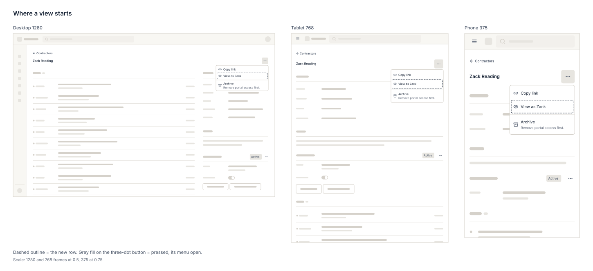

The ⋯ menu on a contractor's page with "View as Zack" as its second row, under Copy link. At 1280 the menu hangs from the ⋯ at the end of the title row with 32px rows. At 768 and 375 it is the same anchored menu with 44px rows, and nothing drops on a phone.

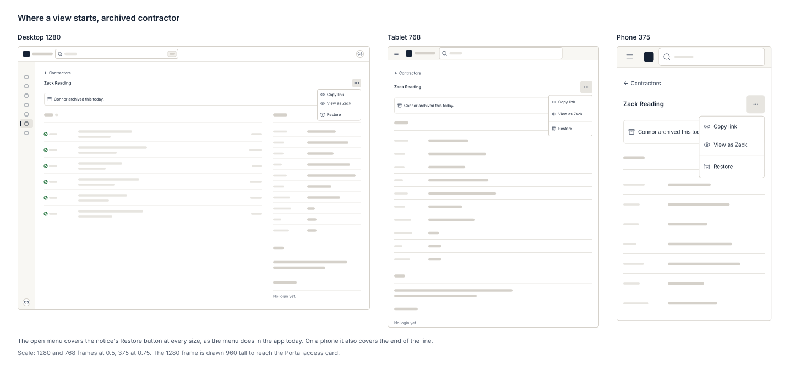

The same menu on an archived contractor: the last row reads Restore, and the Archived line sits under the name. The three sizes behave as in image 01.

- The item is one more row in the existing menu ([`RecordMoreMenu`][record-archive], lines 46 to 101), mounted once for every size at [the contractor page][contractor-page]:127-134. The page has it for every contractor, archived ones included.
- The label is "View as" and the person's first name from the record (`firstName` in [names.ts][names], falling back to the full name, as the Portal access card does at [portal-access-card.tsx][access-card]:117). The icon is lucide Eye.
- It shows only for the account that holds the flag, and only where the portal is turned on. The other partner never sees it, and calling the action directly answers Not found.
- With the portal off the item is hidden (a control that can only refuse is a dead control, the rule at [access-state.ts][access-state]:61-67). A tab loaded before the setting changed gets the toast "The portal is off. Turn it on."
- Pressing it goes through the same guard Sign out uses, so staff uploads still going up ask first ([account-menu.tsx][staff-account-menu]:47-62).
- It lands on My jobs at /p as that person.

### 2.2 The bar

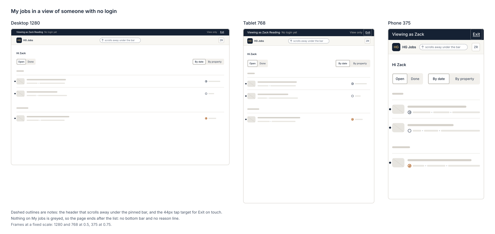

My jobs as Zack sees it, under the ink bar. At 1280 and 768 the bar reads "Viewing as Zack Reading · No login yet" at the leading edge and "View only" and Exit at the trailing edge. At 375 it reads "Viewing as Zack" and Exit; "View only" and the state words drop on a phone.

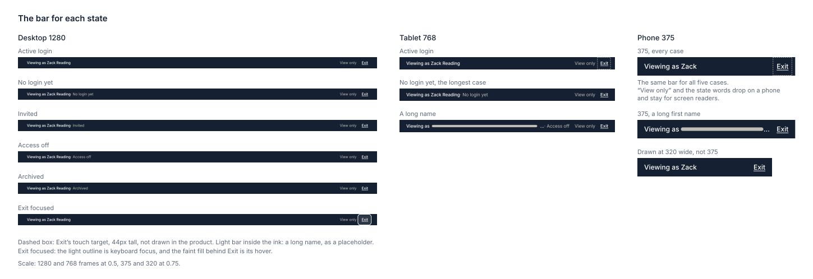

The bar by itself for each case: an active login (name only), No login yet, Invited, Access off and Archived, then the phone bar at 375 and at 320, and a long name. At 1280 and 768 a long name truncates first and the fixed words never do. At 375 and 320 only the first name and Exit show.

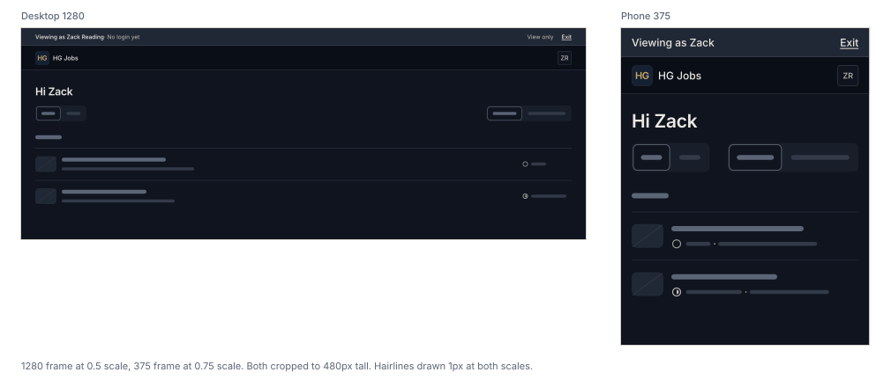

The bar over My jobs in dark theme, at 1280 and at 375, with its 1px edge. The 768 bar is the 1280 bar on a 44px row.

- The bar is drawn once by the portal layout, above every portal page. It is pinned to the top while the page scrolls.
- Ink is the toast material: `--toast-bg` ground, `--toast-fg` words, `--toast-fg-2` for the state words and "View only", and a 1px `--toast-edge` rule along the bottom that shows only in dark ([globals.css][globals]:48-51, 77, 133-136, 146). Exit is drawn as the toast's Undo, from the same class list (section 3).
- Height is 40px with a mouse and 44px on touch. Gutters are 16, 24 and 32, the page's own.
- Type: the toast's size, 13px with a mouse and 16px on touch. "Viewing as Zack Reading" and Exit are weight 500; the state words and "View only" are 400 in `--toast-fg-2`. Exit's underlined word ends on the gutter at every size.
- The state words sit beside the name, after a middle dot, because they are about the person. "View only" and Exit sit together at the trailing edge.
- The words come from the same source as the Portal access card, so the card and the bar cannot disagree (section 5.8). Archived speaks alone: an archived person has no working login either way.
- A person who cannot sign in is shown what they would see with a working login. On desktop and tablet the bar says which case it is. On a phone it does not, by Connor's choice. The dropped words stay in the markup for screen readers.
- On the job page, the page's own header stays pinned directly under the bar. On My jobs the header is not pinned today ([page.tsx][my-jobs-page]:22), so it scrolls away under the bar.
- The bar's ink runs the window's width in every case (decision 7). Decision 13, below, is where its words sit.
- By date or By property is a setting kept in Connor's own browser ([my-jobs.tsx][my-jobs]:83-88). A view shows his last choice, and changing it changes his.
- The greeting reads "Hi Zack", the viewed person's first name. Their own entries in Updates read "You", as they do for them.

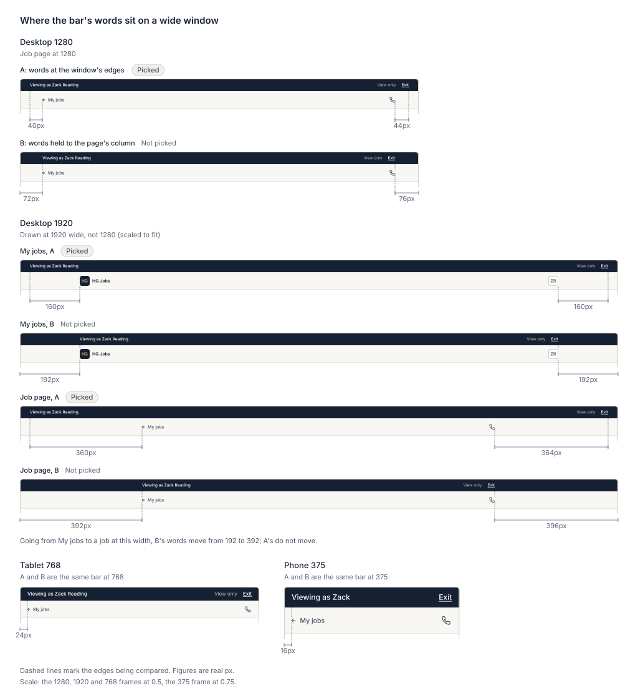

Choice 3, decided as A: the job page at 1280, then My jobs and the job page at 1920, each with the bar's words at the window's edges (A, picked) and held to the page's column (B, not picked). At 768 and 375 the two options are the same bar, because no column is capped below 1200.

- **A (picked): the words sit on the window's gutters.** Circle's and Stripe's bars do this in the research's captures, and so does the staff app's own bar over its capped pages ([app-shell.tsx][app-shell]:170). The bar never moves between pages. The cost: on a wide window its words start left of the page under it. On My jobs the two edges match up to 1600 wide ([page.tsx][my-jobs-page]:23). On the job page the header sits in a centered 1200 column ([page.tsx][job-page]:66), so the words start at 32px against the back link's 72px at 1280, and at 32px against 392px at 1920.
- **B (not picked): the words are held to the column of the page under the bar.** They line up with that page's header at every width. The cost: on a wide window the name and Exit shift inward when Connor goes from My jobs (1600) to a job (1200), and the layout has to learn each page's column (not needed under A, section 5.8).
- The figures are arithmetic from the classes. Nothing was rendered.

### 2.3 The greyed controls

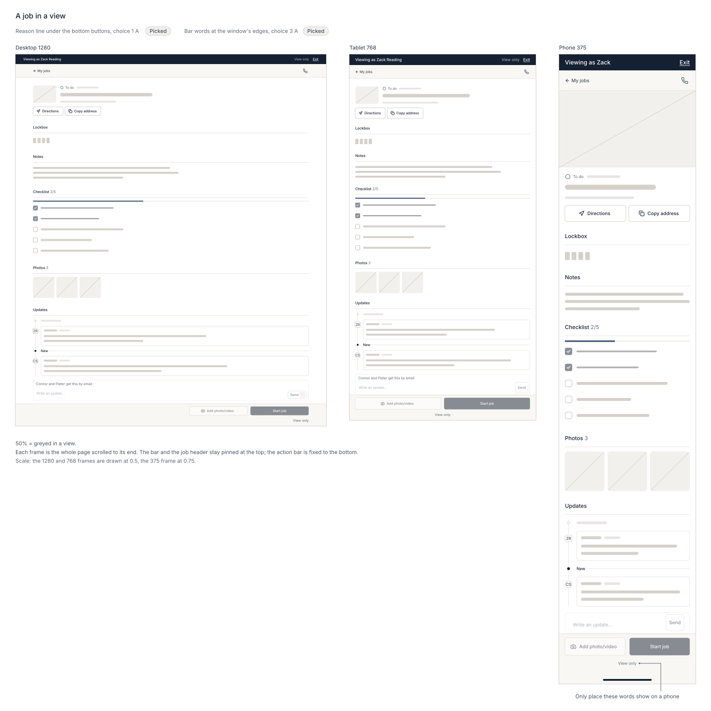

An active job (To do) as Zack sees it. At 1280 the two bottom buttons sit at the trailing end, greyed, with "View only" right aligned under them. At 768 and 375 they share the width and the line is centered under them. On a phone the bar's "View only" drops, so this line is the only place the words appear.

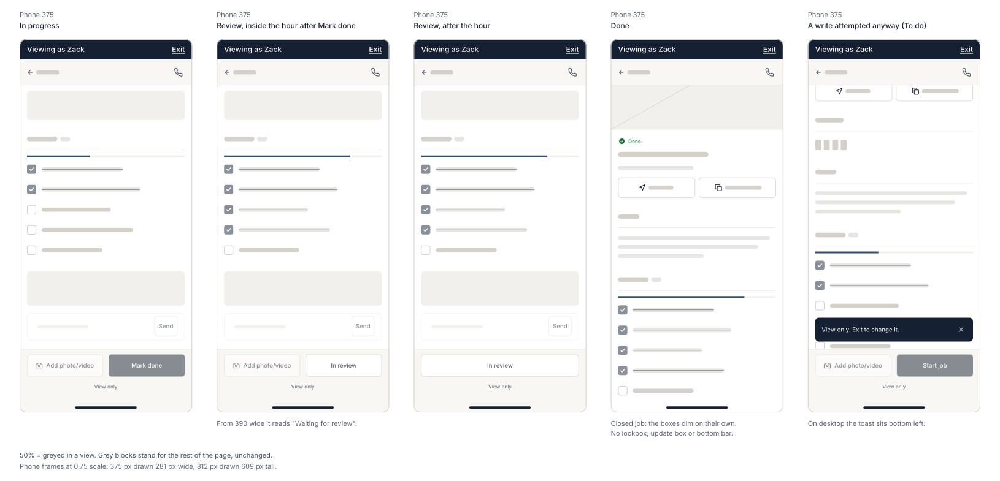

The same page at 375 for In progress, Review inside the hour after Mark done, Review after the hour, and a Done job, plus the refusal toast. These are phone frames only; at 768 and 1280 the buttons follow image 04.

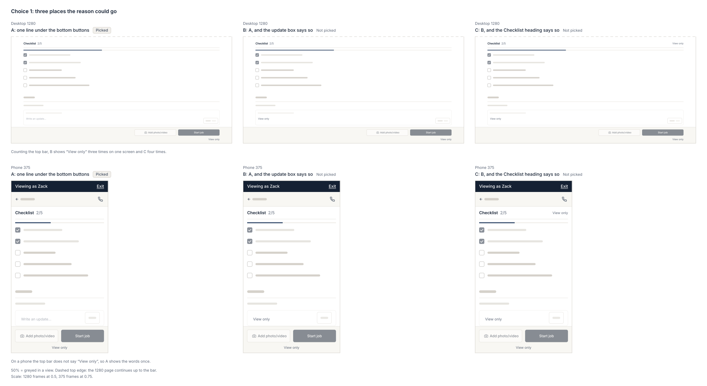

Choice 1, decided as A: options A (picked), B and C side by side at 1280 and at 375. A puts one line under the bottom buttons. B also writes "View only" in the update box. C also adds it to the Checklist heading. At 768 each option follows its 375 frame with the tablet's wider column.

Greyed means drawn and not usable:

- **Checklist boxes.** Dimmed to 50% and not tickable, the look a closed job's checklist already has ([job-details.tsx][job-details]:127-129, [ui.tsx][ui]:477-481).
- **The update box and Send.** The field is dimmed and cannot be focused, so no keyboard opens on a phone. It keeps its own words ("Write an update…").
- **Add photo/video, Start job and Mark done.** The standard disabled look: 50%, no hover ([brand-guidelines.md][brand]:331). Mark done's sheet does not open.
- **A job waiting for review** keeps its own label ("Waiting for HG to review", or the shorter forms on a phone, [job-actions.tsx][job-actions]:609-618). Add photo/video beside it is greyed for the hour after Mark done.
- **A closed job and My jobs** have nothing greyed, so they show no reason line. Nothing there could be changed as the contractor.

Everything that only reads stays live: Back, Call HG, Directions, Copy address, the lockbox code's tap to copy, See the update, the photo viewer, file rows, links in updates, Open and Done, By date and By property, Search jobs, and the job rows.

The reason line (decision 11) is one line, "View only", in the bottom bar's existing reason slot ([action-bar.tsx][action-bar]:48-53), in the same grey the "Finishing 2 uploads" line uses today ([job-actions.tsx][job-actions]:633). The page's bottom padding grows by that line's height, so the update box never sits flush against the bar when scrolled to the end (today's 6.5rem is 1px short of a touch bar with a reason line). The brand rule already asks for it: a disabled primary always has a one-line reason under it ([brand-guidelines.md][brand]:331).

If a write is attempted anyway (a stale tab, or a control switched back on in the browser's inspector), the server refuses it and one toast line shows: "View only. Exit to change it."

A view never shows uploads in progress, failed photos or No signal lines. Those live on the contractor's phone. A file dragged onto a view page is not uploaded; on a computer the browser may open it in the tab.

### 2.4 Photos

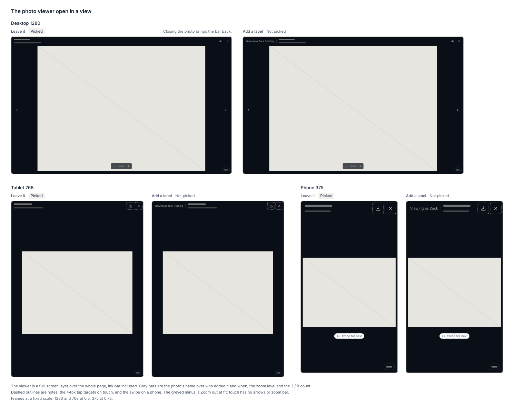

Choice 2, decided as leave it: a photo open full screen in a view, as it is today (picked) and with a small label (not picked). At every size the viewer covers the bar and closing it brings the bar back. With the label, 1280 and 768 show the full name and 375 shows the first name in the row with Close and Download.

The viewer is a full-screen layer above everything ([lightbox.tsx][lightbox]:218-223). A contractor's viewer offers only Download, Close and next or previous ([lightbox.tsx][lightbox]:212-215), so nothing in it can change anything. Connor chose to leave it (decision 12): a label inside it would change a shared component the staff app also uses. It is the one time a view hides the bar, by his choice.

### 2.5 Ending a view

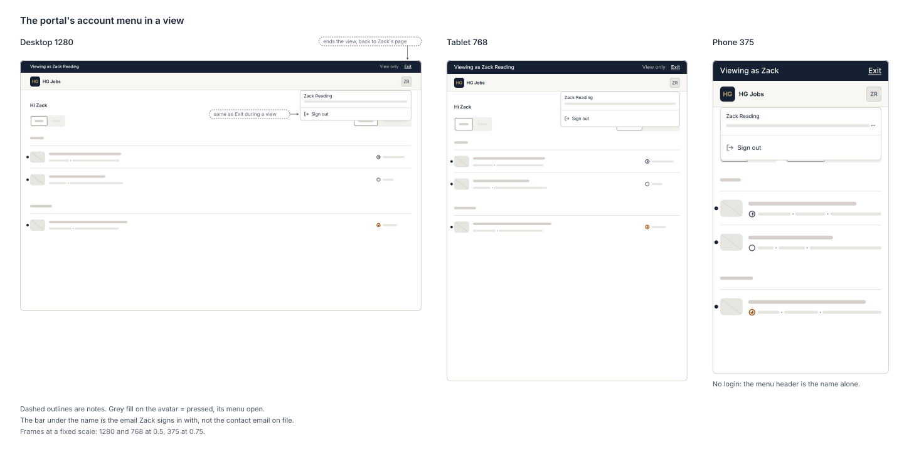

My jobs in a view with the account menu open: Zack's name over his login's email, then Sign out. At 1280, 768 and 375 the menu is the same anchored menu; at 375 the bar above it is the two-word phone bar.

- **Exit** on the bar and **Sign out** in the portal's account menu do the same thing: the view ends and Connor lands on that contractor's page in the staff app, the page in image 01 with its menu closed. A view that is already over is the one exception (below).
- Neither ever signs a contractor out, even if a contractor is also signed in on that browser.
- The menu shows the email the contractor signs in with, the one their own menu shows them. A person with no login has none, so the menu shows the name alone. The contact's email on file is a different value and is never used here (section 5.8).
- **Signing out of the staff app** in that browser ends the view. So does **signing in again** in that browser, as anyone.
- **Starting another view** ends the one before it, on any device.
- **If his staff sign-in runs out mid-view**, the next tap asks him to sign in. The view has ended and does not resume, and he lands on the dashboard, because sign-in only returns staff to staff pages ([next-path.ts][next-path]:88-101).
- **Exit pressed on a bar whose view is already over** (the sign-in ran out, or a view started on another device ended it) lands on the Contractors list, not on the person (decision 14). Once a view is over the server no longer says whose it was (section 5.10). After a lapsed sign-in that is the list after signing in, which is an inference from the code and is on the by-hand list (section 8). After a staff sign-out in another tab it is the sign-in page, since nobody is signed in by then.
- **If he starts a second view from another tab**, the first tab reloads itself on its next page, so the bar names the right person (section 5.8).
- Remove access, Reset password, Sign out everywhere and the Job emails switch on the Portal access card do not end a view of that contractor. The switch changes nothing a view shows: the one portal line that reads it is the last line of Mark done's payoff ([job-view.ts][job-view]:476-477), and a view never opens Mark done. Archiving or restoring them mid-view changes only the bar's word, on the next full load.

### 2.6 What a view shows for each kind of person

The portal's reads key on the contact and nothing else: [queries.ts][queries] uses only the contact id from whoever is looking, once `getJob`'s job-emails read is keyed on it too (5.7), and its one gate is a live access row on the job ([queries.ts][queries]:116-117). So every case draws the same pages.

| Person | What the view shows | Bar says (desktop and tablet) |
|---|---|---|
| Signed in on their own password | Open: every active job they have access to. Done: finished or canceled since Oct 27, 2026 ([queries.ts][queries]:29, 124-131). The New dots and the New divider sit where the contractor left them | Name only |
| No login yet | The same lists. Access to a job is granted on assignment whether or not a login exists ([core.ts][core]:192-202). Everything since assignment counts as new | No login yet |
| Invited (still on a starting password, or never signed in) | Their jobs. Their real first screen is the first-password page; a view skips it, because that screen exists only to change their real password | Invited |
| Access turned off | Their jobs. Remove access blocks sign-in and leaves their job access alone | Access off |
| Inactive contact | Their jobs. Nothing in the app sets a contact inactive (a search of the code finds only `active: true` written), so this arises only from a hand edit | Access off |
| Archived | Their closed jobs on the Done tab, read only, with no lockbox code. Open is empty in practice, because archiving is refused until their open jobs are reassigned ([archive.ts][archive]:71-75, 181-184). "Empty in practice" is an inference; the query itself does not guarantee it | Archived |

Lockbox codes are visible in a view on active jobs assigned to that person ([queries.ts][queries]:465), as they already are to staff on the property's units ([edit-units.tsx][edit-units]:308-309). A view does not log them per job.

### 2.7 Copy

Every word the feature adds, in one place. Names come from the record, never from code.

| Where | Text |
|---|---|
| Contractor page ⋯ menu, new item | View as Zack |
| Bar, leading words, 640px and wider | Viewing as Zack Reading |
| Bar, leading words, under 640px | Viewing as Zack |
| Bar, state words after a middle dot, 640px and wider: no login on file | No login yet |
| Bar, state words: login not yet used on their own password | Invited |
| Bar, state words: access removed, or the contact is inactive | Access off |
| Bar, state words: archived (takes the place of the other three) | Archived |
| Bar, trailing words, 640px and wider | View only |
| Bar, button, every size | Exit |
| Exit button, name for screen readers | Stop viewing as Zack Reading |
| Job page, the line under the greyed bottom buttons | View only |
| Toast when a write is attempted in a view | View only. Exit to change it. |
| Toast when View as is pressed after the portal was turned off | The portal is off. Turn it on. |
| Toast when the contractor's row no longer exists | Contractor not found. Reload. |
| Portal account menu, unchanged | Sign out |

Each toast says what happened, then what to do next, and ends on that step ([copy-rules.md][copy-rules], rule 7). Each fits the 30 characters a phone toast shows whole at 320 ([toast-line.ts][toast-line]:10), far inside the copy rules' cap of about 90, so the step is never the part cut off. The refusal is 29 characters and the portal line exactly 30. The refusal names the bar's own button as the step: once out of the view, Connor makes the change as himself from the task page in the staff app. Each ends in a period, so the existing rule passes it to the screen as written ([action-result.ts][action-result]:257-259, 373). None trips the copy lint (`hg/vague-copy`, `hg/filler-copy` in [eslint.config.mjs][eslint]).

The missing-contractor line is the view's own. The line [archive.ts][archive]:253 throws for the same case, "This contractor is gone.", names no next step and stays as it is; it is outside this spec.

The shared word is "No login yet", with no period. The Portal access card shows it as a sentence today ([portal-access-card.tsx][access-card]:169) and keeps doing so by adding its own period, so the staff page's copy does not change.

## 3. Reuse check

| | What | Where |
|---|---|---|
| **Reused as is** | The ⋯ menu's anatomy, `Menu` and `MenuItem` | [record-archive.tsx][record-archive], [menu.tsx][menu] |
| | `useRun` for the item's refusal toast, `withResult` for the action | [record-archive.tsx][record-archive]:33-43, [server-action.ts][server-action]:24-32 |
| | `useLeaveGuard({ signOut: true })`, the guard Sign out uses | [leave-guard.tsx][leave-guard]:173-177 |
| | The bottom bar's reason slot and its buttons' sizing | [action-bar.tsx][action-bar]:20, 48-53 |
| | The checklist's `editable` prop and the Checkbox's disabled look | [job-details.tsx][job-details]:127-129, [ui.tsx][ui]:477-481 |
| | The toast material tokens | [globals.css][globals]:48-51, 77, 194-198 |
| | The bar-height variable pattern (`--app-bar-h`) for the new `--view-bar-h` | [globals.css][globals]:92-97, [app-shell.tsx][app-shell]:170, 206 |
| | Token minting, shape check and hashing; the request's address hash and browser name | [tokens.ts][tokens]:16-28, [request.ts][request]:18-24 |
| | The refusal path: a plain sentence thrown by a gate reaches the toast | [action-result.ts][action-result]:362-376 |
| | The split of a request half over a core that takes a transaction, so tests can run the core | [accounts-core.ts][accounts-core]:4-9 |
| **Extended** | `RecordMoreMenu` gains an optional `viewAs` prop (`{ firstName, action }`). Deals and properties pass nothing | [record-archive.tsx][record-archive], [deal page][deal-page]:53, [property page][property-page]:164-170 |
| | `Composer` gains a `disabled` prop: field off, Send off, the draft store neither read nor written | [composer.tsx][composer] |
| | [access-state.ts][access-state] gains the card's words (moved from the card's private `BADGE` at [portal-access-card.tsx][access-card]:52-56 and the literal at :169) and `viewAsStateWords` | [access-state.ts][access-state] |
| | The four session wrappers and `portalHomePath` learn about a view; one new wrapper for pages; one small reader for Exit's return | [session.ts][session] |
| | The read queries' first parameter becomes the session's `PortalViewer` type, and `getJob`'s job-emails read keys on the contact instead of the login (5.7). No other query changes | [queries.ts][queries]:124, 432, 479 |
| | `noteJobViewed` asks `getPortalPrincipal()` and returns when there is none | [jobs.ts][jobs]:45-46 |
| | The view cookie beside the portal cookie | [cookie.ts][cookie], [request.ts][request] |
| | `RefreshOnReturn` gains an `eager` option and a second mount, in the portal layout during a view | [refresh-on-return.tsx][refresh-on-return], [refresh-on-return.ts][refresh-rule] |
| | The toast's Undo classes and its quieter "· detail" tone are lifted into one export that the toast and the bar both use, so the bar copies neither | [toast.tsx][toast]:127, 136 |
| | The three scroll anchors add the bar's height to their margin | [job-updates.tsx][job-updates]:145, [activity-timeline.tsx][activity-timeline]:82, [comment-card.tsx][comment-card]:212 |
| | Staff auth gains `viewAsStarterId`, `mayViewAs` and `requireViewAs`. `getCurrentUser` and `SessionUser` do not change | [auth.ts][auth] |
| | The staff session gains one reader for when a verified token ends. Today's reader drops it | [session.ts][staff-session]:20-22, [session-token.ts][session-token]:29-33 |
| | `signOutPortal`, `signOut` and `login` end a view | [p/actions.ts][portal-actions], [login/actions.ts][login-actions] |
| | The portal account menu accepts a missing email | [account-menu.tsx][portal-account-menu]:17, 44 |
| | The job bar's markup is lifted out of [job-actions.tsx][job-actions]:597-639 into one presentational piece both the real page and the view use | [job-bar.tsx][job-bar] (new file) |
| | The local-database test, held privately in two files today, moves to one helper that answers yes or no. Both files keep their own refusing wrappers over it | [dev-reset-passwords.ts][dev-passwords]:19-32, [setup.ts][device-setup]:29, 49-58, [local-db.ts][local-db] (new file) |
| | The users script writes the flag on a local database only, through that helper | [00-users.ts][users-script] |
| | The device check gains view variants of two pages | [routes.ts][device-routes], [setup.ts][device-setup], [devices.spec.ts][device-spec] |
| **New** | `ViewAsBar`, shared chrome with a [components.md][components-doc] row | [view-as-bar.tsx][view-as-bar] |
| | The pure rules and the transaction-level writes of a view; the one read; the request half of start and end | [view-as-core.ts][view-as-core], [view-as.ts][view-as], [view-as-session.ts][view-as-session] |
| | The two view-only strings | [view-only.ts][view-only] |
| | The view's stand-in for the job page's writing half (feature only, no components.md row) | [job-actions-view-only.tsx][job-actions-view-only] |
| | A small client check that reloads a tab whose page and bar disagree (feature only) | [viewer-check.tsx][viewer-check] |
| | `User.canViewAs`, the `ViewAsSession` table with its `ViewAsSubject` enum, and one migration | [schema.prisma][schema] |

Nothing here is invented from scratch. The entry is the existing ⋯ menu, the bar follows Circle and Stripe on the toast material, and the greyed controls use the existing disabled looks and the existing reason slot. The one piece with no component behind it is the reload check, which follows the refetch-on-focus pattern the app already has in `RefreshOnReturn`.

**Considered for the bar and passed over.** `Notice` ([source-line.tsx][source-line]:17-26) is the nearest piece the app has: one line saying the page's context is different (the sandbox line, an archived record's Restore), with the same anatomy of words that truncate before one trailing control. It was not extended because it is a card on `--surface` inside the page, and decision 7 asks for an ink bar pinned across the window. The bar takes its anatomy from `Notice` and its material from the toast.

**Main's new shared pieces are not on a view's path.** The Job emails switch and the trades picker brought `InlineSwitch` onto the Portal access card, the new `TagsField`, an add row in `OptionList` and a sheet footer in `PickerLayer` ([inline-field.tsx][inline-field], [tags-field.tsx][tags-field], [option-list.tsx][option-list], [picker-layer.tsx][picker-layer]). No portal file imports any of them, `Menu` and the other pieces above are unchanged, and a view adds no picker, so they change nothing in this table.

**Doc lines that change.**

- [components.md][components-doc] line 53 (the ⋯ menu row): add that `viewAs` puts "View as Zack" after Copy link on a contractor's page, for the one account that holds the flag, through `useLeaveGuard({ signOut: true })`.
- [components.md][components-doc], a new row under "Navigation and tabs" (line 119 on): `ViewAsBar` in `components/view-as-bar.tsx`, with its words from `lib/portal/access-state.ts`.
- [components.md][components-doc] line 71 (the Composer row): name `disabled`.
- [components.md][components-doc] line 92 (the upload queue row): the portal layout mounts the queue except during a view.
- [components.md][components-doc] line 124 (the `RefreshOnReturn` row): it says "Mounted once" in the app layout. Name `eager` and the second mount, in the portal layout during a view.
- [components.md][components-doc] line 136 (the Account row): say that Sign out in the portal menu ends a view, and remove the stale clause "the portal's account menu sits outside the job page's, so it never asks yet". The portal layout has wrapped every portal page in one guard since [layout.tsx][portal-layout]:49-55, and line 40 of the same doc says so.
- [brand-guidelines.md][brand], one bullet added under "Toasts" (after line 410) giving the ink material its other jobs: the tooltip's label, which already uses it ([tooltip.tsx][tooltip]:103), and the bar pinned above the portal while a partner views it as a contractor.
- [brand-guidelines.md][brand] lines 160 to 162 (the `--toast-bg`, `--toast-fg` and `--toast-fg-2` rows of the token table): widen each Job cell to name the bar. Line 160 also names the tooltip; line 162's second job is the bar's state words and "View only".
- [asana-migration-plan.md][asana-plan] line 205 ("The portal never imports staff auth"): name the one exception, one function in one file (section 6).
- The header comment of [layout.tsx][portal-layout] (lines 15 to 44): it says every page calls `requirePortalPrincipal()` and describes the queue as always mounted. Both change.
- [README.md][readme]: the flag's runbook (section 9), and two lines under Local development: `PORTAL_ENABLED=1` is needed for View as to appear, and `npm run migrate users` must have run once on the local database or the device check stops (section 8).
- [CLAUDE.md][claude-md] is not edited. Its Device check section already sends readers to README, Local development, for what the check needs.
- [docs/specs/README.md][specs-readme]: one line for this spec.

## 4. References

Mobbin and product docs, from the Nov 14 research. The links were gathered by the research run; this spec did not reopen them.

- **Entry on the person's record.** [Jobber, Log in as Client](https://mobbin.com/flows/932fd517-9b16-4003-9e3b-0e16506e0f56): staff open an outside party's portal from that party's record, in its More Actions menu. This is the same shape as this feature. Its toast-only signalling is the part not copied.
- **The bar.** [Circle, View as](https://mobbin.com/flows/cc1c1f70-65d8-43d6-a54a-f7a72474f73c): a full-width black bar reading "Viewing as: Alex" with Exit at the far right. [Stripe's sandbox bar](https://mobbin.com/screens/1a4d59a6-cd4a-4377-aec5-7b0ea3e3819a): ink ground, one line, exit at the trailing edge.
- **View-only signalling.** [Honestly, proxy view](https://help.honestly.com/help/employees/proxy-view.md): a read-only badge in the bar plus one line at the blocked control, and the employee is not notified. [15Five, impersonate](https://success.15five.com/hc/en-us/articles/50988642168091): read-only, with the action buttons greyed, which is decision 8.
- **The phone form.** [Google app, incognito strip](https://mobbin.com/screens/61cc4d25-b46b-4571-8e1b-a785f4324df5): a persistent mode shrinks to one line in a thin strip at the top, the position that fits a page with a bottom bar.
- **The repo's own review.** [IA-038 in docs/uiux-review/ia.md][ia] (line 418): "Add 'View as Zack' to preview the portal exactly as a contractor sees it", with its two references, [Jobber](https://mobbin.com/screens/1e4846b8-cb8a-40eb-9491-54c8db93960f) and [Base44](https://mobbin.com/screens/74ff85dd-dbad-4f03-8248-294e40499dff).

Where this spec departs from them:

- **No timer.** The references that state a length time-box the session: 15Five ends it after 30 minutes idle, [Clerk](https://mobbin.com/flows/7c36a134-e217-4857-9f32-9e4172a8d1d0) after 10 minutes idle or 30 in all, and [WorkOS](https://workos.com/docs/user-management/impersonation) after 60. Connor was offered 30 minutes and 1 hour and picked "Until I exit" (decision 9). It is safe here because a view is honoured only beside his own staff sign-in in the same browser and cannot outlast it (section 5.6), and because a view cannot act, where Clerk's and WorkOS's sessions can.
- **The reason is a line, not a tooltip.** 15Five explains its greyed buttons in a hover tooltip, which has no touch form.
- **The bar is ink, not orange.** Cal.com's orange bar reads as an alert, and `--warn` already has a job here ([brand-guidelines.md][brand]:137).
- **The phone bar follows the incognito strips.** The research found no phone capture of an admin viewing as another person.

Next.js behaviour is cited from the local docs: Server Actions are POST only and compare Origin with Host ([data-security.md][next-data-security]:546-550), cookies can be set only in a Server Function or Route Handler ([cookies.md][next-cookies]:74-81), layouts do not re-render on navigation ([layout.md][next-layout]:154, 240), and request data cannot be read inside `after` from a page ([after.md][next-after]:118-122).

## 5. How it works

### 5.1 The flag

`User.canViewAs`, a boolean, default false. It is a narrow name on purpose, not a role system.

- **Locally** the users script sets it. `SEED_USERS` in [00-users.ts][users-script] carries it on Connor's row, and the script writes it only when `isLocalDb()` answers yes and `NODE_ENV` is not production.
- **`isLocalDb()` is one shared helper**, in [local-db.ts][local-db]: a localhost host in `DATABASE_URL` and no `VERCEL_ENV`. The same test is held privately in two files today: `assertLocalDb` in [dev-reset-passwords.ts][dev-passwords]:21-32, which cannot be imported because that script runs its `main()` on import (line 55) and itself imports `SEED_USERS` from the users script (line 17), and a second copy in [setup.ts][device-setup]:49-58. Both throw. The helper answers yes or no and has no imports, because the users script must keep running on production to add a user and only skip the flag there. The passwords script and the device setup keep their own refusing wrappers and their own messages on top of it, so no third copy is written.
- **On any other database the script never writes it.** This matters because `npm run migrate users` is the README's way to add a production user ([README.md][readme], Runbook, "Add a user"), and a plain `npm run migrate` runs the users step first ([run.ts][run-script]:28, 37). Without the guard, every run would grant the flag in production, or grant it again after it was removed on purpose.
- The script's upsert ([00-users.ts][users-script]:19) gets a `select` of the id, so it reads back one column and not the whole row. That an upsert reads the whole row back by default is this spec's understanding of Prisma, not something that was run.
- **In production** it is one `UPDATE`, run only with Connor's OK (section 9).
- **No file under `src` writes it.** A static test holds that.

### 5.2 The table and the migration

One row is both the live view and its record.

```prisma
enum ViewAsSubject {
  CONTRACTOR
}

model ViewAsSession {
  id          String        @id @default(cuid())
  user        User          @relation(fields: [userId], references: [id], onDelete: Restrict)
  userId      String        // who started it
  subjectKind ViewAsSubject @default(CONTRACTOR)
  contact     Contact?      @relation(fields: [contactId], references: [id], onDelete: Restrict)
  contactId   String?       // who is viewed, when the subject is a contractor
  tokenHash   String        @unique
  createdAt   DateTime      @default(now())
  expiresAt   DateTime      // when the staff sign-in it was started under ends: a bound, never a visible timer
  endedAt     DateTime?
  ipHash      String?
  userAgent   String?

  @@index([userId])
  @@index([contactId])
}
```

`User` and `Contact` each gain the list field for the other side of the relation. That Prisma requires both sides is this spec's understanding, not something that was run.

- **What the record holds.** Who viewed whom, from when, until when, a keyed hash of the address and the browser's name. It does not list which jobs or lockbox codes were opened. No screen shows it in this version; the runbook has the query (section 9).
- **`expiresAt` is the end of the staff sign-in the view was started under**: the `exp` of the staff token the start request carried ([session-token.ts][session-token]:29-33), or the start plus 30 days if that were ever earlier ([session.ts][staff-session]:12-13). So the row itself holds "a view cannot outlast the sign-in it leans on", whatever later code does with staff sessions. It adds no timer Connor can see: at that moment his staff sign-in ends anyway. A row's end of record is `endedAt`, or failing that `expiresAt`.
- **`onDelete: Restrict` on both sides**, because this row is the only record of the view. The schema writes one other `Restrict` out, on `ContactTrade.trade` ([schema.prisma][schema]:304), from the trades work; every other relation says `SetNull` or `Cascade`, or leaves the default. No code deletes a Contact today: a search for `contact.delete` under `src` and `scripts` finds only one Postgres test clearing its own contact ([trade-links.pg.test.ts][trade-links-pg-test]:64), which no view row ever names.
- **A contractor row always names a contact.** The migration adds one check by hand, since Prisma's schema has no word for it: `CHECK ("subjectKind" <> 'CONTRACTOR' OR "contactId" IS NOT NULL)`. An earlier migration already carries a hand-written check (`20261023000100_asana_cutover`).
- **Row level security** is enabled on the new table in the same migration, with no policies, as on every table ([README.md][readme], Rules of the road). [db-rls.test.ts][db-rls-test] fails otherwise.
- **The migration is additive**: one boolean column with a default, one enum, one new table. Nothing existing is dropped, renamed or tightened.
- **Its folder sorts after main's latest.** Main gained `20261114140000_portal_job_emails` ([migration.sql][job-emails-migration]) and `20261114180000_contractor_trades` ([migration.sql][trades-migration]) after this spec was first drafted. The view's migration takes a later timestamp than both, so a fresh database applies it last and the health check's latest names it (section 9). It is generated only after those two are applied locally (`npx prisma migrate deploy`), and its SQL is read before it is committed: the column, the enum, the table, the check and row level security, and nothing about `PortalAccount.jobEmails`, `Trade` or `ContactTrade`. Generated against a database that lacks them, it would carry their tables and column a second time.

**Other kinds of people later (decision 1).** The flag, the cookie, the row, the liveness rule, the start and end services, the bar and the record query carry over as they are. A new kind brings four things and changes no existing row:

1. **Who is viewed.** One more value in `ViewAsSubject`, one more nullable subject column beside `contactId`, and one more clause in the check. `contactId` is nullable from the start so that a row for another kind never needs this column altered.
2. **Where a view opens and where Exit returns.** One function, `viewPaths(kind, id)` in [view-as-core.ts][view-as-core], answers `/p` and `/contractors/<id>` for a contractor. Start and Exit ask it and name no path themselves.
3. **The bar's state words.** `viewAsStateWords` is the contractor's. Another kind supplies its own, or none.
4. **A reader on the surface that kind uses.** A tenant given a portal login would reuse the portal's reader (5.6). The other partner uses the staff app, which has no view-only reader today, so viewing as him is its own piece of work on top of these parts. It does not redo them.

### 5.3 The cookie

`__Host-hg_view` on HTTPS and `hg_view` on local http, beside the portal cookie in [cookie.ts][cookie] and following its rule (the `__Host-` prefix, so a sibling subdomain cannot plant one, and the http name never read on HTTPS, lines 8 to 12). HttpOnly, SameSite lax, Path /, Max-Age 60 days. The value is 32 random bytes; the table stores only its SHA-256 ([tokens.ts][tokens]:16-28).

Max-Age is not what ends a view; the row is. A dead cookie cannot be cleared during a page render ([cookies.md][next-cookies]:81), so it needs some bound. The bound is 60 days because a contractor's session lasts 30 days from sign-in ([limits.ts][limits]:7, 18-20): the view cookie then outlasts every contractor session that was in the browser when the view began, and the shadow rule (5.6) never hands a forgotten tab back to one.

### 5.4 Staff auth: three small functions

All three live in [auth.ts][auth]. `getCurrentUser` (line 17) and `SessionUser` (line 11) stay exactly as they are, so no staff page comes to depend on the new column.

- `viewAsStarterId(): Promise<string | null>` is the signed-in staff user's id when a by-id read says they hold the flag, else null. It is built on `getCurrentUser`, so "a valid staff session" keeps one definition: the cookie verifies and the user still has a password hash ([auth.ts][auth]:17-24).
- `mayViewAs(): Promise<boolean>` is the same as a yes or no for staff pages. It catches any failure, logs it and answers false, so a fault in the flag read can never break the contractor page for both partners.
- `requireViewAs()` is `requireUser()`, then Not found unless `viewAsStarterId()` answers that user's id. It is the first line of the start action. It returns the user and the moment that staff sign-in ends, read from the verified token. The token carries that moment ([session-token.ts][session-token]:29-33) and today's reader drops it ([session.ts][staff-session]:20-22), so the staff `session.ts` gains one small reader beside it. Staff auth reads it; portal code never does.

### 5.5 Starting a view

- [The contractor page][contractor-page] passes `viewAs` to the menu only when `mayViewAs()` is true and the portal is on (`getEnv().portalEnabled`, already imported at line 10). `mayViewAs()` is awaited after the page's first `Promise.all`, not inside it: a pin reads that expression as it is (section 6). The second one, `[rows, jobCount, allTrades]` ([contractor page][contractor-page]:88), is read by no pin and can hold it.
- `startViewAs(contactId)` in [contractors/actions.ts][contractor-actions] runs inside `withResult`: `requireViewAs()` first, the file's own id check (line 18), the start service with the user's id and the sign-in end that `requireViewAs()` just returned, then a redirect to where a contractor's view opens, `/p` (from `viewPaths`, 5.2). `withResult` lets the redirect through ([server-action.ts][server-action]:28). It is a Server Action called from the menu item, never a link or a GET route.
- The start service is two halves, the way [accounts.ts sits over accounts-core.ts][accounts-core]:
  - `startViewAsSession(userId, contactId, staffSessionEndsAt)` in [view-as-session.ts][view-as-session] is the request half. It reads whether the portal is on, the address hash and the browser's name, mints the token, calls the core, and sets the cookie. The staff id has to arrive as an argument, because portal code may not ask staff auth who is calling (rule 2, section 6). A pin holds it to one caller.
  - `startViewIn(tx, input)` in [view-as-core.ts][view-as-core] takes a transaction and touches no request, so a test can run it on an in-memory one.
- Between them they are the only code that writes the table or the view cookie. In one transaction `startViewIn`:
  1. re-reads by user id that the user holds the flag and has a password hash;
  2. refuses while the portal is off ("The portal is off. Turn it on."), a fact the request half reads and passes in;
  3. requires the Contact to exist, and nothing else about it ("Contractor not found. Reload."). Archived, inactive, no login, access off and a starting password are all accepted (decision 4);
  4. ends that user's other open rows;
  5. inserts the new row, with `expiresAt` from the staff sign-in's end (5.2), the address hash and the browser's name.

  Then the request half sets the cookie.
- Next renders the redirect's target with the action's new cookies merged in, so the first load of /p sees the staff cookie and the view cookie together. Contractor sign-in already relies on the same behaviour ([login/actions.ts][login-actions]:72-73, then [layout.tsx][portal-layout]:46). This is the red team's reading of Next's action handler, not something this spec re-read.

### 5.6 How a request is recognised, with no timer

A view is recognised in exactly one function, `readLiveView()` in [view-as.ts][view-as], which is called from exactly one place, the portal's `readSession` ([session.ts][session]:42). The rule, in order:

1. The portal is on. This stays `readSession`'s first statement, as pinned today.
2. The request carries a well-formed view cookie. If not, stop: no staff call and no query. A normal contractor request costs nothing extra.
3. `viewAsStarterId()` returns an id. That means the same request carries a staff cookie that verifies, for a user who still has a password and still holds the flag. If not, the view table is not even read.
4. The row for that cookie exists, its `userId` equals that id, `endedAt` is empty and now is before `expiresAt`.

The person's state (no login, invited, access off, inactive, archived) is not part of the rule. It only feeds the bar's words.

**Where the rules live, so tests can run them.** [view-as-core.ts][view-as-core] has no `server-only` import and reads no request, so node:test can import it. [queries.ts][queries]:1 and [session.ts][session]:1 are `server-only` and cannot be imported that way. The core holds:

- `decideView({ starterId, row, now })`, which is steps 3 and 4;
- `viewStateFor(read)`, which turns the three things a view read can say into the session's answer: a live view gives a viewer with no principal, a view cookie that is present but dead gives signed out, and no view cookie tells `readSession` to go on to the contractor's session as today;
- `startViewIn` (5.5) and `endViewIn` (5.10), which take a transaction;
- `viewPaths` (5.2).

The contractor's own principal is still built in one place, `readSession` ([session.ts][session]:78-87), and nowhere in the core.

[view-as.ts][view-as] keeps only the cookie read, the staff call and the one table read.

The live view that `decideView` returns has the contact's id, the name, the login's email if there is one, and the state words. It has no account id, no session id and no user id, so the staff identity is compared and then dropped.

**Why no timer is safe.**

- **A view cookie by itself opens nothing, forever.** Without a flagged staff session in the same request, the table is not read for it and no portal page answers. The one thing its holder can do is end that view (5.10).
- **Staff sign-out in that browser ends the view.**
- **A view cannot outlast the staff sign-in it was started under**, and the row itself holds that: `expiresAt` is that sign-in's own end (5.2). Today the staff token is minted in one place, at sign-in ([login/actions.ts][login-actions]:64; a search of `src`, `scripts` and `tests` finds no other caller of `signSession`), and every sign-in ends the view first. A pin holds the single mint site (section 6). If staff sessions are ever made to slide, or are re-issued somewhere else, a view still stops at the end of the sign-in it started under. It fails early, never late.

**The shadow rule.** While a browser carries a well-formed view cookie, it is never treated as a contractor. `readSession` returns before it reaches the contractor's session row: a live view gives a viewer with no principal, and a dead or unreadable view gives signed out. This closes a real hole: without it, a view whose staff sign-in lapsed would fall through to a contractor's real session in the same browser, and that request would move their "Last seen" ([session.ts][session]:70-76) and mark a job seen ([jobs.ts][jobs]:45-58) under a bar that still said view only. The browser is a contractor's again only once the view cookie is gone: Exit, either sign-out or any sign-in. Left alone the cookie lasts 60 days, longer than any contractor session that was there when the view began (5.3). Normal contractors carry no view cookie, so nothing changes for them.

**Failure.** Any error inside the view lookup passes Next's own control-flow errors through first (`unstable_rethrow`, as [server-action.ts][server-action]:28 does), is logged, and counts as not live.

**One thing a copy can do.** "The browser it was started in" is true by possession of the cookie. Copied to Connor's own second device, where he is also signed in as staff, the cookie works. That gives nothing his staff sign-in there does not already give.

### 5.7 The session wrappers

The portal's session state keeps its name, `PortalSessionState` (a pin reads it, section 6), and becomes `{ principal, viewer, mustChangePassword }`.

- `viewer` is a `PortalViewer`, a type exported from [session.ts][session]: the contact's id, the name, the login's email or none, and `viewOnly`.
- A contractor's own session has a principal, and a viewer with `viewOnly: false`.
- A view has **no principal**, a viewer with `viewOnly: true` and the bar's state words, and reports no pending password.
- **`viewOnly` is the one field that tells a view from the contractor's own session.** It is written in two places and no others: `true` in the core's view answer (`viewStateFor`, 5.6), and `false` beside the principal where `readSession` builds it. Nothing infers a view from a missing email or from state words: a view of an Active contractor has an email and no state words, and would pass for the contractor's own session.

| Wrapper | In a view |
|---|---|
| `getPortalPrincipal` ([session.ts][session]:104) | null. It returns the state's principal and never looks at the viewer |
| `requirePortalPrincipal` (:123), every action's and service's gate | 404 while the portal is off, /login when signed out, then throws "View only. Exit to change it." before today's password rules. This one refusal is what the design rests on, so a pin holds its place (section 6) |
| `requirePortalSession` (:144), the layout's gate | its two pinned lines stay; returns the viewer |
| `requirePortalViewer` (new), every page's gate | the same three gates as `requirePortalPrincipal`, in the same order: the 404, /login, and the first-password page for a login still on its starting password. Returns the viewer. A view has no pending password, so the first-password page sends it on to My jobs. A pin holds all three gates, so moving pages onto this wrapper weakens nothing for contractors |
| `portalHomePath` (:156) | null. /login also bounces any signed-in staff user before it asks ([login/page.tsx][login-page]:28) |

Every portal write asks for the principal itself, and a view has none:

- the nine actions ([p/actions.ts][portal-actions]:12, 41; [jobs/[id]/actions.ts][job-server-actions]:41, 48, 55, 62; [upload-actions.ts][upload-actions]:63, 81, 90);
- seven service functions, which throw ([jobs.ts][jobs]:92, 111, 122, 129, 142; [job-uploads.ts][job-uploads]:51, 71);
- three routes, which get null ([blob route][blob-route]:144, [files route][files-route]:77, [reset route][reset-route]:37).

So every write path is refused by default, including ones added later. The eighth service function, `noteJobViewed` ([jobs.ts][jobs]:46), is called while a page renders, so it does not throw: it asks `getPortalPrincipal()` and returns when there is none (5.9).

The read queries in [queries.ts][queries] take `p: PortalPrincipal` today (lines 124, 379, 387, 432, 530, 547, 576, 645, 694). Every read but one uses only `p.contactId`. The one came in with the Job emails switch: `getJob` reads the login's job-email facts by `p.accountId` ([queries.ts][queries]:479) for `getsEmail`, which picks the last line of Mark done's payoff ([job-view.ts][job-view]:476-477). A viewer has no account id (5.6), and a person with no login has no account at all, so that read keys on the contact instead: `where: { contactId: p.contactId }`. It finds the same row for a contractor, because `PortalAccount.contactId` is unique ([schema.prisma][schema]:625), and it is how `contractorGetsEmail` already reads it ([core.ts][core]:359-363). In a view it answers the viewed person's state, or none, and nothing shows it. The parameter's type becomes `PortalViewer` and its name stays `p`, which existing pins read ([queries.test.ts][queries-test]:60, 71, 73, 108). Typecheck then fails on any `p.accountId` left in the file. That one key is the only query change. `listMyJobs` and `getJob` return lockbox codes ([queries.ts][queries]:465), and a looser type would let a later staff-side preview call them with a bare contact id, past the flag, the liveness rule and the record. Pin i (section 6) keeps them imported only by portal pages, and keeps viewers made only in the two places above.

### 5.8 Pages, the layout and a truthful bar

- **Pages.** The three pages ([My jobs][my-jobs-page]:14, [the job][job-page]:44, [first password][welcome-page]:19) call `requirePortalViewer` and name the result `viewer`. Each page, and the layout, tells a view by `viewer.viewOnly` and by nothing else. The job page passes it down one level as a prop. It is a prop from the page and not a context from the layout because the page re-runs on every navigation and the layout does not ([layout.md][next-layout]:154).
- **My jobs in a view** hands the account menu `viewer.email` ([page.tsx][my-jobs-page]:28). That is the login's email, `PortalAccount.email`, as it is for the contractor ([session.ts][session]:83), or nothing when there is no login. It is never `Contact.email`, which the staff page carries as a separate value ([contractor page][contractor-page]:164, 171). My jobs no longer has a "Password saved" line after a first password, so a view has nothing there to leave out.
- **The job page in a view** does not call `noteJobViewed`; passes `editable={active && !viewOnly}` to the checklist; mounts neither `JobActions` nor `LateUploads`; and on an active job mounts [job-actions-view-only.tsx][job-actions-view-only] in their place: the shared `Composer` with `disabled`, and the shared job bar with every button disabled and "View only" in the reason slot. Because the writing half is never mounted, none of its effects run: no kept-file drain on mount or unmount, no held-photo post, no uploader ([job-actions.tsx][job-actions]:359-379, 436-458). The stand-in takes no `getsEmail`: the one thing it feeds is Mark done's payoff, which a view never opens.
- **The view's draft key is never the contractor's.** The real composer keeps a draft under a key built from the job and the contact ([job-actions.tsx][job-actions]:555). A disabled composer skips the draft store, and the view passes a key that is not the contractor's, so a shared browser can never have its unsent draft touched.
- **The layout** ([layout.tsx][portal-layout]:45-59) reads the viewer through `requirePortalSession`. Outside a view it is today's tree. In a view the tree is `ToastProvider`, then `LeaveGuard`, then [ViewAsBar][view-as-bar], `RefreshOnReturn` with `eager`, and the page, with **no upload queue**. Both providers stay: the page's toasts throw without one ([toast.tsx][toast]:161), and `RefreshOnReturn` reads the guard ([refresh-on-return.tsx][refresh-on-return]:34-35). With no queue mounted nothing restores an outbox, drains on wake or fetches an upload code ([upload-queue.tsx][upload-queue]:383-415), and the queue's hooks are safe without a provider (:345-347, :513-521).
- **The bar's markup.**
  - `ViewAsBar` is a labelled `div` that is `sticky` at the top. It is not a `header` and not `fixed`: the print rules key on `header.fixed` ([globals.css][globals]:476-484) and must not match it.
  - Its layer is z-30: above the job page's header (z-20, [page.tsx][job-page]:65), below sheets, dialogs and the photo viewer (z-50, [lightbox.tsx][lightbox]:223) and below toasts. Menus must open over it, which is on the by-hand list.
  - It is hidden in print. Its ground would not print, so its light words would be white on white.
  - It takes `exitAction` as a prop, and the portal layout passes `signOutPortal`. No file under `src/components` imports from `@/app` today; the staff menu gets `signOutAction` the same way ([account-menu.tsx][staff-account-menu]:35-42).
  - Exit is a form button that posts that action, as Sign out on the first-password page is ([page.tsx][welcome-page]:28), so it works before the page's script has loaded.
  - With decision 13 (A), the bar needs nothing from the page.
- **Screens with no header.** The job's Not found screen and the portal's error screen render inside the layout ([not-found.tsx][job-not-found]:13-22, [error.tsx][portal-error]:11-16), so the bar sits over them too.
- **The bar's words.** `viewAsStateWords` in [access-state.ts][access-state] answers Archived, No login yet, Invited, Access off or nothing, in that order, from the same facts the staff page reads ([contractor page][contractor-page]:71-73). The `jobEmails` that select now also reads is not one of them. The Portal access card switches to the same words, so the card and the bar cannot drift. The exact rule for showing words is "the card's state is not Active", which is a little wider than "cannot sign in": Invited includes a login that works but has not been used on its own password ([access-state.ts][access-state]:34).
- **Under the bar: one CSS variable, `--view-bar-h`.** It follows `--app-bar-h` ([globals.css][globals]:92-97). It is 0px at the root. One rule in [globals.css][globals] sets it to 2.5rem on the view layout's wrapper, with an override to 2.75rem for a coarse pointer. CSS is not linted, so that rule is checked by hand. These read it:
  - the bar's own height;
  - the top of the job page's pinned header ([page.tsx][job-page]:65, [loading.tsx][job-loading]:22);
  - the scroll margin of all three anchors a job can open at: [job-updates.tsx][job-updates]:145, the `ANCHOR` in [activity-timeline.tsx][activity-timeline]:82 (the New divider) and [comment-card.tsx][comment-card]:212.

  The last two are shared components. Without them a job opened from a row with news ([my-jobs.tsx][my-jobs]:179, at `#new`) or from "See the update" ([job-notice.tsx][job-notice]:43) lands with its target hidden: the margin is 68 or 72px and the pinned chrome in a view is 96 to 100px (arithmetic from the classes; nothing was rendered). For a person with no login everything counts as new, so that is the usual way into a job in a view. The variable is 0 outside a view, so the staff app does not move.
- **Keeping the bar truthful.** The layout draws the bar and is not re-run on navigation, and pages are kept 30 seconds in the router's memory ([next.config.ts][next-config]:31). Three pieces cover it:
  1. Every page reads the session itself. A dead view sends it to /login, which leaves the portal layout.
  2. The layout puts a key for who it drew (view or contractor, contact, name, state words) in a small client context. Each page renders [viewer-check.tsx][viewer-check] with the key it just read. A mismatch does one full reload, so the layout runs again. This is the case where a second view was started in another tab.
  3. `RefreshOnReturn` with `eager` refreshes on any return to the tab, a window focus, or a back-forward restore. The 5 second gap and the offline rule stay ([refresh-on-return.ts][refresh-rule]:25, 84-88).

  What remains, in both cases with nothing on the page able to act:

  - A tab that stays visible, unfocused and untouched keeps the bar it was drawn with until it is focused or used.
  - The browser's Back and Forward reuse a page from the router's memory with no request ([glossary.md][next-glossary]:47). So a view ended from another device can show again on Back, until the next real request. Ending a view in the same tab does not have this gap: Exit sets a cookie, which empties that memory ([glossary.md][next-glossary]:49).

### 5.9 What a view never writes, and why

| Write today | Where | Why a view cannot cause it |
|---|---|---|
| The login's "Last seen" and the session's last used | [session.ts][session]:70-76 | It sits after the contractor session read, which a view never reaches (the shadow rule) |
| The jobs' seen state (the New dots and the New divider) | [jobs.ts][jobs]:45-72 | Two locks. The job page does not call `noteJobViewed` in a view. And the function's first lines become `const p = await getPortalPrincipal(); if (!p) return;`, before `after(`, in place of today's `requirePortalPrincipal()` (line 46). A return, not a throw: a later page that forgets the view branch then renders and writes nothing, where a throw would show the error screen |
| The lockbox log | [jobs.ts][jobs]:78-88 | Same call, same two locks |
| Updates, Start job, Mark done, checklist ticks | [jobs.ts][jobs]:92-142 | Each asks for the principal first and is refused |
| Upload tokens, records and posts | [blob route][blob-route]:144-173, [job-uploads.ts][job-uploads]:51, 71 | No principal; the route answers its existing 404. No uploader or queue is mounted |
| The contractor's unsent draft, in the browser | [composer.tsx][composer]:394-398, 430-434, 503-510 | A disabled composer skips the store, under a key that is not theirs |
| A new password on the first-password page | [p/actions.ts][portal-actions]:40-54 | The page is never drawn in a view, and the action is refused |
| A reset finished in that browser keeping a session | [reset route][reset-route]:37 | It asks for the principal and gets none |
| Emails and notices to the contractor | none | A view posts nothing, so nothing is queued |

What Connor's own account writes: one `ViewAsSession` row per view, and his own Recent entry when he opens the contractor's staff page ([contractor page][contractor-page]:100), as today. The grouping cookie in his browser changes only when he taps the switch.

### 5.10 How a view ends

Views end only inside Server Actions, or by the staff session ceasing to verify. A page render never writes the row.

One helper does it: `endViewAs()` in [view-as-session.ts][view-as-session], the request half, over `endViewIn(db, tokenHash, now)` in [view-as-core.ts][view-as-core], which a test can run.

- If the request has no well-formed view cookie, it returns at once with no query. So a fault in the view table can never fail a normal sign-in or sign-out.
- Otherwise it clears the cookie first (set to empty with the same attributes, as [session.ts][session]:190-193 does for the portal cookie), then stamps the row's `endedAt` if it is still open, inside a try and catch that logs.
- It never throws, and it needs no staff check: it stamps only the row that the caller's own cookie names. This is the one thing a view cookie can do by itself.
- It returns only whether a view cookie was present. It never says who was viewed, so the cookie by itself tells its holder nothing.

Exit's return path comes from the session instead. `liveViewContactId()`, a small reader in [session.ts][session], answers the viewed contact's id for a live view and null for anything else. A view is live only beside the starter's own flagged staff session, so only Connor is ever told where to return.

| What happens | What runs |
|---|---|
| Exit on the bar, or Sign out in the portal menu | `signOutPortal` ([p/actions.ts][portal-actions]:9-14) asks `liveViewContactId()` first, then calls `endViewAs()`. If a view cookie was present it redirects to `/contractors/<that id>`, or to `/contractors` when the view was no longer live, and stops. Only when no view cookie was present does today's contractor sign-out run. So neither control can touch a contractor's session. The branch turns on the cookie, not on who seems signed in. The order matters, because once the cookie is cleared the same request could read as a contractor's; a pin holds it |
| Staff Sign out in that browser | `signOut` ([login/actions.ts][login-actions]:76-80) calls `endViewAs()` before it deletes the staff cookie |
| Any sign-in in that browser | `login` calls `endViewAs()` on both success paths (before lines 64 and 72), before the new session is set. Without this a contractor signing in on that browser would find the view outranking their new session |
| Starting another view | The start service ends that user's other open rows |
| The staff sign-in runs out, the flag is removed, or his password hash is cleared | No code runs. The view is dead on the next request, because step 3 of the rule fails |

The login action has no check for an existing session; only the page does ([login/page.tsx][login-page]:28-32 against [login/actions.ts][login-actions]:40-74). So a /login tab opened earlier can sign someone in while a view is live. That is why sign-in ends the view itself.

## 6. Guard test changes

The portal's static guard is [auth-guard.test.ts][auth-guard-test]. Its rule 2 says portal code never imports staff auth. This feature needs one answer from staff auth, so the rule gains one named exception, and the new pins below make the rule stricter than it is today.

**What rule 2 protects** is stated at [session.ts][session]:20-22: a portal session cannot satisfy a staff check, and the other way round. After the change:

- Staff auth still never reads the portal cookie or the view cookie.
- A contractor session still cannot satisfy any staff check.
- A staff session still cannot satisfy a contractor check. The one value that crosses can only make a viewer with no principal, and every write demands a principal that only a contractor's own session row can produce.

**The exception.** `PORTAL_IMPORT_EXCEPTIONS` (line 372) gains one entry: `"src/lib/portal/view-as.ts": { "@/lib/auth": ["viewAsStarterId"] }`. The existing machinery already limits an entry to a plain named import of the listed names in that one file (lines 376 to 394), and a stale entry fails (lines 413 to 420).

**New pins**, in [auth-guard.test.ts][auth-guard-test] unless a line names another file:

- a. `PORTAL_IMPORT_EXCEPTIONS` deep-equals its two known entries, so a third is a second deliberate edit.
- b. The name `viewAsStarterId` appears in exactly two non-test files under `src`: [auth.ts][auth] and [view-as.ts][view-as]. No staff module can re-export it for the portal.
- c. In [auth.ts][auth], `viewAsStarterId` takes no parameters and returns `Promise<string | null>`, and its body is pinned.
- d. [view-as.ts][view-as] exports only `readLiveView`; calls `viewAsStarterId` once; checks the cookie's shape before the staff call, and makes the staff call before the table read; and contains no create, update, upsert, delete, raw SQL, transaction, `after(` or cookie set. It does not mention `PortalPrincipal`, `accountId`, `sessionId` or `taskPrincipal`.
- e. `readLiveView` is imported only by [session.ts][session]. In `readSession` it comes after the pinned first statement and before the contractor session query, and for a live or a dead view `readSession` returns there, before that query. The core's view answer is written with `principal: null`.
- f. Transitive: following imports from every portal file, `@/lib/auth`, `@/lib/session` and `@/lib/session-token` are reached through that one edge and no other. Today's rule reads direct imports only (lines 399 to 408), so a relay module would pass unseen. This closes it.
- g. No portal file except [cookie.ts][cookie] and its test names `hgos_session`, and none names `SESSION_COOKIE`. Portal code already holds the secret that signs staff sessions ([request.ts][request]:19, 33), so without this pin it could verify the staff cookie by hand and rule 2 would stay green.
- h. No non-test file under the portal folders except [session.ts][session] builds an object literal with `kind: "contractor"`. Today one does ([session.ts][session]:164). The pin reads object literals only: the same text is a type in [job-send.ts][job-send]:14 and [job-batch.ts][job-batch]:15, and tests build their own actors ([job-batch.test.ts][job-batch-test]:24). A viewer has a contact id and a name, which is all core's contractor actor needs ([core.ts][core]:46), so this pin is what stops a viewer being turned into a write identity by hand.
- i. Lockbox reads stay behind a session. `listMyJobs` and `getJob` are imported only by page files under `src/app/(portal)`, which is true today ([page.tsx][my-jobs-page]:6, [page.tsx][job-page]:12). Among non-test files, `viewOnly: true` is written once, in the view answer in [view-as-core.ts][view-as-core], and `viewOnly: false` once, beside the principal in [session.ts][session]. `viewStateFor` is imported only by [session.ts][session]. So nothing else can make a viewer to hand them.
- j. `requirePortalViewer` holds the same three gates as `requirePortalPrincipal`, in order: the off 404, the signed-out redirect, and the redirect to `WELCOME_PASSWORD_PATH` for a pending password. The existing off-gate pin ([upload-guards.test.ts][upload-guards-test]:378) asserts the 404 line in both wrappers.
- k. In `requirePortalPrincipal`, the view refusal (a throw of the view-only constant when the state has no principal) sits after the signed-out redirect and before `opts.passwordPage`. [session.ts][session] contains no `principal!` and no cast to `PortalPrincipal`. The function's return type already stops a bare null; it does not stop a non-null assertion.
- l. `getPortalPrincipal` returns `state.principal` and never reads `state.viewer`.
- m. One caller starts a view. `startViewAsSession` is imported by one non-test file, [contractors/actions.ts][contractor-actions], and its first argument there is the id of the user `requireViewAs()` returned in the same function. `viewAsSession.create` appears only in [view-as-core.ts][view-as-core], inside `startViewIn`, which only [view-as-session.ts][view-as-session] imports. Without this a second caller could end Connor's live view and write a record in his name. The cookie it set would open nothing, but the record, the one trace decision 3 keeps, would be false.
- n. One place mints a session of either kind. Under `src`, outside tests, `signSession(` is called and `SESSION_COOKIE` is set in one file, [login/actions.ts][login-actions], inside `login`, after `endViewAs()`. `startPortalSession(` has that one caller too ([login/actions.ts][login-actions]:72). "A view does not resume" and the cookie's 60 day bound (5.3) both rest on this, and until now it was a fact nobody pinned.

**Rule 1 (every action checks the caller).**

- `GUARDS` (line 39) becomes five names: the four there today plus `requireViewAs`, with its body pinned (`requireUser`, then Not found without the flag). It is `requireUser` plus one more check, so it is never weaker than the guard it joins.
- Not in `GUARDS`, and pinned as absent: `viewAsStarterId`, `mayViewAs`, `readLiveView`, `requirePortalViewer`, `requirePortalSession`, `liveViewContactId`. "May look" never counts as "checked who is calling" for an action or a route.
- `requirePortalViewer` and `requirePortalSession` are never called from a "use server" file or a route file. `liveViewContactId` is imported by one file, [p/actions.ts][portal-actions], and called only in `signOutPortal`.
- `signOutPortal` still passes rule 1 as written, because its body still calls `getPortalPrincipal`. Its view branch checks no caller, for the reason `signOut` is on the allowlist: it clears only the caller's own cookie and stamps only the row that cookie names.
- The allowlist reason beside `src/app/login/actions.ts#signOut` (line 48) changes from "only clears the caller's own cookie" to "clears the caller's own cookies and ends the view this browser holds".
- No route file creates a `ViewAsSession` row.

**The header comments** for rule 2 in [auth-guard.test.ts][auth-guard-test] (lines 9 to 11) and at [session.ts][session]:20-22 are reworded to name the two exceptions, each one function in one file.

**Existing pins changed on purpose**, in the same commit as the code they pin:

| Pin | Today | Becomes |
|---|---|---|
| [portal-gate.test.ts][portal-gate-test]:19 | the layout's first statement is `const principal = await requirePortalSession();` | `const viewer = await requirePortalSession();` |
| [portal-gate.test.ts][portal-gate-test]:28-35 | three named pages contain `requirePortalPrincipal(` | every `page.tsx` found by walking the portal folder contains `requirePortalViewer(` |
| [upload-guards.test.ts][upload-guards-test]:31 | `principal` then `portalScope(principal.contactId)` on the next line | the queue's scope is built from the viewer only on the branch that is not a view |
| [composer-draft.test.ts][composer-draft-test]:129 | the job page passes `contactId={principal.contactId}` | `contactId={viewer.contactId}`, on the branch that is not a view |
| [component-wiring.test.ts][wiring-test]:17 | the timeline's `ANCHOR` is the app bar's height plus 1rem | the same with `var(--view-bar-h)` added (5.8) |
| [upload-guards.test.ts][upload-guards-test]:378 | the off 404 is the first gate of `requirePortalPrincipal` | the same line, asserted in `requirePortalViewer` too (pin j) |

The names change on purpose. The design's safety rests on a view having no principal, so a variable called `principal` must never hold a viewer.

**Existing pins that shape the build.** These stay as they are, and each one rules out a way the code could be written:

- [archive-wiring.test.ts][archive-wiring-test]:19 reads the contractor page's first `Promise.all` as `[me, c, open]`. `mayViewAs()` is awaited outside it.
- [upload-guards.test.ts][upload-guards-test]:246 reads the job page's `{active ? (`, then `<JobActions`, then `<LateUploads taskId={job.id}`. The branch that is not a view keeps that expression whole, and the view branch is written around it, not into it.
- [upload-guards.test.ts][upload-guards-test]:379 reads `readSession`'s first statement and the type name `PortalSessionState`. Both stay.
- [upload-guards.test.ts][upload-guards-test]:33-36 reads the layout's gate and the queue's JSX. Both stay, on the branch that is not a view.
- [queries.test.ts][queries-test]:60, 71, 73, 108 read `p.contactId` in the queries. The parameter stays named `p`.
- [composer-draft.test.ts][composer-draft-test]:128 reads the draft key in `job-actions.tsx`. Lifting the bar's markup out leaves that line where it is.
- [auth-guard.test.ts][auth-guard-test]:437-441 fails any portal file, other than `access-code.ts` and its test, that contains the text "units". Comments count, so no new portal file quotes a path that has the word in it.

## 7. Security

| Threat | Answer |
|---|---|
| The view cookie is copied or stolen by itself | It opens nothing, forever. Without a flagged staff session in the same request no portal page answers and nobody is named (5.6). Its holder can do one thing: end that view (5.10) |
| A second caller starts a view in Connor's name | Pin m: one caller, passing the id `requireViewAs()` just returned |
| Staff sessions are later made to slide, or are minted somewhere new | The row's `expiresAt` is the end of the sign-in the view started under, so the view stops there regardless (5.2). Pin n fails first |
| The view cookie is used beside another staff user's session | Refused: the row's starter must equal the staff user in that request |
| The staff cookie is stolen | The thief already has the whole staff app for up to 30 days ([session.ts][staff-session]:12-13). View as adds nothing staff cannot already read. If it is Connor's, starting a view ends his own live one |
| Something writes as the contractor during a view | A view has no principal, and every write path asks for one (5.7). The types back it: the task actor and the upload record take a `PortalPrincipal`, which a viewer is not |
| A viewer's contact id is turned into a contractor actor by hand | Pin h (section 6) |
| The principal's gate is loosened so a view passes it | Pins k and l: the refusal's place is fixed, and `session.ts` holds no `principal!` |
| The page gate loses a check when pages move onto `requirePortalViewer` | Pin j: the same three gates, in order |
| A later staff page reads a contractor's lockbox codes with a bare contact id | Pin i: the two queries are imported only by portal pages, and a viewer is made in two pinned places |
| A greyed control is switched back on in the browser, or an action is posted by hand | Refused with "View only. Exit to change it." A ticked box reverts. The greyed bar buttons and update box have no handler behind them at all |
| Looking leaves a trace without a tap | Nothing writes on the contractor (5.9). The by-hand check in section 8 proves it with real rows |
| A dead view turns into a contractor's real session mid-tab | The shadow rule (5.6) |
| Exit or Sign out ends a contractor's real session | `signOutPortal` branches on whether a view cookie was present, not on who seems signed in (5.10) |
| A forgotten view tab turns into an older contractor session when the view cookie ages out | The cookie lasts 60 days and a contractor session 30, and only sign-in makes a contractor session, which clears the cookie (5.3, pin n) |
| A fault in the view table breaks sign-in or sign-out | `endViewAs` makes no query without a view cookie, clears the cookie before it stamps, and never throws |
| The other partner or a contractor starts a view | The item is not rendered for them. The action's first line is `requireViewAs` (Not found; a contractor has no staff session at all). The service re-reads the flag |
| Another site starts or ends a view | All three actions are Server Actions: POST only, with Origin compared to Host ([data-security.md][next-data-security]:546-550). Both cookies are SameSite lax ([login/actions.ts][login-actions]:17-23, [cookie.ts][cookie]:37-47), and no allowed origins are configured ([next.config.ts][next-config]:19-33). Start is never a link or a GET route |
| A planted cookie | On HTTPS the name carries `__Host-`. Beyond that, a row for his id can only be made by the start action under his own session |
| The code ships before the migration | Two pushes, with the migration confirmed in between (section 9) |
| The flag is set in production without the approved update | The users script writes it on a local database only (5.1). No file under `src` writes it |
| A view that is never exited | It exposes nothing his staff sign-in in that browser does not already expose, and stops when that sign-in does. Starting a view anywhere, removing the flag, or clearing his password hash ends it |
| The bar names the wrong person, or lingers | The three pieces in 5.8 |
| The contractor's upload queue or drafts mix with Connor's browser | No queue is mounted in a view, and the view's draft key is never the contractor's (5.8) |

**Accepted gaps.**

- **Files open under Connor's own staff access.** The file route answers as staff before it ever asks the portal ([files route][files-route]:74-81), and a view always has a staff session. A file could open for him and fail for them: an old public file, or a person with no working login.
- **A staff password change signs nobody out today.** The staff token carries no password version, and [auth.ts][auth]:23 checks only that a hash exists. This predates the feature. A view is exactly as strong as the staff session and inherits it. Clearing his password hash, or removing the flag, does end a view on the next request. A later fix in `getCurrentUser` reaches views with no further work, because `viewAsStarterId` is built on it.
- **Staff sign-out does not revoke a copied staff token** ([login/actions.ts][login-actions]:76-80 only deletes the browser's cookie). Also from before. Exit, sign-out and sign-in stamp the view's row, so a copied view dies even though a copied staff token does not.
- **Files opened in a view stay in that browser's own cache** for up to a year and reopen there with no new check, after Exit and after sign-out ([headers.ts][file-headers]:20). This is true of every staff page today.
- **The record's end is a bound when he never exits**: the end of the staff sign-in the view started under (5.2).
- **The record does not list which jobs or lockbox codes were opened**, by decision.
- **Refused taps are not an audit trail.** A refusal writes one console line through the action wrapper ([server-action.ts][server-action]:29, [log.ts][log]:6-20) and alerts nobody. Nothing should be built on it.
- **A view shows more than a person with no login can reach today**, lockbox codes included, and the phone bar does not say so, by decision 7.
- **A visible, unfocused, untouched tab** keeps its bar until used (5.8).
- **Back and Forward can show a view that was ended from another device**, until the next real request (5.8).
- **Exit on a bar whose view is already over lands on the Contractors list**, not on the person (2.5, 5.10). The other choice was to let the cookie by itself name who was viewed.
- **A printed view page carries no bar** (5.8).
- **The photo viewer covers the bar** while a photo is open (decision 12).
- **A file dragged onto a view page** opens in the tab on a computer. Nothing is uploaded.
- **With the portal turned off**, /p is Not found even mid-view and the item is hidden. The view works again when the setting is back.
- **The view cookie works on Connor's own other device** if copied there while he is signed in (5.6).

## 8. Tests to add

**Static, in [auth-guard.test.ts][auth-guard-test]:** pins a to n, the `GUARDS` set, the absent names, the changed allowlist reason, and additions to the inline self-test (an import of `getCurrentUser` in view-as.ts is refused; `viewAsStarterId` with a second name is refused; a namespace or dynamic import of `@/lib/auth` is refused; a relay module is caught).

**Static, elsewhere:**

- **No user row is read whole.** Every `.user.<method>(` call in a non-test file under `src` and `scripts` passes `select`, whatever the client is called (`prisma`, `tx`, `db`). No `include` or `select` names a relation whose type is `User` with `true`; the test takes those relation names from [schema.prisma][schema]. Seven calls fail the first half today and push 1 fixes them (section 9). No relation fails the second. Test files are left out, because the Postgres tests create users with no `select` ([job-batch.pg.test.ts][job-batch-pg-test]:67-68).
- **The app never writes the flag.** The name `canViewAs` appears in two non-test files under `src`, [auth.ts][auth] and [view-as-core.ts][view-as-core], where the two re-reads are, and never inside a `data` object.
- **The users script writes the flag only inside a branch on `isLocalDb()`.** The host list lives in [local-db.ts][local-db] and nowhere else: not in the passwords script and not in the device setup.
- **Order pins.** `signOutPortal` reads `liveViewContactId()`, then calls `endViewAs()`, and redirects before `endPortalSession`. `signOut` calls `endViewAs()` before the staff cookie is deleted. `login` calls it on both success paths before the new session is set.
- **`noteJobViewed`.** Its first statement is `const p = await getPortalPrincipal();`, and `if (!p) return;` comes before the text `after(`.
- **The view branch.** The job page and the layout tell a view by `viewer.viewOnly` and by nothing else. The job page's view branch contains neither `<JobActions` nor `<LateUploads`; the checklist's `editable` is off in a view; `noteJobViewed` is called only outside a view. The layout's view branch renders its children with no upload queue.
- [job-actions-view-only.tsx][job-actions-view-only] imports no server action, uploader, queue hook or post helper, and its draft key is never built from the contact id.
- **Closed by default.** A file is a write surface when it imports a "use server" module, or imports a write surface that is a plain module with no directive of its own. One such module exists today, [record-and-post.ts][record-and-post] (line 19). The test finds every write surface that is not a test, among the portal folders' server and client files and among the files under `src/components` that a portal file imports. It fails on any that is not on its list under one of three labels. Today's list:
  - ends the view: [account-menu.tsx][portal-account-menu], and [layout.tsx][portal-layout] once it hands the bar its Exit;
  - not mounted in a view: [job-actions.tsx][job-actions], [late-uploads.tsx][late-uploads], [record-and-post.ts][record-and-post], [portal-upload-queue.tsx][portal-upload-queue], [welcome-form.tsx][welcome-form], and [the first-password page][welcome-page], a server component that uses an action as a form's action (lines 7 and 28);
  - disabled in a view: [job-details.tsx][job-details].

  A new write control wired any of these ways fails until someone classifies it. A test that looked only at client files importing an action directly would miss the files that reach one through the helper, and the two server files.
- **The disabled composer.** With `disabled` it does not call `readDraft`, its restore effect returns first, the field is disabled and Send is off.
- **One source for the words.** The card holds no literal "Invited", "Access off" or "No login yet", and the bar holds none of the four state words. The other two callers of `RecordMoreMenu` do not pass `viewAs`.
- **One source for Undo's look.** The toast and the bar take the classes from the one export; neither file spells them out.
- **The bar-height variable.** The three anchors, the job page's header and its loading twin name `--view-bar-h`, and [globals.css][globals] sets it at the root and on the view wrapper.
- **Two constants, asserted from outside the portal folders.** The portal's 30 day fallback for `expiresAt` equals `SESSION_TTL_MS`. The view cookie's Max-Age is longer than `PORTAL_SESSION_TTL_MS`.

**Pure:**

- `decideView`: no staff id, no row, another person's row, an ended row, a lapsed row, one millisecond before the bound; live for a contact with no login, invited, access off, inactive and archived; the live view's keys are exactly the allowed ones.
- `viewStateFor`: a live view gives a viewer with `viewOnly` true and no principal; a view cookie that is present but dead gives signed out; no view cookie gives the answer that sends `readSession` on to the contractor. That a dead view never reaches the contractor's row is pin e, read from `readSession`'s source.
- `viewAsStateWords` across the six cases, and that each word equals what the card shows for the same facts.
- The view's key differs between a view and a contractor session for the same contact, between two contacts, and when the state words change.
- `startViewIn` on an in-memory transaction: refuses a user without the flag or without a password; accepts archived, inactive, no-login, access-off and starting-password contacts; refuses a missing contact and a portal that is off, each with its line; ends the starter's other open rows; stores only the hash; sets `expiresAt` to the earlier of the staff sign-in's end and the start plus 30 days.
- `endViewIn` on an in-memory client: it stamps an open row once, a second call changes nothing, and an unknown hash changes nothing.
- `endViewAs`, read from its source because the file is `server-only`: no cookie returns before any query; the cookie is cleared before the stamp; the stamp sits inside the try; the function returns a boolean and nothing about the row.
- `viewPaths`: the contractor's two paths.
- `isLocalDb`: localhost, 127.0.0.1 and [::1] are local; another host, a missing address and a set `VERCEL_ENV` are not.
- The staff token's end: the new reader answers the `exp` of a token that verifies, and nothing for one that does not.
- The view's three toast lines (the refusal, and the start's portal-off and missing-contractor lines): each fits `TOAST_PHONE_CHARS`, ends on its step, reads as a plain message, and contains no em dash. The bar's line and the reason line are one constant.
- The view cookie: its two names, its attributes, and that it is neither the portal cookie's name nor the staff one's.
- `RefreshOnReturn` with `eager`: a return after 0 ms hidden refreshes; inside the 5 second gap it does not; offline it does not; without `eager` today's cases are unchanged.

**No new Postgres test.** `listMyJobs` and `getJob` live in a `server-only` file bound to the app's own database client ([queries.ts][queries]:1, 3). node:test cannot import it, which is why the existing query test reads the source instead ([queries.test.ts][queries-test]:6), and the existing Postgres test imports only modules kept free of `server-only` ([job-batch.pg.test.ts][job-batch-pg-test]:5-8). The queries change in one key only (5.7), so pulling a database-taking core out of them for one test is not worth it. Two checks cover the same ground:

- The device check's view fixture is a contact with no login. Its job page must answer 200 and stay on its own address, or the run fails ([devices.spec.ts][device-spec]:97-106). That load also runs `getJob`'s job-emails read for a person with no account.
- The by-hand list checks the lockbox code on that job, and an archived contact's Done tab.

**The device check.** Today each page loads once, with one session ([routes.ts][device-routes]:53-61, 100-114; [devices.spec.ts][device-spec]:68-73).

- [routes.ts][device-routes] gains a `portal-view` session and a title on every route. `listRoutes()` itself returns the two extra loads, /p and /p/jobs/[id] in a view. It has to be that list: the reporter calls a run complete only when its rows match it ([gallery-reporter.ts][device-reporter]:107-110), and the commit gate needs a complete run ([device-check-gate.mjs][device-gate]:52-57).
- The title, for example "/p (view)", takes over the three jobs the pattern has today: the test's name, the screenshot's name and the known-issues key ([devices.spec.ts][device-spec]:59, 117, 146). Two loads of one pattern would otherwise collide on all three.
- The view's job gets its own key in `SAMPLE_PARAMS`, found through the view fixture's contact. Today `jobs/[id]` finds the first fixture's job ([routes.ts][device-routes]:21-26) and keys come from path segments (:105-107), so the view load names its key itself.
- [setup.ts][device-setup] seeds a third fixture contact with no login, the longest bar, and its own In progress job with a checklist and a lockbox code, so every greyed control is on screen. It is seeded beside `seedPortalFixture`, not through it: that helper resets a login, now including its `lastSignInAt` for the Job emails rule ([setup.ts][device-setup]:84-89), and this contact has none. It seeds one live view row for a local user who holds the flag, picked by the flag and not by age. It never writes the flag. Everything stays behind the local-database check ([setup.ts][device-setup]:49).
- **A new precondition.** When no local user holds the flag, setup stops with one line that names the fix: run `npm run migrate users`. After push 2 every machine needs that once per local database, or no device run completes and the gate blocks UI commits. The README's Local development section says so (section 3).
- [devices.spec.ts][device-spec] sets two cookies on that session: the staff cookie for that same user, and the view cookie under its http name. Staff routes keep today's user, the oldest with a password ([setup.ts][device-setup]:174-178); the two may be different local users.
- The sweep then shoots the bar on every device and checks 320 to 1920 for wrapped rows. [known-issues.json][known-issues] is empty today, so the new loads start with no excused errors.

**By hand, before handoff.**

- **The before and after count.** On the local database, with real rows, note these for one contractor who has a login and an active job with a lockbox code: the login's `lastSeenAt`; the count and newest `lastUsedAt` of their `PortalSession` rows; the count and newest `lastSeenAt` of their `TaskReadState` rows; the count of `SecurityEvent` rows; the count of `NotificationOutbox` rows; the count of `TaskEvent` rows on that job; the count of `ViewAsSession` rows. Start a view, open My jobs, both tabs, the job, a photo, a file; leave and come back; let the tab sit; press Exit. Every number is unchanged except `ViewAsSession`, which has exactly one new row with a start and an end.
- **Nothing leaves the browser without a tap.** With the Network panel open on an active job and a closed job in a view: only page fetches, no action POST and no upload request. In Storage: no job draft key written and the upload outbox untouched.
- **The refusal.** In a view, switch a checklist box back on in the inspector and tick it: the toast shows, the tick goes back by itself, and the task is unchanged in the staff app. Start job and Send, switched back on the same way, do nothing: they have no handler behind them.
- **Every state you touched, at 375 and 320, light and dark**, since the sweep only sees default states: the ⋯ menu with the item on a live and an archived contractor; the bar for each state word; To do, In progress, Review inside and after the hour, and Done; the photo viewer; the portal account menu for a person with a login and for one without; the job's Not found screen and the portal's error screen under the bar.
- **Layers.** The portal's account menu opens over the bar, and a toast shows over it.
- **The bar's height.** 40px with a mouse and 44px on touch, with the job page's header pinned flush under it at both. CSS is not linted.
- **Edges.** Below 1200 wide, Exit's underlined word and the Call HG icon under it end on the same edge; the drawings show them about 4px apart because of the icon button's padding, so measure and line them up. On a job scrolled to its end at 375, the update box clears the bottom bar and its "View only" line.
- **Anchors.** In a view at 375 and at 1280, open a job from a row with a New dot, then tap "See the update". Each target lands below the pinned header, not under it. The same two as a contractor, and an update link on a staff task, land where they do today.
- **Ending.** Exit and the portal's Sign out both land on the contractor's page. Staff Sign out in a second tab, then return to the view tab: it leaves the portal, and Exit on that old bar lands on the sign-in page.
- **Back and Forward.** Start a view, press the browser's Back, then Forward, then Exit, then Back. The last must not show the view.
- **Both cookies.** Open a /login tab first. Start a view. In the /login tab sign in as a contractor: their own jobs show with no bar, and the view's row has an end.
- **A second view from another tab.** The first tab reloads on its next page and names the right person.
- **A lapsed staff sign-in mid-view** (clear the staff cookie): the next tap asks for sign-in and lands on the dashboard. Pressing Exit instead lands on the Contractors list after sign-in.
- **A view ended elsewhere.** End the row by hand with the removal statement's first line (section 9), then press Exit: it lands on the Contractors list.
- **The other partner.** Signed in as the other local user, the menu has no item and a direct call to the action answers Not found.
- **The view cookie alone** (a private window with only that cookie): /p gives the sign-in page. Posting Exit ends the view and answers with the Contractors list's address, never a contractor's id.
- **A person with no login, and an archived one.** In a view of the device fixture's no-login contact, the job shows its lockbox code. In a view of an archived contractor with a job finished since Oct 27, 2026, the Done tab lists it with no lockbox code and Open is empty.
- **Print preview** of a view page: no bar, and the page as it is.
- **WebKit at 375.** Check how the disabled update box draws on iOS Safari. If the browser dims it further than the rest, set the opacity on the field. This is a guess to check, not something read.

Then `npm run typecheck`, `npm run lint`, `npm test` and `npm run test:devices`, as [CLAUDE.md][claude-md] requires for UI work.

## 9. Build order

Nothing starts before Connor's "build it". The images in [view-as/](view-as/) are drawn and every choice is made.

**Push 1: the migration, with no behaviour change.**

- [schema.prisma][schema] and one migration: `User.canViewAs`; the `ViewAsSubject` enum; the `ViewAsSession` table with its check and row level security; and the list field on `User` and on `Contact` for the other side of each relation. Its folder sorts after `20261114180000_contractor_trades`, and its SQL holds nothing else (5.2).
- [login/actions.ts][login-actions]:57 narrowed to read only the password hash. Lines 57 to 60 use nothing else.
- [asana/import.ts][asana-import]:359 given a `select`. It is `tx.user.update`, a write that reads its whole row back, and only the import scripts call it.
- The same for the five script calls: [00-users.ts][users-script]:19, [backfill-password-hashes.ts][backfill]:24 and 31, and [dev-reset-passwords.ts][dev-passwords]:44 and 50.
- The static test that no user row is read whole (section 8).
- Its own checks before it lands: `npm run typecheck`, `npm run lint`, `npm test`, and a full `npm run test:devices` once the migration is applied locally. The commit gate counts `src/app/login/actions.ts` as a UI file ([device-check-gate.mjs][device-gate]:14) and blocks the commit without a complete run.

**Why this goes first.** Sign-in reads the whole user row with no column list, before it knows whether the email is staff or a contractor ([login/actions.ts][login-actions]:57, then the branches at 58 and 68). Once the schema knows the new column, that read asks the database for it. If the column is not there yet, nobody can sign in, staff or contractor. That a read or a write with no `select` lists every column and fails on a missing one is this spec's understanding of Prisma, not something that was run. The new table is not the danger: nothing reads it without a view cookie.

The script calls are not on the sign-in path. The build runs [backfill-password-hashes.ts][backfill] only straight after it has applied migrations ([prebuild.mjs][prebuild]:27-30), and [dev-reset-passwords.ts][dev-passwords] is local only. They get a `select` so the static test needs no exceptions.

**Confirm the migration is applied before going on.** Production's build applies migrations by itself only when its database address is not the Supabase transaction pooler ([prebuild.mjs][prebuild]:19-33), and the repo's docs disagree about which case production is ([DEBUG.md][debug]:82-85 says it is automatic; [task-templates-plan.md][templates-plan]:98-99 says it is done by hand). So check, do not assume:

- Before push 1, the health check (below) names `20261114180000_contractor_trades` or later. Main's two Nov 14 migrations say they reach production through the same prebuild, so an older name there means the build is skipping migrations and push 1's will need applying by hand.
- The build log shows `prisma migrate deploy` running ([prebuild.mjs][prebuild]:27), or the line "DATABASE_URL is the Supabase transaction pooler" ([prebuild.mjs][prebuild]:32).
- The health check names the new migration as the latest: the `latestMigration` command at [DEBUG.md][debug]:87-89.
- If the build skipped it, apply it by hand through a direct connection, with Connor's OK, before push 2.

**Push 2: the feature.** Everything in sections 5 and 6, the doc lines in section 3 and the tests in section 8, built in this order. Each step is its own commit, green on typecheck, lint and tests, and each pin lands in the commit with the code it pins. A step that touches a file under `src/app` or `src/components` also needs a full device run before the gate lets it commit.

1. The pure pieces and their tests: view-as-core.ts, the view-only strings, the words in access-state.ts, the cookie's names, and `isLocalDb` with the passwords script, the device setup and the users script moved onto it.
2. The session state, the wrappers, `requirePortalViewer`, the three page swaps, the query types with `getJob`'s job-emails key, and `noteJobViewed`, with the pins that change for them (section 6), in one commit. A contractor's experience is identical after it.
3. view-as.ts, the auth.ts helpers and the staff token's end reader, the guard exception and its pins.
4. The start and end services, the two actions, the hooks in `login`, `signOut` and `signOutPortal`, and the order pins.
5. The job bar lifted out with no behaviour change. Then the view-only stand-in, the disabled composer, the layout's view branch, the bar, the reload check and the three anchors.
6. The menu item.
7. The device check's view loads, then the doc lines.

**Local steps for push 2**, once per machine: apply the migration (`npx prisma migrate deploy`), run `npm run migrate users` so a local user holds the flag, then run the device check. Without the second step the device setup stops and names it.

**A contractor's own pass, by hand, before push 2 lands.** Steps 2 and 5 change code that every contractor request runs, whether or not anyone holds the flag ([session.ts][session]:42-88, [layout.tsx][portal-layout]:45-59, [page.tsx][job-page]:123-139, [job-actions.tsx][job-actions]:597-639). Signed in locally as a contractor, with no view open: sign in, open a job from a row with a New dot, tick a checklist box, send an update with a photo, Start job, Mark done, sign out. Each works as it does today.

**Rolling back.** Revert push 2. Push 1 stays: the migration is additive, and with push 2 gone nothing reads the new column or table.

**Then, with Connor's OK: the flag.** One statement on the production database, the project the repo's docs already name ([build-plan.md][build-plan]:578), on his own row. His sign-in email is the first entry of `SEED_USERS` in [00-users.ts][users-script].

```sql
UPDATE "User" SET "canViewAs" = true WHERE "email" = '<his sign-in email>' RETURNING "email";
```

Exactly one row must come back. None means the email did not match and nothing was granted.

That statement, its removal and the record query below all go into the [README.md][readme] runbook.

To remove it, which also ends any view he has open:

```sql
UPDATE "ViewAsSession" SET "endedAt" = now()
 WHERE "endedAt" IS NULL AND "userId" = (SELECT "id" FROM "User" WHERE "email" = '<his sign-in email>');
UPDATE "User" SET "canViewAs" = false WHERE "email" = '<his sign-in email>' RETURNING "email";
```

To read the record:

```sql
SELECT u."name" AS "viewer", s."subjectKind" AS "kind", c."fullName" AS "viewed", s."createdAt" AS "from",
       coalesce(s."endedAt", s."expiresAt") AS "until", s."endedAt" IS NULL AS "never exited", s."userAgent"
  FROM "ViewAsSession" s
  JOIN "User" u ON u."id" = s."userId"
  LEFT JOIN "Contact" c ON c."id" = s."contactId"
 ORDER BY s."createdAt" DESC;
```

**After the flag is set**, Connor runs the short check in production: the item shows on a contractor's page, a view opens, Exit returns, and the record has one row with a start and an end.

## 10. Not built, and left as is

**Not built in this version.**

- Acting as the contractor. Every write is refused.
- Viewing as the other partner, or as a tenant.
- A picker in the account menu, or switching person from the bar.
- Any timer.
- A screen that shows the record.
- The first-password screen inside a view. An Invited person's view opens on My jobs.
- Mark done's sheet inside a view. Mark done is greyed, so its photo slots and note cannot be seen. Opening it read-only can follow without redoing anything.
- A push that clears the bar in an unfocused tab the moment a view ends elsewhere.
- A typed reason, a confirm step or a notice to the contractor. The references that add them (WorkOS, Cal.com) allow acting as the person, which this does not.

**Left as is.**

- `getCurrentUser`, `SessionUser` and every staff page's sign-in check.
- The portal's read queries, apart from the type of their first parameter and the key of `getJob`'s job-emails read. No database-taking core is pulled out of them.
- The contractor's own experience. A contractor with no view cookie takes the same path through `readSession` as today.
- The upload queue, the composer's draft store and the job page's writing half, outside a view.
- The staff session itself: a stateless 30 day token that a password change does not revoke (section 7).
- The deal and property pages' ⋯ menus.
- One unrelated finding from the review, left for when that file is next open: the pin at [upload-guards.test.ts][upload-guards-test]:421 looks for text the source no longer has, so it cannot fail. This is the checker's report and was not re-read for this spec.

**Line cites.** They were read on Nov 14, 2026 on the branch this spec was written on, then re-read the same day against main at 041eaea, after the Job emails switch, the first-password fixes, the copy rules and contractor trades landed. The build re-reads each cited file first and corrects any line that moved.

[ia]: ../uiux-review/ia.md
[asana-plan]: ../asana-migration-plan.md
[build-plan]: build-plan.md
[brand]: ../brand-guidelines.md
[copy-rules]: ../copy-rules.md
[components-doc]: ../components.md
[specs-readme]: README.md
[templates-plan]: ../task-templates-plan.md
[readme]: ../../README.md
[debug]: ../../DEBUG.md
[claude-md]: ../../CLAUDE.md
[schema]: ../../prisma/schema.prisma
[job-emails-migration]: ../../prisma/migrations/20261114140000_portal_job_emails/migration.sql
[trades-migration]: ../../prisma/migrations/20261114180000_contractor_trades/migration.sql
[eslint]: ../../eslint.config.mjs
[next-config]: ../../next.config.ts
[prebuild]: ../../scripts/prebuild.mjs
[users-script]: ../../scripts/migrate/00-users.ts
[run-script]: ../../scripts/migrate/run.ts
[dev-passwords]: ../../scripts/dev-reset-passwords.ts
[backfill]: ../../scripts/backfill-password-hashes.ts
[auth]: ../../src/lib/auth.ts
[staff-session]: ../../src/lib/session.ts
[next-path]: ../../src/lib/next-path.ts
[names]: ../../src/lib/names.ts
[archive]: ../../src/lib/archive.ts
[core]: ../../src/lib/tasks/core.ts
[server-action]: ../../src/lib/server-action.ts
[action-result]: ../../src/lib/action-result.ts
[toast-line]: ../../src/lib/toast-line.ts
[refresh-rule]: ../../src/lib/refresh-on-return.ts
[asana-import]: ../../src/lib/asana/import.ts
[session]: ../../src/lib/portal/session.ts
[cookie]: ../../src/lib/portal/cookie.ts
[request]: ../../src/lib/portal/request.ts
[tokens]: ../../src/lib/portal/tokens.ts
[queries]: ../../src/lib/portal/queries.ts
[jobs]: ../../src/lib/portal/jobs.ts
[job-uploads]: ../../src/lib/portal/job-uploads.ts
[access-state]: ../../src/lib/portal/access-state.ts
[view-as-core]: ../../src/lib/portal/view-as-core.ts
[view-as]: ../../src/lib/portal/view-as.ts
[view-as-session]: ../../src/lib/portal/view-as-session.ts
[view-only]: ../../src/lib/portal/view-only.ts
[auth-guard-test]: ../../src/lib/auth-guard.test.ts
[db-rls-test]: ../../src/lib/db-rls.test.ts
[portal-gate-test]: ../../src/lib/portal/portal-gate.test.ts
[upload-guards-test]: ../../src/lib/portal/upload-guards.test.ts
[composer-draft-test]: ../../src/lib/composer-draft.test.ts
[record-archive]: ../../src/components/record-archive.tsx
[menu]: ../../src/components/menu.tsx
[action-bar]: ../../src/components/action-bar.tsx
[composer]: ../../src/components/composer.tsx
[ui]: ../../src/components/ui.tsx
[leave-guard]: ../../src/components/leave-guard.tsx
[refresh-on-return]: ../../src/components/refresh-on-return.tsx
[tooltip]: ../../src/components/tooltip.tsx
[lightbox]: ../../src/components/lightbox.tsx
[upload-queue]: ../../src/components/upload-queue.tsx
[app-shell]: ../../src/components/app-shell.tsx
[staff-account-menu]: ../../src/components/account-menu.tsx
[view-as-bar]: ../../src/components/view-as-bar.tsx
[globals]: ../../src/app/globals.css
[login-actions]: ../../src/app/login/actions.ts
[login-page]: ../../src/app/login/page.tsx
[reset-route]: ../../src/app/login/reset/submit/route.ts
[files-route]: <../../src/app/api/files/[kind]/[id]/route.ts>
[blob-route]: <../../src/app/api/blob/[kind]/route.ts>
[contractor-page]: <../../src/app/(app)/contractors/[id]/page.tsx>
[contractor-actions]: <../../src/app/(app)/contractors/actions.ts>
[access-card]: <../../src/app/(app)/contractors/[id]/portal-access-card.tsx>
[deal-page]: <../../src/app/(app)/deals/[id]/page.tsx>
[property-page]: <../../src/app/(app)/properties/[id]/page.tsx>
[edit-units]: <../../src/app/(app)/properties/[id]/edit-units.tsx>
[portal-layout]: <../../src/app/(portal)/p/layout.tsx>
[portal-actions]: <../../src/app/(portal)/p/actions.ts>
[my-jobs-page]: <../../src/app/(portal)/p/(jobs)/page.tsx>
[my-jobs]: <../../src/app/(portal)/p/_components/my-jobs.tsx>
[portal-account-menu]: <../../src/app/(portal)/p/_components/account-menu.tsx>
[viewer-check]: <../../src/app/(portal)/p/_components/viewer-check.tsx>
[welcome-page]: <../../src/app/(portal)/p/welcome/password/page.tsx>
[job-page]: <../../src/app/(portal)/p/jobs/[id]/page.tsx>
[job-loading]: <../../src/app/(portal)/p/jobs/[id]/loading.tsx>
[job-server-actions]: <../../src/app/(portal)/p/jobs/[id]/actions.ts>
[upload-actions]: <../../src/app/(portal)/p/jobs/[id]/upload-actions.ts>
[job-actions]: <../../src/app/(portal)/p/jobs/[id]/_components/job-actions.tsx>
[job-details]: <../../src/app/(portal)/p/jobs/[id]/_components/job-details.tsx>
[job-updates]: <../../src/app/(portal)/p/jobs/[id]/_components/job-updates.tsx>
[job-bar]: <../../src/app/(portal)/p/jobs/[id]/_components/job-bar.tsx>
[job-actions-view-only]: <../../src/app/(portal)/p/jobs/[id]/_components/job-actions-view-only.tsx>
[device-routes]: ../../tests/devices/routes.ts
[device-setup]: ../../tests/devices/setup.ts
[device-spec]: ../../tests/devices/devices.spec.ts
[device-reporter]: ../../tests/devices/gallery-reporter.ts
[known-issues]: ../../tests/devices/known-issues.json
[device-gate]: ../../scripts/device-check-gate.mjs
[local-db]: ../../scripts/lib/local-db.ts
[session-token]: ../../src/lib/session-token.ts
[log]: ../../src/lib/log.ts
[file-headers]: ../../src/lib/attachments/headers.ts
[archive-wiring-test]: ../../src/lib/archive-wiring.test.ts
[accounts-core]: ../../src/lib/portal/accounts-core.ts
[limits]: ../../src/lib/portal/limits.ts
[queries-test]: ../../src/lib/portal/queries.test.ts
[job-send]: ../../src/lib/portal/job-send.ts
[job-batch]: ../../src/lib/portal/job-batch.ts
[job-batch-test]: ../../src/lib/portal/job-batch.test.ts
[job-batch-pg-test]: ../../src/lib/portal/job-batch.pg.test.ts
[job-view]: ../../src/lib/portal/job-view.ts
[trade-links-pg-test]: ../../src/lib/contractors/trade-links.pg.test.ts
[toast]: ../../src/components/toast.tsx
[inline-field]: ../../src/components/inline-field.tsx
[tags-field]: ../../src/components/tags-field.tsx
[option-list]: ../../src/components/option-list.tsx
[picker-layer]: ../../src/components/picker-layer.tsx
[source-line]: ../../src/components/source-line.tsx
[activity-timeline]: ../../src/components/activity-timeline.tsx
[comment-card]: ../../src/components/comment-card.tsx
[wiring-test]: ../../src/components/component-wiring.test.ts
[job-not-found]: <../../src/app/(portal)/p/jobs/[id]/not-found.tsx>
[portal-error]: <../../src/app/(portal)/p/error.tsx>
[job-notice]: <../../src/app/(portal)/p/jobs/[id]/_components/job-notice.tsx>
[record-and-post]: <../../src/app/(portal)/p/jobs/[id]/_components/record-and-post.ts>
[late-uploads]: <../../src/app/(portal)/p/jobs/[id]/_components/late-uploads.tsx>
[portal-upload-queue]: <../../src/app/(portal)/p/_components/portal-upload-queue.tsx>
[welcome-form]: <../../src/app/(portal)/p/welcome/password/welcome-form.tsx>
[next-glossary]: ../../node_modules/next/dist/docs/01-app/04-glossary.md
[next-data-security]: ../../node_modules/next/dist/docs/01-app/02-guides/data-security.md
[next-cookies]: ../../node_modules/next/dist/docs/01-app/03-api-reference/04-functions/cookies.md
[next-layout]: ../../node_modules/next/dist/docs/01-app/03-api-reference/03-file-conventions/layout.md
[next-after]: ../../node_modules/next/dist/docs/01-app/03-api-reference/04-functions/after.md
